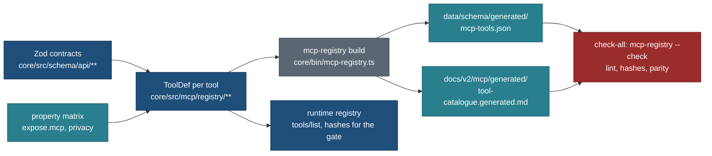

# MCP tool catalogue: every tool from M1 to M5, its schemas, route and rules

Status: **spec, planned; the single authoritative list** (28 Oct 2026, travel-planner, Opus 5.5). Docs only. Owner
direction of 27 Oct 2026, item 2: "The MCP is built on top of the same API layer, with proper tool definitions, schema
definitions and all operations (R-252 stays)." PLAN R-288; BACKLOG 15.403 and 15.406; tasks MCP-C (contract), SCH-G (the
generator and check) and the per-phase build tasks ([BUILD-READINESS.md](BUILD-READINESS.md)).

> **Owner decision, 27 Oct 2026: no public or anonymous MCP endpoint.** Every tool, catalogue reads included, is served on
> the one authenticated endpoint `/mcp/` to a signed-in account ([identity-and-roles.md](identity-and-roles.md) 1.1). The
> `catalogue` level is the lowest signed-in level. Quotas are per user, never per IP. This page is written to that
> decision.

**This page wins** over the tool lists in [product-roles-and-tools.md](product-roles-and-tools.md) 3 and 4,
[tools-v1-from-api.md](tools-v1-from-api.md) 3 to 5 and [auth-and-sign-in.md](auth-and-sign-in.md) 14.3 (the first table)
for names, levels, annotations and counts. Those pages keep their reasoning, the read projections in detail (tools-v1 6,
the field lists from the property matrix) and the response payloads ([product-response-format.md](product-response-format.md)).
Once SCH-G ships, the generated `docs/v2/mcp/generated/tool-catalogue.generated.md` is the as-built list and this page is
the plan it is checked against. The planner-era catalogue (auth 14.3's second table: reservations, tasks, budget,
household, shares, templates) is **not** part of M1 to M5; it arrives with the planner features (F01 to F17) and joins this
page then (section 6).

## 0. The decision in one paragraph

There are **56 tools** across five phases, all behind sign-in: 21 catalogue tools and `whoami` (M1), 5 reads of the user's
own plans (M2), 15 user-scope tools (M3),
13 research and review tools (M4) and 1 export tool (M5). Every tool is a projection of one `/api/v1` or `/api/account`
route or one operation the web app also uses (R-252, MX1); its input schema is that route's Zod input, picked and
tightened; its output schema is a projection of the route's answer whose fields come from the property matrix; both are
generated from Zod in `core/src/schema/api/**` and `core/src/mcp/registry/**`, never written by hand. Names are verb-first
and stable; annotations are always explicit; writes take `client_op_id`; bulk-changing writes go through
`preview_trip_change` then `apply_change`; nothing that governs access is a tool. **Trade-off:** 56 names is more than
README principle 1's "about 25"; levels keep each app's list short (21 to 43 tools for non-owners), and the owner's 56 are
grouped and verb-first.

## 1. Counts, and what changed against the earlier lists

### 1.1 Per phase and per level (end state after M5)

| Phase | New tools | Cumulative |
|---|---|---|
| M1 (v0.19, bundle H): authenticated catalogue read | 22 | 22 |
| M2 (v0.20, H): my plans, read | 5 | 27 |
| M3 (v0.20a, H2) | 15 | 42 |
| M4 (v0.20b, H2) | 13 | 55 |
| M5 (v1.3, bundle L, QX13) | 1 | 56 |

| Level (auth 14.2) | Tools listed (before M5) | After M5 |
|---|---|---|
| `catalogue` (the lowest signed-in level) | 22 | 22 |
| `plans_read` | 29 | 30 |
| `plans_propose` | 40 | 41 |
| `plans_write` | 42 | 43 |
| `research` | 27 | 27 |
| `owner_admin` | 55 | 56 |

`catalogue` = the 21 and `whoami`. `plans_read` = the 21, `whoami`, the five Mine reads, `get_my_map` (add-on `map`), `get_my_profile`, `get_my_interests`
(add-on `interests`). `plans_propose` adds eleven (`copy_trip`, `preview_trip_change`, `apply_change`, `create_plan`,
`add_private_place`, `save_favourite`, `remove_favourite`, `mark_visited`, `suggest_place`, `request_trip`,
`report_problem`). `plans_write` adds `remove_my_trip` and `update_my_travellers` (add-on `people`). `research` = the 21,
`whoami` and five research tools; it never reaches plans (auth 14.2 rule 3). Counts assume every add-on is on; an add-on
that is off hides its tool.

### 1.2 Reconciliation

| Earlier list | Said | Now | Why |
|---|---|---|---|
| tools-v1 3, 5 | 12 public + 2 graph = 14 | 21 public | product pages added `get_day`, `trip_bookings`, `get_format`, `get_example`, `get_method`, `validate`, `gap_report` (already bannered) |
| product-roles 3 | `whoami` at `plans_read` | every level, in M1 | a research app must be able to say what it may do ([identity](identity-and-roles.md) 4) |
| product-roles 3 | `list_my_trips`, `get_my_trip` over `/api/account/drafts` | over `/api/account/plans` | EM-1 built `/api/account/plans/**` with `plan-draft/1`; one own-plan model (builder map O7) |
| product-roles 3, 4.3 | `edit_my_trip` (mode preview or apply), `preview_change`, `apply_change` | `preview_trip_change` (read-only: prepares and shows) and `apply_change` (the write) | read and write split (B7, Q196): a client's "Always allow" on a preview never covers a write; one write path for every prepared change |
| product-roles 4.3 | `create_plan` writes `user-plan/1` | writes `plan-draft/1` (built mode) through `/api/account/plans` | O7: UPL-C keeps `user-place/1` only |
| product-staging 1.3, 3 | `stage_from_submission` named | listed (M4, `owner_admin`) | it was missing from the matrix |
| product-roles 3 | 50 for `owner_admin` | 55 before M5, 56 after | +`stage_from_submission`, +`get_my_map`, +`mark_visited` (WM-M), +`get_my_interests` (TK-MCP), +`get_my_profile`, +`update_my_travellers` (QX17), +`export_trip` (M5), −1 for the preview merge |
| auth 14.2 add-ons | `codes`, `people`, `removals` | plus `map` ("My travel map", world-map spec 9) and `interests` (trip-kinds spec) | both specs added an add-on, off by default |
| R-124, README 2, tools-v1 3, auth 1 | a public `/mcp/` with no sign-in plus `/mcp/private/` | one authenticated `/mcp/`; `whoami` moves to M1 | owner decision, 27 Oct 2026 (PLAN R-291) |
| README 8 | 29 tools | superseded by this page for M1 to M5; README 8 stays the planner-era target | |

## 2. Rules every tool follows

| # | Rule |
|---|---|
| C1 | **Name:** `^[a-z][a-z0-9_]{2,47}$`, verb first (`get_`, `list_`, `find_`, `search`, `copy_`, `create_`, `add_`, `remove_`, `save_`, `mark_`, `update_`, `suggest_`, `request_`, `report_`, `stage_`, `decide_`, `preview_`, `apply_`, `export_`, `validate`). Stable; a breaking change gets `_v2` and the old name stays 6 months (README 6) |
| C2 | **Title:** ≤ 60 characters, sentence case, what a person would call it |
| C3 | **Description** (≤ 600 characters, written once in the `ToolDef`, linted by SCH-G): (1) a verb-first sentence of the job; (2) when to use it rather than its neighbour; (3) what it never does; (4) limits and handle lifetimes; (5) the honesty rule where it applies ("never fill a gap from memory; say not checked yet"). No catalogue data, no user text, no URLs except our origin, no instruction about other tools or servers, no "ignore", no capital-letter commands. The lint fails on any of these |
| C4 | **Annotations:** all four set explicitly. Reads: `readOnlyHint: true, destructiveHint: false, idempotentHint: true, openWorldHint: false`. Writes: `readOnlyHint: false`, `destructiveHint` true when the tool can remove or overwrite something the user made, `idempotentHint: true` (every write takes `client_op_id`), `openWorldHint: false` (our server reaches no third party, MX5). The annotations of a tool never change with the caller's level (auth 14.12) |
| C5 | **Input:** a strict JSON Schema 2020-12 object generated from the route's Zod input, `.pick()`ed and tightened (L2 of tools-v1); unknown keys refused; no argument named `user_id`, `role`, `level`, `scope`, `token`, `client`, `as_user` (strict-schema fuzz test, identity IT12); text fields have `maxLength`; arrays have `maxItems` |
| C6 | **Output:** `structuredContent` is a `travel-view/1` envelope (response format 2) whose `data` is the tool's projection; `outputSchema` is generated from the projection's Zod; a text block leads with a summary ≤ 1,200 characters and the page URL; default size 16 KB, hard cap 64 KB unless the row says otherwise; above the cap: `too_large` with a narrowing hint |
| C7 | **Errors** are tool execution errors (`isError: true`) with `{error: {code, message, field?, details?, hint?, retryable}}`; codes and their API mapping in section 2.1 |
| C8 | **Idempotency:** every write takes `client_op_id` (a ULID); the server stores it with the result per user for 24 hours; a repeat returns the first result |
| C9 | **Preview and apply:** a write that rewrites more than one item of a plan goes through `preview_trip_change` (a `preview_id` bound to user, plan, `base` revision and expiry, 30 minutes) and `apply_change`; at `plans_propose` an apply becomes a pending change approved on our site (`needs_confirmation` with `approve_url`, 24 hours) |
| C10 | **Quotas:** each tool names its buckets (auth 6.4, product-security 5); every call also takes the caller's general bucket |
| C11 | **Privacy class per output field** comes from the property matrix (`public`, `household`, `internal`, `contact`, `secret`): catalogue tools return `public` only, whoever calls; tools on the user's own data return `public` plus the caller's own `household` fields behind their add-ons; `internal`, `contact` and `secret` never leave (tools-v1 11) |
| C12 | **Stored user text** (titles, notes, place summaries, submissions, batch notes) comes back only in `untrusted_text` fields, length-capped (auth 6.5) |
| C13 | **One route per call,** except the declared composites (`get_public_trip` with `origin`; `get_my_trip` with the plan model) |
| C14 | **No tool governs access** (registry G2): nothing reads or writes roles, grants, tokens, locks, settings, quotas or the audit |

### 2.1 Error codes

| MCP code | API code (HTTP) | When | `retryable` | Extra fields |
|---|---|---|---|---|
| `validation_failed` | `invalid_input`, `invalid_scope` (400) | a key, value or cap the schema refuses | no | `field` |
| `not_found` | `not_found` (404) | unknown or not the caller's (no existence leak) | no | |
| `too_large` | `too_large` (413) | above a result cap | no | `details.max`, `hint` |
| `not_available` | `not_available` (501), or a lock | a data layer is off, or the tool is locked, off, paused, changed or not open | no | `reason`: `layer_off`, `locked`, `off`, `paused`, `changed`, `not_open` |
| `forbidden` | (MCP only) | level or add-on missing | no | `needed_level`, `needed_addon`, `settings_url` |
| `rate_limited` | (MCP only) | a quota bucket | yes | `retry_after_s` |
| `conflict` | `409` from the plans route | `base` revision is behind | no (re-read) | `current_revision` |
| `needs_confirmation` | (MCP only) | an apply at `plans_propose`, a removal without `removals`, anything Q198 always asks | no | `approve_url`, `expires_at`, `summary` |
| `privacy_input` | `E_PRIVACY_INPUT` | household data in a public-bound draft | no | `path` |
| `internal` | `internal` (500) | a bug, or the privacy detector refused the body | once | |
| (result type) `input_required` | | a missing choice the server can ask inline (2026-07-28 MRTR), for example Day 1 | | `inputRequests` |

## 3. The catalogue

Column key: **Lvl** is the lowest level that lists the tool (`cat`, `read`, `prop`, `write`, `res`, `adm` for `catalogue`,
`plans_read`, `plans_propose`, `plans_write`, `research`, `owner_admin`), with add-ons after a plus sign. **RDIO** are the
four annotations (letter = true, dot = false). **Route or op** is the R-252 tool-to-route entry. Caps default to 16 KB
structured (64 KB hard) unless stated. Input limits not stated are the API's (`API_LIMITS`).

### 3.1 M1: catalogue tools (21; signed in; `catalogue`)

Quotas: `mcp:user` (600 an hour) on every call and `mcp:catalogue:user` (300 an hour) on these 21, plus the global daily
cap `mcp:global` ([identity](identity-and-roles.md) 2.4).

| # | Tool | Title | RDIO | Route or op | Input | Output `data` and cap | Quota | Notes and tests |
|---|---|---|---|---|---|---|---|---|
| 1 | `search` | Search trips and places | R.I. | `GET /api/v1/search` (`search`) | `q` string 1..200; `kind?` `trip`, `place`, `area`; `country?` ISO alpha-2 lower; `limit?` 1..10 (default 5) | groups of hits `{kind, name, subtitle, slug, url}`, counts | user | parity with the route (tools-v1 13) |
| 2 | `list_places` | List places with filters | R.I. | `GET /api/v1/places` (`listPlaces`) | `q?` ≤ 200; `facets?` map of facet key to ≤ 20 values; `sort?` ≤ 4 keys; `bbox?` [w, s, e, n]; `page?` ≥ 1; `pageSize?` 1..25 (default 10) | `Paged<PlaceRowMcp>` + `unchecked_note`; 32 KB | user | `pageSize: 26` refused; facet parity with the site |
| 3 | `near` | Find places near a place, area or town | R.I. | `GET /api/v1/near` (`near`) | exactly one of `near` (`place:<slug>` or `area:<id>`) or `city` (town id); `r?` 1..100 km; facets, `page`, `pageSize` ≤ 25 | `NearPage` rows + `distanceKm`, `bearing`, `band`, `basis`, `minutes`; `clamped`; 32 KB | user | coordinates refused (hint names `find_towns`) |
| 4 | `find_towns` | Find a town by name or nearby | R.I. | `GET /api/v1/towns` (`towns`) | `prefix` (2..60) with `cc` and `region?`, or `near` or `city` with `r?` | ≤ 50 towns (public gazetteer fields); `truncated` | user | Q87 town rules |
| 5 | `list_public_trips` | List published trips | R.I. | `GET /api/v1/trips` (`listTrips`) | `tripQuery` fields; `pageSize` ≤ 25 | `Paged<TripRowMcp>` (no `isDone`) | user | PRIV-TD fields absent |
| 6 | `get_place` | Get one place's facts | R.I. | `GET /api/v1/places/{slug}/facts` (API-P) | `slug`; `include?` subset of `suitability`, `relevance`, `links`, `photos` | `PlaceMcp` (tools-v1 6.3); 48 KB | user | `read` dates kept; gaps as "not checked yet" |
| 7 | `place_nearby` | What is around a place | R.I. | `GET /api/v1/places/{slug}/nearby` | `slug` | ≤ 8 rows + day-trip count | user | |
| 8 | `get_public_trip` | Get a published trip | R.I. | `GET /api/v1/trips/{slug}` (+ `/getting-there` with `origin`) | `slug`; `profile?` {`p`, `pace`, `a`, `walk`, `split`}; `origin?` (`iata:`, `hub:`, `town:`, `gn:`) | `TripMcp` summary, one line per day; 32 KB | user | origin never logged; composite C13 |
| 9 | `get_day` | Get one day of a published trip | R.I. | `GET /api/v1/trips/{slug}` projected to one day | `slug`; `day` 1..99; `profile?` | one `publicDay` | user | `day_timeline` view hint |
| 10 | `trip_bookings` | What a trip needs booked | R.I. | `GET /api/v1/trips/{slug}` projected to book rows (PA-X kinds) | `slug`; `profile?` | rows `{name, kind, rule_text, note, day, link, park}` | user | `check` rows not counted (QP3) |
| 11 | `trip_legs` | Driving legs of a trip | R.I. | `GET /api/v1/trips/{slug}/legs` | `slug`; `geometry?` bool (default false) | legs (minutes, km, mode, basis); 64 KB with geometry | user (geometry counts 3) | ODbL credit in the payload |
| 12 | `nearest_airports` | Airports near a place or trip | R.I. | `GET /api/v1/airports` (ORG-A) | `near`: `place:<slug>`, `trip:<slug>`, or `lat,lon` rounded to 1 decimal | ≤ 3 airports | user | coordinates never logged |
| 13 | `sun` | Sunrise, sunset and darkness | R.I. | `GET /api/v1/sun` (API-S) | `lat` −90..90, `lon` −180..180 (east positive), `from`, `to` ISO dates ≤ 60 days apart; `tz?` IANA | days of times | user | east-positive longitude test (CLAUDE.md sun rule) |
| 14 | `get_related` | Related places (members, starts at, offers) | R.I. | `GET /api/v1/places/{slug}/related` (ENTITY) or `?park=` (PA-Q) | `slug`; `rel` (relation vocabulary); `kind?`; `page`; `pageSize` ≤ 25 | `Paged<PlaceRowMcp>` + `relation`, `via` | user | dark until the route exists (QM9) |
| 15 | `place_needs` | What a place needs (entry, permits) | R.I. | `GET /api/v1/places/{slug}/needs` or `PlaceLookup.entry` (PA-Q) | `slug`; `mode?`; `month?` 1..12 | `EntryBlock` with oldest `read` | user | dark until the route exists |
| 16 | `get_type` | Our checklist for a kind of place | R.I. | `GET /api/v1/types[/{id}]` (API-T) | `id?`: a type id or a word ≤ 60 | the tree, or one type's checklist | user | |
| 17 | `get_format` | A record format and its rules | R.I. | `GET /api/v1/method/formats/{id}` (MTH-1) | `id` enum: `capture/1`, `suitability/1`, `relevance/1`, `capture-changeset/1`, `research-batch/1`, `plan-draft/1`, `user-place/1`, `windowSpec`, `priceRow`, `entry` | JSON Schema + rules by validator code; 64 KB | user | `user-plan/1` and `trip-custom/1` removed (O7) |
| 18 | `get_example` | A complete example record set | R.I. | `GET /api/v1/method/examples/{type}` | `type` id | synthetic records only | user | planted-household check on fixtures |
| 19 | `get_method` | A section of our research method | R.I. | `GET /api/v1/method/{doc}` | `doc` enum (method page 2); `section?` ≤ 80 | Markdown section + version + links; 32 KB | user | MTH-G privacy scan |
| 20 | `validate` | Check records against our rules | R.I. | `POST /api/v1/validate` (API-V) | `format` + `doc` (≤ 256 KB), or `format: "batch"` + `docs` (≤ 1 MB, ≤ 200 records) | `{ok, errors[], warnings[], completeness, licence[], refs}`; 64 KB | `mcp:validate:user` 120 an hour | input privacy refusal; nothing stored; body never logged |
| 21 | `gap_report` | What is still missing for a record | R.I. | `POST /api/v1/validate` with `report: "gaps"`, or `{ref}` | as `validate`, or `ref` | per record: required, conditional, safety-first gaps, lane, cost class | as `validate` | |

### 3.2 `whoami` (M1) and the reads of my plans (M2)

| # | Tool | Title | Lvl | RDIO | Route or op | Input | Output `data` | Privacy and tests |
|---|---|---|---|---|---|---|---|---|
| 22 | `whoami` (M1) | Who am I connected as | every level | R.I. | MCP-G resolve function (`mcp_gate` facts) | `{}` | `{first_name, role_words, level_words, addons[], tools_count, settings_url}` | own data; no email |
| 23 | `list_my_trips` | List my trips | read | R.I. | `GET /api/account/plans` (`web/lib/server/plans.ts`) | `kind?` `template` or `built`; `page?`; `pageSize?` ≤ 25 | rows `{id, kind, title (untrusted_text), source_trip, start, days, updated, revision}` | own rows (RLS); cross-user `not_found` |
| 24 | `get_my_trip` | Get one of my trips | read | R.I. | `GET /api/account/plans/{id}` + the plan model (`tripPageModelForBuilt`, STEP2-M) | `id` (UUID v4); `include?` `days`, `bookings`, `notes` | trip summary, days, bookings; travellers as labels ("Child 1 (9)") unless `people`; `from`, `gw` only with `people`; notes in `untrusted_text`; 48 KB | QM8; planted instructions stay in `untrusted_text` |
| 25 | `list_my_favourites` | List my saved places | read | R.I. | FAV-D account favourites read route | `page?`; `pageSize?` ≤ 25 | refs + `PlaceRowMcp` (no saved-at time) | `favouredAt` never returned |
| 26 | `list_my_requests` | List my suggestions and reports | read | R.I. | `POST /api/account/submissions/read` (FBK-2) | `page?` | `{id, kind, target, state, created, note (untrusted_text)}` | never the intake contact |
| 27 | `get_my_map` | My travel map | read + `map` | R.I. | `GET /api/account/visits` (WM-S) | `level?` `country` or `city`; `include_places?` bool | counts, countries and levels; places only when asked; "Lived" only with `map` (world-map 9) | own data |

### 3.3 M3: user scope (15; writes need `MCP_WRITES_ENABLED`)

Common: writes take `client_op_id`; at `prop` every write except the three "Ask" tools becomes a pending change
(`needs_confirmation`, approval on our site, MCP-P); at `write` it applies. Bucket `mcp:write:user` (60 an hour) on every
write; `draft_cap` 50 plans and copies, 500 private places (staging U7).

| # | Tool | Title | Lvl | RDIO | Route or op | Input | Output `data` | Notes and tests |
|---|---|---|---|---|---|---|---|---|
| 28 | `get_my_profile` | My name and travellers | read | R.I. | `GET /api/account/profile` (ACCT-P server function) | `{}` | `{display_name, travellers: labels ("2 adults, Child 1 (9)")}`; ages and birth years only with `people` | QX17; `people` off: no ages beyond the label |
| 29 | `get_my_interests` | My interest profile | read + `interests` | R.I. | TK account interests route (TK-SY) | `{}` | interests and weights (trip-kinds spec) | TK-MCP |
| 30 | `copy_trip` | Copy a published trip into my trips | prop | ..I. | the copy builder Step 2 uses (core plan copy function) + `PUT /api/account/plans/{id}` with `base: null` | `source_trip` slug; `start?` ISO date; `profile?`; `title?` ≤ 120; `client_op_id` | `{plan_id, title, start, days, url, next: [...]}` | equals the web copy (stored doc and inverse) |
| 31 | `preview_trip_change` | Prepare a change to my trip | prop | R.I. | the Step 2 operations on `plan-draft/1` (STEP2-C1, C2: `removeItem`, `moveItem`, `insertDay`, `dropDay`, notes, title, start, variants, add from catalogue, add private place), run in memory; nothing stored but the handle | `plan_id`; `base` revision; `ops[]` ≤ 50 of the op union (product-roles 4.3, renamed to the Step 2 op names) | `{preview_id, expires_at, diff: [{op, summary}], warnings: [{code, text}], days_before_after}` | handle bound to user, plan, `base`, 30 minutes; day checks as warnings |
| 32 | `apply_change` | Apply a prepared change | prop | .DI. | `PUT /api/account/plans/{id}` (`putPlan`) with the previewed document and `base` | `preview_id`; `client_op_id` | `{plan_id, revision, url, undo_hint}` or `needs_confirmation` | stale `base`: `conflict`; another user's handle: `not_found`; locked origin tool: `not_available` (registry 7) |
| 33 | `create_plan` | Create my own plan in our format | prop | ..I. | builds `plan-draft/1` (built mode) and `PUT /api/account/plans/{id}` (TB-SY route, O7) | `title` ≤ 120; `country` ISO2; `region?`; `nights?` 0..60; `start?`; `days?` ≤ 60 of `{title?, base_place_id?, items ≤ 30: {ref? or place_id?, time?}}`; `client_op_id` | `{plan_id, revision, url, validation}` | validates first; stores nothing on an error (U9) |
| 34 | `add_private_place` | Add a private place to my plan | prop | ..I. | `POST /api/account/places` (UPL-C `user-place/1`) | `plan_id`; `record` (name ≤ 120, type id, `point?` {lat, lon, approx, source}, `summary?` ≤ 600, `links?` ≤ 10, `facts?` registry keys only, `sources?` ≤ 20 with URL, read date, quote ≤ 300); `client_op_id` | `{place_id, validation, suggest_hint}` | household class; 8 KB per place; `privacy_input` never needed here (private), but public-bound copies are checked at `suggest_place` |
| 35 | `remove_my_trip` | Remove one of my trips | write (+ `removals` to skip approval) | .DI. | `DELETE /api/account/plans/{id}` with `base` (tombstone; `PUT ... restore: true` undoes) | `plan_id`; `base`; `client_op_id` | `{plan_id, removed_at, restore_hint}` or `needs_confirmation` | without `removals`: pending change |
| 36 | `save_favourite` | Save a place to my favourites | prop | ..I. | FAV-2 favourites write route | `ref` (`place/<slug>`); `client_op_id` | `{ref, saved}` | |
| 37 | `remove_favourite` | Remove a saved place | prop | .DI. | FAV-2 favourites delete | `ref`; `client_op_id` | `{ref, removed}` | re-add is the undo |
| 38 | `mark_visited` | Mark places or countries as visited | prop + `map` | ..I. | `PATCH /api/account/visits` (WM-S) | `marks[]` ≤ 50 of `{target: country ISO2 or place ref, state: visited, lived (needs `map`), wish, none}`; `client_op_id` | `{changed, counts}` | WM-M; preview not needed (one row per mark, undo by `none`) |
| 39 | `update_my_travellers` | Update my travellers | write + `people` | .DI. | `PUT /api/account/profile/party` (ACCT-P, with the AP-15 consent version server-side) | `travellers` (`travellers/1`: adults 1..12, children 0..8 with ages 0..17); `base`; `client_op_id` | `{revision, travellers_labels}` | QX17; first save needs the consent the site shows: if none exists, `needs_confirmation` with the Account page link |
| 40 | `suggest_place` | Suggest a place to the site | prop | ..I. | `POST /api/v1/submissions` signed in (FBK-1), `source_ref` = a private place snapshot | `place_id?` or `{name, country, why ≤ 1,000}`; `client_op_id` | `{submission_id, state}` | detector on input (`privacy_input`); applies at `prop` (it is a proposal) |
| 41 | `request_trip` | Ask the site for a trip | prop | ..I. | FBK-1 | `{destination, country, when?, notes ≤ 1,000}`; `client_op_id` | `{submission_id, state}` | as above |
| 42 | `report_problem` | Report a problem with a page | prop | ..I. | FBK-1 (today `POST /api/v1/report`) | `{target ref or URL on our origin, kind, text ≤ 2,000}`; `client_op_id` | `{submission_id}` | URL host checked |

### 3.4 M4: research and review (13; need `MCP_STAGE_ENABLED`; owner only at first, QX11)

| # | Tool | Title | Lvl | RDIO | Route or op | Input | Output `data` | Notes and tests |
|---|---|---|---|---|---|---|---|---|
| 43 | `research_brief` | What to research for a record or place | res | R.I. | `GET /api/v1/method/brief` (MTH-1 + capture `fields`, `gaps`) | `type`; `ref?`; `destination?` {name, country, region?} | checklist, lanes, gaps, rules block, format, example ref; 48 KB | rules block always present (method 5) |
| 44 | `work_list` | What needs research next | res | R.I. | `GET /api/admin/worklist` (STG-1) | `kind` `gaps`, `stale`, `requests`; `trip?`; `class?`; `page?` | rows `{ref, field, why, cost_class, lane}` | |
| 45 | `stage_batch` | Stage a research batch for review | res | ..I. | `POST /api/admin/stage` (STG-C, STG-1; `research-batch/1`) | `batch` (≤ 200 records, ≤ 500 changes); `submit?` bool; `client_op_id` | `{batch_id, state, validation, diff_summary, review_url}` | validates first; detector on input; never a catalogue write (C1); M5: may return a task |
| 46 | `list_my_batches` | List my staged batches | res | R.I. | `GET /api/admin/stage?by=me` | `state?`; `page?` | rows | |
| 47 | `get_batch` | Get one staged batch | res | R.I. | `GET /api/admin/stage/{id}` | `batch_id` | batch with `untrusted_text` notes; 64 KB | |
| 48 | `review_queue` | What waits for my review | adm | R.I. | `GET /api/admin/stage?state=submitted` + REQ-M intake | `kind?` `batches`, `submissions`; `page?` | rows | |
| 49 | `diff_batch` | Compare a batch with the catalogue | adm | R.I. | `GET /api/admin/stage/{id}/diff` | `batch_id`; `record?` | per record: new, changed paths (old, new, source, read), removed, validator results | |
| 50 | `decide_batch` | Record my decisions on a batch | adm | .DI. | `POST /api/admin/stage/{id}/decision` | `batch_id`; `decisions[]` ≤ 500 `{change_id, decision: accept, reject, ask, note?}`; `client_op_id` | `{state, approval_url}` | binding only after the site confirmation (C4, Q198) |
| 51 | `list_submissions` | List visitor submissions | adm (moderator later) | R.I. | REQ-M intake list | `state?`; `kind?`; `page?` | rows (never `intake_contact`) | |
| 52 | `show_submission` | Show one submission | adm | R.I. | REQ-M intake detail | `id` | detail with `untrusted_text` | |
| 53 | `decide_submission` | Decide on a submission | adm | .DI. | REQ-M decision | `id`; `decision`; `note?`; `client_op_id` | `{state}` | notify stays a site action |
| 54 | `stage_from_submission` | Start a batch from a submission | adm | ..I. | STG-1 (`stage_from_submission`, staging 1.3) | `submission_id`; `client_op_id` | `{batch_id, state: "draft"}` | snapshot only; no submitter contact |
| 55 | `coverage` | Catalogue coverage | adm | R.I. | `GET /api/admin/coverage` (`catalog.coverage`) | `area?`; `kind?` | counts per tier and kind | |

### 3.5 M5: export (1)

| # | Tool | Title | Lvl | RDIO | Route or op | Input | Output | Notes and tests |
|---|---|---|---|---|---|---|---|---|
| 56 | `export_trip` | Export one trip as a file | read | R.I. | `GET /api/v1/export/{type}/{slug}` for a published trip; the account export of `/t/<id>/` for the caller's own trip (STEP2-E6) | one of `slug` or `plan_id`; `format` `ics`, `gpx`, `kml`, `csv` | an embedded resource (`text/calendar`, `application/gpx+xml`, ...) ≤ 512 KB with the file name and the credit line | P8: one item per call, signed in, `mcp:export:user` 20 a day; household fields of the caller's own trip only with `people`; never a whole list |

M5 adds no other tool: the research toolkit is the M1 discovery tools plus the Agent Skills bundle (resources), directory
listings are packaging, and long runs use the tasks extension on `validate` and `stage_batch` (section 7).

## 4. The schema-definition pipeline

| Step | What | Owner |
|---|---|---|
| 1 | The route's Zod input and answer live in `core/src/schema/api/**` (one author per contract, MASTER-ORDER 4.3) | API tasks |
| 2 | A `ToolDef` (registry 3.1) names the route, `.pick()`s and tightens the input, names the projection, its Zod output (built from the matrix's `expose.mcp` list), title, description, annotations, add-ons, quota and review | MCP-C (type and M1 rows); each phase's build task adds its rows |
| 3 | `node core/bin/mcp-registry.ts build` writes `data/schema/generated/mcp-tools.json` (every field of 3.1 with the JSON Schemas and the definition hash) and `docs/v2/mcp/generated/tool-catalogue.generated.md` (this page's tables, as built) | SCH-G |
| 4 | `mcp-registry --check` (a check-all stage and a T1 suite on the map): the generated files are current; every tool names a route or operation of the endpoint table (L1); the input is a subset of the route's (L2); projections import only schema, format and the matrix (L3); the description lint (C3); all four annotations set (C4); no forbidden argument names (C5); output schemas are strict; tool names unique and stable against the previous generated file (a removed or renamed tool fails unless listed in `retired` with a date); no governance route (registry G2); counts per level match section 1.1 | SCH-G |
| 5 | The runtime imports the same `ToolDef`s, serves `tools/list` from them and passes the hash to the gate (registry 3.3) | GOV-1 |
| 6 | The generated JSON and Markdown are generated files: never hand-edited; the "Generated ... Do not edit" line on top (CLAUDE.md folder contract) | SCH-G |

Planned names only; nothing exists yet. JSON Schema dialect: 2020-12 (the spec default), `additionalProperties: false`
everywhere, `$ref` only inside the document (the 2026-07-28 `$ref` resolution rules).

## 5. Never over MCP

Sign-in methods, passwords, email changes, account deletion, the full account export, Connected apps (grants, levels,
add-ons, tokens), approving pending changes, publishing, merging catalogue entries, roles, suspensions, locks, settings,
quotas, the audit, the registry, `db:sync`, `stage.ts export`, and any third-party fetch. Each is a site action by a
person or an owner step on the Mac.

## 6. Planner-era tools (not in M1 to M5)

The auth 14.3 target catalogue (reservations, tasks, budget, household, shares, templates, research jobs over
`changeset`) stays the target for the planner (F01 to F17). When a planner feature ships its route, its tool joins this page
with the same rules (C1 to C14), a phase label after M5, and its own review. Name clashes are settled now: the public trip
tools keep `list_public_trips` and `get_public_trip`; the user's trips are `list_my_trips` and `get_my_trip`; the
planner's richer trip tools, when they come, extend these two rather than adding `list_trips` and `get_trip`.

## 7. M5 in concrete terms

| Item | What ships | Task (BUILD-READINESS M5) |
|---|---|---|
| Tasks extension | `validate` with more than 50 records and `stage_batch` return a `CreateTaskResult` when the client declares `io.modelcontextprotocol/tasks` (never otherwise); tasks stored in a new table `mcp_task` (migration slug `mcp_task`: id, user, client key, tool, status, ttl, result, error, created, updated), bound `<user_id>:<task_id>`, TTL 24 hours, `pollIntervalMs` 2,000; `tasks/get`, `tasks/update` (not used in v1), `tasks/cancel`; the worker runs inside the call up to 25 s, then continues on the next poll (Vercel has no background job on Hobby; each poll advances the work by a bounded step) | M5-T |
| `export_trip` | tool 56 | M5-X |
| Agent Skills bundle | three skills (`travel-plan`, `travel-research`, `travel-format`) generated from MTH-G as thin `SKILL.md` files that call `get_method` and `get_type`; published as a downloadable folder on `/mcp-help/` and, where the client supports it, through the Skills over MCP extension (`io.modelcontextprotocol/skills`) as resources | M5-K |
| Public research toolkit | the M1 discovery and check tools plus the bundle; a page `/mcp-help/research/` with the method in plain words; sign-in is required as for every tool | M5-K |
| Directory listings | Claude directory submission and the ChatGPT apps directory: titles and annotations already meet the rules (B5); privacy policy and terms lines; screenshots; test accounts; owner steps O-M9 | M5-D |
| Researchers | the `researcher` role opened to invited people (QX11) from the panel; the `research` level for non-owners | M5-R |
| Review and evals | M5-S security review; evals E9 (a long batch through a task, lock mid-task) and E10 (export privacy) | M5-S, M5-EV |

## 8. Tests (summary; detail per task in BUILD-READINESS)

| # | Case | Tier |
|---|---|---|
| CT1 | `mcp-registry --check` passes; a hand edit to a generated file fails it | T1, check-all |
| CT2 | counts per level equal 1.1 for the deployed phase | T1 |
| CT3 | each read tool equals the projection of its route on sampled inputs (parity) | T2 |
| CT4 | each write equals the web route's effect (same stored doc, same inverse); retry by `client_op_id` returns the first result | T1 |
| CT5 | description lint: a planted "ignore previous instructions" in a description fails; a description over 600 characters fails | T1 |
| CT6 | strict inputs: unknown keys and forbidden names refused for all 56 tools (fuzz) | T1 |
| CT7 | output size caps and `too_large` hints per tool | T1 |
| CT8 | MCP Inspector CLI lists the expected tools per level on a local build; the official conformance runner at a pinned version, recorded, not gating | T2, T3 |
| CT9 | model-in-the-loop evals E1 to E11 at T3 per bundle (product-testing 2) | T3 |

## Gotchas

- **`preview_trip_change` is read-only by annotation** although it stores a handle. Claude may let it run without asking;
  that is the intent. The write is `apply_change`.
- **A `plans_propose` app's writes all become approvals.** Favourites and visited marks at that level need a click on the
  site; tell users "My plans, change" is the level for quick saves.
- **`get_my_profile` without `people` still names the party in labels** ("2 adults, Child 1 (9)"), as the site does on
  the party bar; the label is the user's own data, returned only to that user.
- **`export_trip` returns a file inside the chat.** Some clients show embedded resources poorly; the text block carries the
  file name and size, and the site's export menu remains the main path.
- **The generated catalogue lags this page until SCH-G ships;** after that, a difference between them is a planning bug to
  fix here, not in the generated file.

## Change log

- 28 Oct 2026: written (travel-planner, Opus 5.5) on `public/MCP-PLAN` for the owner's direction of 27 Oct 2026.
- 28 Oct 2026: reworked for the owner's decision of 27 Oct 2026 (no anonymous endpoint): `whoami` to M1, per-user quotas, counts.
