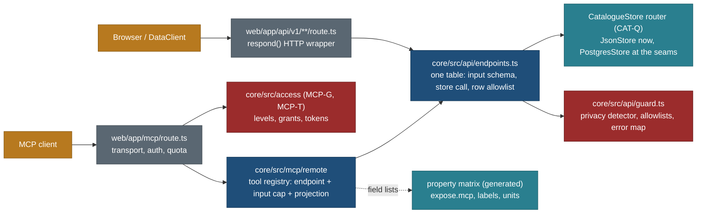

# Remote MCP v1, derived from the API: tools, schemas, field lists, errors, privacy and tests

> **28 Oct 2026, owner decision of 27 Oct 2026: no anonymous MCP** (README decision record, PLAN R-291). The "public
> tools" of section 3 are served on the one authenticated endpoint `/mcp/` to signed-in accounts at the `catalogue` level;
> section 4's tools move to `/mcp/` too (`whoami` in M1, the Mine reads in M2). Read "no sign-in", "public endpoint",
> "a request with an `Authorization` header gets 400", `mcp:anon:*` and "the 61st anonymous call" as withdrawn: quotas are
> per user (`mcp:catalogue:user` 300 an hour), and PR1 and PR3 hold for catalogue tools whoever calls. The authoritative
> tool list is [tool-catalogue.md](tool-catalogue.md).
>
> **Layer 1 of the MCP product (26 Oct 2026, owner's second direction; [product.md](product.md)).** This page stays the
> detailed spec of the read tools (projections, field lists, paging, error mapping, privacy, tests). Where the product pages
> differ, they win: the catalogue set grows from 12 to 21 tools (`get_day`, `trip_bookings`, `get_format`, `get_example`,
> `get_method`, `validate`, `gap_report`, plus the graph tools), every result follows the `travel-view/1` response contract
> ([product-response-format.md](product-response-format.md)), the private set and the write, research and admin tools are in
> [product-roles-and-tools.md](product-roles-and-tools.md), and the hours and bundles of section 15 are replaced by
> [product-packaging-and-phases.md](product-packaging-and-phases.md) 4 (MCP-C 10 h, MCP-1 8 h, bundle H 81 h, new bundle H2).

Status: **spec only, planned** (26 Oct 2026, travel-planner, Opus 5.5). Docs only. Owner direction of 26 Oct 2026: "MCP is
built entirely from the API side, never direct to the database; write the MCP spec in detail from the API contracts."
Companion to [../features/property-display-matrix.md](../features/property-display-matrix.md), which holds the property
matrix, the shared task list (its section 12) and the owner questions QM1 to QM10 (its section 13). Rule R-252 and
[README.md](README.md) 1.1 (M1 to M5) are in force and unchanged; this page makes them buildable.

Checked against: `core/src/schema/api/*.ts` (the Zod contracts), `data/schema/generated/openapi.json` (23 GET and 1 POST
routes), `core/src/catalogue/store.ts` (`CatalogueStore`, 23 methods), `web/lib/server/respond.ts`, `core/src/privacy/detect.ts`,
[auth-and-sign-in.md](auth-and-sign-in.md) 6 and 14, MASTER-ORDER 3.5, 3.8, 4.3 and 5.3 (bundle H: v0.19 public, v0.20
private), RELEASE-PLAN 0a (H: "MCP publishes only the fields AU-D kept; exposure parity 0").

**Supersedes** (each page carries a banner pointing here): README principle 8's `cursor` paging and section 5's error list
(7 and 10 here); README section 2's "Hono app" and "`packages/domain`" (the route is `web/app/mcp/route.ts`, the contracts are
`core/src/schema/api/**`); the **v1** use of [tools-explore.md](tools-explore.md) (its tools stay the planner-era target;
v1 is section 3 here); the names `list_entity_types` and `get_entity_schema` in auth-and-sign-in.md 14.3 (now `get_type`,
with a different meaning); the `schema://entity/<kind>` resources of [resources-and-prompts.md](resources-and-prompts.md)
(section 12 here); the MCP-C, MCP-1 and MCP-2 hours of auth-and-sign-in.md 14.9 (matrix page 12).

## 0. The decision in one paragraph

Every remote MCP tool is **a named projection of one `/api/v1` (or `/api/account`) endpoint**. API-G moves the endpoint
table and the guard of `respond()` (allowlists, privacy detector, error mapping, moved slugs) from `web/lib/server/` into
`core/src/api/`, so the HTTP route and the MCP tool call the same function with the same input schema and get the same
guarded result; the MCP layer only tightens caps, picks fields and adds the page URL. Input schemas are the API's Zod
inputs with tighter caps; output schemas are projections of the API read models whose field lists come from the property
matrix (`expose.mcp`). A tool with no endpoint cannot be registered (contract test). The public set for v0.19 is 12 tools
over existing or small new routes; two graph tools ship only when their API routes exist; the private set for v0.20 maps to
account routes. **Trade-off:** four small API tasks (API-G, API-P, API-T, API-S, about 14.5 h) land before MCP-C, against
an MCP that re-implements reads, formatting or privacy checks on its own.

## 1. Review: the existing MCP specs against the API contracts

| # | Existing spec says | The API contract says | Finding | Fixed in |
|---|---|---|---|---|
| F1 | Paging by opaque `cursor` (README principle 8; tools-explore `search`) | `page`, `pageSize`, `nextPage` on every paged method (`paged()` in `common.ts`) | two paging schemes for one data set | 7: MCP uses the API's numbers (QM4) |
| F2 | Error codes `validation_failed`, `not_found`, `forbidden`, `conflict`, `needs_confirmation`, `rate_limited`, `upstream_unavailable`, `internal` (README 5) | `invalid_input`, `invalid_scope`, `not_found`, `too_large`, `not_available`, `internal` (`API_ERROR_CODES`) | no MCP code for `too_large` or `not_available`; no mapping | 10 |
| F3 | Compact entity `{id: "ent_01J9...", kind: "trail", facts: {distance_km...}, trust, fresh_until, url: app.<domain>/p/...}` (tools-explore) | `PlaceRow` (41-key allowlist, `ref`, `slug`), `PlaceDetail` | invented ids, fields and URLs | 3, 6: rows are `PlaceRow` projections; URLs are `https://travel-beta-tan.vercel.app/places/<slug>/` (the site origin from `siteOrigin()`) |
| F4 | `search` takes `party.ages`, `for_trip`, `open_between` dates, `near.point`, `drive_min`, `along_route`, `persona` | `search` takes `q`, `scope.kind`, `scope.country`, `limit`; lists take facets incl. `kid`, `season`, `effort`, `stroller`; `near` takes a `place:`/`area:` token or a town id, never coordinates | planner-era design; raw coordinates would be an unscoped near query (P8) and could carry a home point | 3: v1 `search` and `list_places` mirror the API; ages only as the `kid` facet; no coordinates in |
| F5 | `get` takes up to 20 ids and `include: evidence, offers, relations, media, geometry, conflicts` | `getPlace(slug)`: one item; facts with provenance and conflicts in `facts`, `sections`, `citations` | a bulk read; no `include` in the API | 3: one slug per call (QM6); `include` selects parts of one API answer, never extra reads |
| F6 | `sun` is a tool (auth 14.3) | no `/api/v1/sun` route | breaks M2 (every tool names its route) | API-S adds the route (QM5) |
| F7 | `list_entity_types`, `get_entity_schema` (auth 14.3) | the stdio handlers of the same names return **database table schemas** (`schema.json` `$defs`) | wrong thing for a public client; name clash with the stdio server | `get_type` over API-T (types and properties from the matrix) |
| F8 | `list_trips`, `get_trip` public | same names as the planner's private tools | name clash (already flagged, auth 14.3) | `list_public_trips`, `get_public_trip` (kept) |
| F9 | "`respond()` applies to every MCP response" (R-252, M3) | `respond()` is `web/lib/server/respond.ts`, HTTP-shaped (`Request` in, `Response` out); MCP code lives under `core/src/mcp/**`, which cannot import `web/` | M3 cannot be met as written | API-G: a transport-neutral guard in core |
| F10 | "MCP-C ready (core only)" (MASTER-ORDER 3.5) | MCP-C needs API-G's endpoint table, API-P's facts model and the matrix | not ready | MCP-C blocked by API-G, API-P, API-T, API-S, PM-G (matrix page 12) |
| F11 | "MCP-C publishes only kept fields" (RELEASE-PLAN H; AUDITS AU-D) | no artefact says which fields MCP publishes | a gate with no mechanism | `expose.mcp` in the registry; AU-D writes overrides (6) |
| F12 | Rate limits 60 per hour anonymous, 600 per hour signed in (README 4) | auth 6.4: `mcp:anon:ip` 60 per hour and 300 per day, `mcp:anon:global` 3,000 per day, user 600 per hour, PAT 2,000 per hour, one WAF rule | two tables | 9: auth 6.4 wins; README 4 bannered |
| F13 | Tool results carry `fresh_until`, `trust` (tools-explore) | Val carries `read`, `state`, `basis`, `src`; freshness classes are a file | no staleness on the API | API-P adds `read` and `stale` per fact |
| F14 | `get_public_trip` returns the whole trip | `TripDetail` holds `schedule.timelines` and `days[].scheduleInput` as open objects (`looseObject`) and `isDone`, derived from the household's real trip date | open shapes cannot have an output schema; `isDone` is a personal-status leak | 3.8: projection drops them; BACKLOG 15.310 |
| F15 | `PlaceDetail` carries legacy flat copies (`stats`, `minAge`, `hazards`, `facts`, `access`) beside `sections` | both are in the contract | MCP must not publish one fact twice under two names | MCP reads the facts model only (6) |
| F16 | Resources `schema://entity/<kind>` for `place, trail, activity, stay, eatery, hub` generated from "Zod kind schemas in `packages/domain`" | the type tree has 324 type ids in four layers; no such kinds or package | stale | 12 |

## 2. Architecture and layering rules



| # | Rule | Held by |
|---|---|---|
| L1 | A tool is `{name, endpoint, inputCap, projection, annotations, level}`; `endpoint` is a key of `core/src/api/endpoints.ts` | contract test: every registered tool names an endpoint; a tool without one fails |
| L2 | The tool's input schema is the endpoint's Zod input, `.pick()`ed and tightened (smaller `pageSize`, fewer facet values); never widened, never a new key | schema test: the JSON Schema of each tool input is a subset of the endpoint input |
| L3 | The tool's output is `projection(endpointResult)`: a pure function that drops, renames or formats fields of the API answer and adds `url`; it reads no store, file or network | lint test: projection modules import only `core/src/schema/**`, `core/src/format/**` and the matrix; output schema is generated from the projection's Zod |
| L4 | The guard runs on the endpoint result before projection, and the detector runs again on the projected body (the projection adds text) | planted-string tests through both wrappers |
| L5 | No database client, SQL, `HOME_POINT_*` read or `nearHome()` call anywhere under `core/src/mcp/**`, `web/app/mcp/**`, `web/lib/mcp/**` | the R-252 grep test (MCP-C, extended by MCP-1) |
| L6 | The local stdio server (`core/bin/mcp.ts`) stays as it is, owner-only, over files; no remote tool imports a stdio handler | existing MCP-C test |
| L7 | One call to a tool is one endpoint call, except the declared composite `get_public_trip` with `origin` (two endpoints, both public) | contract table lists composites |

## 3. Catalogue tools (v0.19, bundle H; signed in since the owner's decision of 27 Oct 2026)

Annotations for all: `readOnlyHint: true`, `destructiveHint: false`, `idempotentHint: true`, `openWorldHint: false`.
Lowest level `catalogue` (auth 14.2). Every output carries `url` (the page) and, for detail tools, `revision` (the API's
content hash, so a client can tell two answers apart).

| Tool | Endpoint (store method) | Input (derived from) | MCP caps | Output (projection of) |
|---|---|---|---|---|
| `search` | `GET /api/v1/search` (`search`) | `searchQuery`: `q`, `kind` (`trip`, `place`, `area`), `country` | `limit` ≤ 10 per group (API 50) | `SearchResult` groups; each hit `{kind, name, subtitle, url, slug}` from `searchRecord` (`n`, `s`, `h`) |
| `list_places` | `GET /api/v1/places` (`listPlaces`) | `placeQuery`: `q`, `facets` (`PLACE_FACET_KEYS` and `f.<facet>`), `sort` (`PLACE_SORT_KEYS`), `bbox`, `page`, `pageSize` | `pageSize` ≤ 25 (default 10); values per facet ≤ 20 | `Paged<PlaceRowMcp>` (6.2) plus `unchecked_note` when the count line says rows were left out for gaps (H1) |
| `get_place` | `GET /api/v1/places/{slug}/facts` (`getPlaceFacts`, API-P); `include: ["suitability","relevance","links","photos"]` select parts of the same answer | `placeSlugInput` | one slug | `PlaceMcp` (6.3) |
| `place_nearby` | `GET /api/v1/places/{slug}/nearby` (`nearbyForPlace`) | `placeSlugInput` | as API (8 rows, 25 km) | `NearbyBlock` rows as `PlaceRowMcp` plus `distanceKm` |
| `near` | `GET /api/v1/near` (`near`) | `nearQuery`: `near` (`place:<slug>` or `area:<id>`) or `city` (town id), `r`, facets, `page`, `pageSize` | `r` ≤ 100 (API clamp, says `clamped`); `pageSize` ≤ 25 | `NearPage` with `PlaceRowMcp` plus `distanceKm`, `bearing`, `band`, `basis`, `minutes`; `basis.excludedApprox` kept (T5) |
| `find_towns` | `GET /api/v1/towns` (`towns`) | `townQuery`: `prefix` with `cc` and `region`, or `near`/`city` with `r` | ≤ 50 rows | `TownList` (public gazetteer fields only, Q87); the way a client turns "Canmore" into a town id for `near` |
| `list_public_trips` | `GET /api/v1/trips` (`listTrips`) | `tripQuery` | `pageSize` ≤ 25 | `Paged<TripRowMcp>` (6.4) |
| `get_public_trip` | `GET /api/v1/trips/{slug}` (`getTrip`); with `origin`, also `GET /api/v1/trips/{slug}/getting-there` (ORG-A) | `tripSlugInput` (`slug`, `profile` keys `p`, `pace`, `a`, `walk`, `split`); `origin?` (origin reference `iata:`, `hub:`, `town:`, `gn:`) | one trip; days without `scheduleInput` | `TripMcp` (6.4); `getting_there` when `origin` was given; the origin is never logged (auth 6.6) |
| `trip_legs` | `GET /api/v1/trips/{slug}/legs` (`tripLegs`) | `tripLegsInput` | polylines only when `geometry: true`; ≤ 64 KB result | `TripLegs` (minutes, km, mode, basis per leg) |
| `nearest_airports` | `GET /api/v1/airports?near=` (ORG-A) | `near` as `place:<slug>`, a trip slug, or lat,lon rounded to 1 decimal by the client (origin spec 9) | ≤ 3 | airport rows (IATA, name, distance, class) |
| `sun` | `GET /api/v1/sun` (API-S) | `lat`, `lon`, `from`, `to`, `tz?` | ≤ 60 days | `{tz, days: [{date, sunrise, sunset, civil_dawn, civil_dusk, astro_dark_from, astro_dark_to, daylight_min}]}` |
| `get_type` | `GET /api/v1/types` and `/api/v1/types/{id}` (API-T) | `id?` (a type id or a word `resolveWord` knows) | tree: ids and labels only | without `id`: the type tree; with `id`: the resolved checklist (properties with label, unit, mark, section, gap wording; links; source order) from the matrix |

Twelve tools. With the two graph tools (section 5) the public set is 14, under README principle 1's "about 25".

**Per-tool notes for clients** (go into each tool's `description`, which MCP-C writes from this table):
- `list_places`: "Facets are the same as the site's Places filters. `kid` takes the youngest child's age; it is a filter
  over our researched ages, not a promise. Rows left out because a fact is not checked yet are counted in
  `unchecked_note`; say so rather than claiming nothing fits."
- `get_place`: "Quote `read` with any price, hour, window or closure. A fact with `stale: true` may have changed. Never
  fill a gap in `gaps` from memory; say it is not checked yet."
- `near`: "Give a place slug, an area id or a town id from `find_towns`; coordinates are not accepted."
- `get_public_trip`: "Public trips are templates: Day 1 to N, no dates. Booking rules are relative to Day N."

## 4. Tools on the user's own data (`whoami` v0.19, the rest v0.20; endpoint `/mcp/`)

The private endpoint serves the 12 public tools plus the tools below. Each maps to an account route that the app itself
uses; if the route has not shipped by the v0.19 commit, the tool does not ship (L1). Writes stay out of v0.20 (auth 14.3:
`plans_read` is the v0.20 production ceiling, `MCP_MAX_LEVEL=plans_read`).

| Tool | Endpoint (owner task) | Level | Output | Household rules (QM8) |
|---|---|---|---|---|
| `whoami` | the access resolve function of MCP-G (shared server layer) | `plans_read` | name, role, the app's level and add-ons, the settings URL | no email unless the account page shows it |
| `list_my_trips` | `GET /api/account/drafts` (CUS-C account route contract, v0.15) merged with synced copies (NAV-D, v0.16) | `plans_read` | rows `{id, title (untrusted_text), source_trip, updated}` | titles in `untrusted_text` (auth 6.5) |
| `get_my_trip` | `GET /api/account/drafts/{id}` (CUS-C) | `plans_read` | the `trip-custom/1` view the app shows, through a projection | `start` date included; `travellers` as labels ("Child 1 (9)") unless `people`; `from`, `gw` only with `people`; notes in `untrusted_text` |
| `list_my_favourites` | `GET /api/account/favourites` (FAV-D, FAV-2, v0.16) resolved through `resolveRefs` | `plans_read` | refs with `PlaceRowMcp` light rows | no saved-at times (`favouredAt` is a detector key) |

Named in auth-and-sign-in.md 14.3 as `list_my_drafts`, `get_my_draft`: renamed to `list_my_trips`, `get_my_trip` because
Mine shows copies and own plans together (navigation spec, "My trips"); MCP-C decides the final names against CUS-C and
NAV-D, which may change the route paths. `propose_research_changes` stays later (MCP-3).

## 5. Graph tools (API-derived, written once the API exposes them)

These answer the owner's three graph questions. Each is a projection of a route that ENTITY-SPEC and the parks spec define;
MCP-GR writes them only after those routes merge (QM9). Assumptions E3, E4 of the matrix page section 11.

| Question | Tool | Endpoint | Input | Output |
|---|---|---|---|---|
| Members of a park (what is inside) | `get_related` with `rel: "members"` | `GET /api/v1/places/{slug}/related?rel=members&kind=&page=&pageSize=` (ENTITY), or `GET /api/v1/places?park=<slug>` (PA-Q) until it exists | `slug`, `rel` (the relation vocabulary), `kind?` (type id prefix), `page`, `pageSize` ≤ 25 | `Paged<PlaceRowMcp>` plus `relation`, `via` (`part_of`, `covers_areas`) |
| What a trail needs (entry, permits, shuttle, its park's requirements) | `place_needs` | `GET /api/v1/places/{slug}/needs?mode=day\|overnight_front\|overnight_back\|through&month=1..12` (ENTITY or PA-Q's `PlaceLookup.entry`) | `slug`, `mode?`, `month?` | `EntryBlock` (parks spec 6.5): park, authority, state, requirements (kind, summary, needed for, season, price with `read`, window rule text, valid, channel, covered by, link), standing closures, oldest `read` |
| Near here | `near` (section 3) | `GET /api/v1/near` | as section 3 | as section 3 |
| Other relations (starts at, reached by, offers at, pairs with) | `get_related` with that `rel` | the same generic route | as above | as above |

Never: a graph walk computed in the MCP layer, a whole-park dump, or geometry. A park with 300 members pages like any
list (P8).

## 6. Field lists, generated from the property matrix

### 6.1 How a field list is made

1. PM-G generates `data/schema/generated/property-matrix.json`, with `expose.mcp` per registry property and per API
   envelope key (matrix page 8.1).
2. MCP-C's build step reads it and writes `core/src/mcp/remote/fields.generated.ts` (or reads the JSON at build time): the
   allowed fact keys and envelope keys per projection, public and private.
3. Each projection's Zod output schema is built from the API Zod shape `.pick()`ed by that list, so the output schema,
   the projection and the matrix cannot disagree; a snapshot test pins `tools/list` (with output schemas) per level.
4. AU-D (before v0.19) runs `fields.ts audit` on the v0.18 commit for exactly these keys and writes `expose.mcp: none`
   overrides for the fields it drops; MCP-C applies them in the registry (one commit, matrix regenerated). That is how
   "MCP publishes only the fields AU-D kept" is enforced.
5. After v0.19 a removal goes through `deprecated` for one release (AUDITS 4.6; matrix K12).

### 6.2 `PlaceRowMcp` (list rows)

The `PlaceRow` allowlist minus `regionAliases`, `legacyKind`, `flags`, `elevation_m`, `statsState`, plus `url`. Keys:
`ref`, `slug`, `url`, `name`, `type`, `kind`, `kindLabel`, `country`, `country_name`, `region`, `region_name`, `area`,
`area_name`, `lat`, `lon`, `approx`, `nearTown`, `season`, `kid_fit`, `kids_from`, `kids_basis`, `effort`, `km`, `gain_m`,
`time_band`, `price_band`, `booking`, `walk_band`, `shape`, `best_time`, `badge`, `image`, `trips`, `tags`, `honesty`,
`completeness`, `researched`. The final list is the matrix's; this is the starting point AU-D audits.

### 6.3 `PlaceMcp` (detail, from the facts model of API-P)

```ts
interface PlaceMcp {
  ref: string; slug: string; url: string; revision: string;
  name: string; type: string; typeLabel: string; layer: "place" | "route" | "offer" | "event";
  area: { country: string; region: string; area: string | null; chain: { level: string; name: string }[] };
  point: { lat: number; lon: number; approx: boolean; role: string | null; source: string } | null;
  summary: string | null;
  completeness: { level: string; label: string };
  honesty: { id: string; label: string; reason: string }[];
  facts: {                      // registry properties with expose.mcp = public and a value or an answer
    key: string; label: string; section: string;
    text: string;               // core/src/format/property.ts, the same words as the page and print
    value?: unknown; unit?: string;
    state: "value" | "no_limit" | "none_stated" | "searched_none";
    read: string | null; stale: boolean; src: string[];   // source registry ids, resolved in citations
    safety: boolean;            // display rest!: the client must show it (P2 safety exception)
  }[];
  gaps: { key: string; label: string; safety: boolean }[];  // not checked yet, safety first
  relations: { rel: string; ref: string; name: string; slug: string | null }[];  // stored relations (part_of, at, starts_at...)
  links: { kind: string; url: string; linkOnly: boolean }[];
  photos?: { url: string; width: number; author: string; licence: string; sourceUrl: string }[];  // include: photos
  suitability?: { chips: { label: string; text: string }[]; kidsFrom: number | null; warning: string | null };  // include
  relevance?: { badge: string | null; why: string | null; designations: string[]; pairs: { ref: string; name: string }[] };  // include
  citations: Record<string, { publisher: string; title: string | null; url: string | null }>;
  trips: { slug: string; title: string }[];
  moved_from?: string;          // the slug asked for, when the API answered `moved`
}
```

Never in `PlaceMcp`: `geometry` (use `trip_legs` or the page), the legacy flat copies of F15, `notes`, `sources`
(origins), `meta`, `legacyMapped`, ranking inputs unless AU-D keeps them.

### 6.4 `TripRowMcp` and `TripMcp`

`TripRowMcp`: the `TripRow` allowlist minus `isDone`, `seasonNotSet`, plus `url`. `TripMcp`: `ref`, `slug`, `url`,
`title`, `subtitle`, `depth`, `nights`, `daysCount`, `region`, `season` (months, label, why, weather), `tags`, `bases`
(name, nights, days, point), `days` (n, title, base, driveMin, driveIsEstimate, summary, items with name, kind, placeSlug,
time, durationMin, stats, access, suit chips; variants and `know` bullets as plain text), `categories` (with `bookRule`
as text through `bookRuleText`, and `bookNote`), `fromHubs`, `effort`, `ageFit`, `driveAvgMin`, `honesty`,
`getting_there?`. Dropped: `isDone`, `legacyUrl`, `visibility`, `schedule`, `days[].scheduleInput`, `days[].zone.home`
fields (the home zone is the household's), `gallery` (photos through the page).

`days[].zone.home` and `homeAbbr` name the **household's** home time zone; the projection drops them and BACKLOG 15.310 asks
whether the public API should carry them at all.

## 7. Pagination

The API's paging, unchanged: input `page` (≥ 1, default 1) and `pageSize` (default 10 on MCP, at most 25); output
`total`, `page`, `pageSize`, `nextPage` (null on the last page). Sorting is the API's (`sort` keys, then `sortKey(name)`,
then `ref`), so pages cut at the same row as the site. No opaque cursor: the API has none, and page numbers are stable for
one `revision`; a client that sees `revision` change between pages starts again (the tool description says so). `search`
has no pages (per-group limit); `find_towns`, `place_nearby`, `nearest_airports` cut and say `truncated`.

## 8. Auth, levels and scopes

Unchanged from [auth-and-sign-in.md](auth-and-sign-in.md): the public endpoint takes no `Authorization` header (a request
with one gets `400`); the private endpoint verifies Neon's JWT or a personal access token, resolves the app's level and
add-ons through MCP-G's shared function (`core/src/access/**`, R-252 M5) inside the call, and filters `tools/list` by level.
The tool-to-level table of auth 14.3 holds with these changes: `get_type` replaces `list_entity_types` and
`get_entity_schema`; `place_nearby`, `find_towns`, `nearest_airports`, `get_related`, `place_needs` are `catalogue`;
`list_my_trips`, `get_my_trip` replace `list_my_drafts`, `get_my_draft`; the household fields of section 4 follow QM8.

## 9. Rate limits and size caps

Quotas are auth 6.4 (`quota_bucket`; numbers only in `core/src/config/mcp-limits.ts`) and the one Vercel WAF rule shared
with `/api/v1/*`. Added here:

| Cap | Value | On hit |
|---|---|---|
| Structured result size | 64 KB per tool result | `too_large` with `details.max` and a hint to narrow (fewer facets, a smaller page, no geometry) |
| `trip_legs` with `geometry: true` | counts 3 against `mcp:catalogue:user` | as quota |
| Input text | the API's request-size caps (`API_LIMITS.query`) | `validation_failed` naming the field |
| Upstream calls | none in the v1 public set (sun is local, legs are stored, airports are a file) | |

## 10. Error shapes

Tool errors are results with `isError: true` and a JSON body; success with honesty notes is never an error.

```json
{ "error": { "code": "too_large", "message": "At most 25 rows a page.", "details": { "max": 25 },
  "retryable": false, "hint": "Ask for a smaller pageSize or add a filter." } }
```

| API code (HTTP) | MCP code | When | `retryable` |
|---|---|---|---|
| `invalid_input` (400) | `validation_failed` (`field` from `details`) | a key, value or cap the schema refuses | no |
| `invalid_scope` (400) | `validation_failed` (`field: "scope"`) | for example a town prefix with no region | no |
| `not_found` (404) | `not_found` | unknown slug, ref or type id; also anything the caller may not see (no existence leak) | no |
| moved (308) | none: the tool follows once and returns `moved_from` | a retired slug | |
| `too_large` (413) | `too_large` (**new**, README 5 amended) | above a result-size cap | no |
| `not_available` (501) | `not_available` (**new**) | a capability flag or data layer is off (for example towns before META-2, a graph route not shipped) | no |
| `internal` (500) | `internal` | a bug, or the privacy detector refused the body (logged, never rewritten) | once |
| (MCP only) | `forbidden` with `needed_level` | tool outside the app's level (private) | no |
| (MCP only) | `rate_limited` with `retry_after_s` | a quota bucket | yes, after the wait |
| (MCP only, later) | `conflict`, `needs_confirmation` | private writes (MCP-P, planner) | |

The mapping is one table in `core/src/api/guard.ts` (API-G) that both wrappers use, so an HTTP status and a tool code can
never drift.

## 11. Privacy rules

| # | Rule | Held by |
|---|---|---|
| PR1 | No household data on the public endpoint: no party, ages, home town, dates, personal status, stay ideas, booking state (PLAN 1) | the detector on the endpoint result and on the projection (L4); the matrix (no `household` row, K1); planted-string tests |
| PR2 | No home point anywhere: no MCP code reads `HOME_POINT_LAT`, `HOME_POINT_LON` or calls `nearHome()`; `near` takes no coordinates; `nearest_airports` takes coordinates rounded to 1 decimal and never logs them | L5 grep test; input schema |
| PR3 | Server output never varies by the caller on the public endpoint, except echoing the caller's own input (`origin` in `getting_there`) | parity test: two callers, same input, same body |
| PR4 | Towns: town ids on rows, names only through `find_towns` (public gazetteer, Q50 and Q87 rules) | the detector's town rules |
| PR5 | `internal` fields (RowMeta `meta`, `origin`, `sources`, `legacyMapped`, `notes`) never leave | matrix K2; projection allowlists |
| PR6 | Stored user text (private titles and notes) comes back only in `untrusted_text`, length-capped (auth 6.5) | private projection tests |
| PR7 | Logs: tool, level, result code and duration; never arguments, results or tokens (auth 14.10 item 8) | log scan test |
| PR8 | Private: only the caller's rows (RLS through the app's routes); people, origin and codes behind add-ons (QM8) | MCP-2 cross-user and add-on tests |

## 12. Resources and prompts (generated)

| URI | Content | From |
|---|---|---|
| `travel://types` | the type tree: ids, labels, layers | API-T `/api/v1/types` |
| `travel://type/{id}` | the resolved checklist of one type: properties (label, unit, mark, section, gap wording), links, source order | API-T `/api/v1/types/{id}` |
| `travel://properties` | the public projection of the property matrix: key, label, value type, unit, freshness class, privacy, MCP exposure | the matrix through API-T |
| `travel://freshness` | the freshness classes and what stale means | `data/schema/freshness.json` through API-T |
| `travel://facets` | facet keys and values of the Places list | `countPlaces` with no filter (counts only) |

Each carries `schema_version` and the API `revision`. The planner-era resources of resources-and-prompts.md
(`schema://reservation/<kind>`, `lane://`, `profile://`) stay the planner target. Prompts for v1: `find-places-for-family`
(list_places with `kid` and `season`, then get_place for the top three, quoting `read` dates) and `what-do-i-need-for`
(place_needs, then the booking rules); written in MCP-R.

## 13. Test plan

| Layer | Case | Task |
|---|---|---|
| Contract | every tool names an endpoint of `core/src/api/endpoints.ts` (L1); every input schema is a subset of its endpoint's (L2); projections import nothing outside schema, format and the matrix (L3) | MCP-C |
| Contract | `tools/list` snapshot per level, with input and output schemas; every tool declares `title` and four annotations | MCP-C |
| Field lists | every `facts[].key` has `expose.mcp: public` in the matrix; every envelope key in an output schema has a row in `exposure.ts`; a planted registry row with `expose.mcp: none` disappears from `get_place` | MCP-C |
| Parity | for 30 sampled place slugs, 10 trip slugs and 5 near queries: the tool's output equals `projection(GET /api/v1/...)` byte for byte; nothing in a tool output is absent from the API answer (exposure parity, RELEASE-PLAN H "exposure parity 0") | MCP-1 |
| Errors | each row of section 10: the HTTP status and the tool code come from the same table; moved slugs followed once | MCP-1 |
| Caps | `pageSize: 26` refused; 64 KB cap; `near` with coordinates refused; `get_place` with two slugs refused | MCP-1 |
| Privacy | planted household strings, `HOME_POINT` values, a private origin ref (`loc:`), `favouredAt`, `isDone` and `zone.home` in fixture data: refused or dropped (PR1 to PR5); the grep test (L5) | MCP-1, MCP-S1 |
| Quotas | the 301st catalogue call by one user in an hour refused; 20 parallel calls across a bucket edge | MCP-1 |
| Graph | `get_related` and `place_needs` equal their routes for the four parks fixtures (PA-FX F1 to F4) | MCP-GR |
| Private | cross-user (another user's draft is `not_found`); add-on matrix for `travellers`, `from`; `untrusted_text` for planted instructions | MCP-2, MCP-S |
| Inspector and clients | MCP Inspector lists the tools on the preview and production URLs; Claude Code and claude.ai custom connector on the public endpoint | MCP-1, MCP-E |
| Cutover | the parity suite runs again with the store router on `PostgresStore` for the seams (bundle K) with no MCP change | SRV-0 |

## 14. What must land in the API before MCP, in contract order

| Order | Task | Bundle | Why MCP needs it |
|---|---|---|---|
| 1 | PA-C (parks contract; widens `PropertyDef`) | C | the registry shape PM-C extends |
| 2 | **PM-C** registry exposure fields | D | `expose.mcp`, privacy |
| 3 | **PM-G** matrix generator and checks | D | field lists, `get_type`, resources |
| 4 | **PM-F** formatter in core | D (after UXB-7) | the `text` of every fact |
| 5 | ORG-A routes (`/api/v1/airports`, `/trips/{slug}/getting-there`) | C (v0.8) | `nearest_airports`, `get_public_trip.origin` |
| 6 | PA-Q (`park` facet, `PlaceLookup.entry`) | E | `place_needs`, members until the ENTITY route exists |
| 7 | **API-P** facts read model | E | `get_place` |
| 8 | CUS-C account drafts route; NAV-D, FAV-D account routes | F | the private tools |
| 9 | **API-G** endpoint table and guard in core | G | every tool (L1, L4) |
| 10 | **API-T** types routes; **API-S** sun route | G | `get_type`, `sun`, resources |
| 11 | ENTITY generic related and needs routes (assumed, matrix 11 E3, E4) | by the v0.18 commit, or later | graph tools |
| 12 | AU-D overrides | before v0.19 | the published field list |
| 13 | MCP-C, then MCP-1, MCP-R, MCP-GR (v0.19); MCP-G, MCP-T, MCP-2, MCP-O, MCP-U, MCP-S, MCP-E (v0.20) | H | |

## 15. Where it fits in MASTER-ORDER

Lane X (MCP) and lane C (contracts), seat B2, as today. The full task table with hours, models, dependencies and owned files
is [../features/property-display-matrix.md](../features/property-display-matrix.md) section 12. MCP-C's owned files grow by
`core/src/mcp/remote/{contract,projections,fields.generated}.ts` and lose nothing; MCP-1 keeps `web/app/mcp/route.ts`,
`web/lib/mcp/**`, `core/src/mcp/remote/public/**`. Bundle H grows from 56 h to about 64 h; MCP-C's status changes from
"ready (core only)" to "blocked: API-G, API-P, API-T, API-S, PM-G" (F10). The coordinator applies these to MASTER-ORDER
3.5, 3.8, 4.3 and 5.3 and RELEASE-PLAN 0a (task PMD); this page does not edit them.

## 16. Conflicts with existing decisions

| Existing | Where | Here | Resolution |
|---|---|---|---|
| Opaque cursors | README principle 8 | page numbers | QM4; README bannered |
| Error list | README 5 | `too_large`, `not_available` added; mapping table | README bannered |
| Explore tools with party, dates, coordinates | tools-explore.md | v1 mirrors the API | tools-explore bannered as the planner-era target |
| `sun` as a tool with no route | auth 14.3 | API-S route | QM5 |
| `list_entity_types`, `get_entity_schema` | auth 14.3; stdio | `get_type` over API-T; the stdio names stay for the stdio server only | auth 14.3 bannered |
| `list_my_drafts`, `get_my_draft` | auth 14.3 | `list_my_trips`, `get_my_trip` | MCP-C confirms against CUS-C and NAV-D |
| MCP-C ready now, 5.5 h | MASTER-ORDER 3.5, 5.3 | blocked by four API tasks and PM-G; 8 h | PMD applies |
| `respond()` on every MCP response | R-252 M3 | the guard moves to core first (API-G) | same rule, now buildable |
| `share` with `confirmed_by_user` | tools-plan.md | out of v1 (no writes) | unchanged (Q198 already) |

## Gotchas

- `TripDetail.days[].zone.home` and `isDone` are household-derived; the projection drops them, but the public API still
  serves them until BACKLOG 15.310 is decided. The detector does not catch them today because they look like ordinary
  values.
- The `near` token grammar (`place:<slug>`, `area:<id>`) is the API's; chat clients will try coordinates. The error hint
  names `find_towns`.
- `mcp-handler` returns `structuredContent` and a text block; keep the text block short (the summary line and the URL), or
  clients that ignore structured content will paste the JSON.
- Projections must not format numbers themselves; a second formatter would drift from the page (PM-F exists to prevent it).
- A tool whose endpoint is behind a capability flag must answer `not_available`, not disappear from `tools/list`, so
  clients do not cache a shrinking list (auth 14.12).

## Change log

- 26 Oct 2026: written (travel-planner, Opus 5.5) on `public/PROP-MCP-SPEC` with
  [../features/property-display-matrix.md](../features/property-display-matrix.md).
