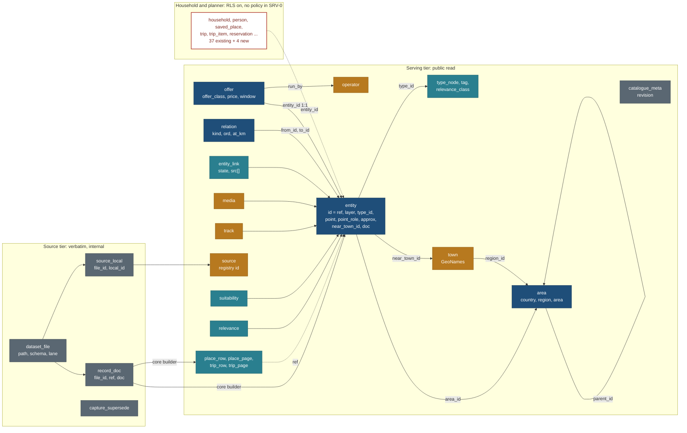

# Schema diff: `docs/v2/schema.sql` against the capture contract (SRV-D, task A10)

Written 21 Oct 2026 by travel-planner (Opus), lane SRV-D of phase A. Read-only: no file other than this one was changed, and nothing was committed. Brief: [briefs/SRV.md](../build/public-site/briefs/SRV.md). Plan: [PLAN.md](../PLAN.md) R-7, [EXECUTION-PLAN.md](../build/public-site/EXECUTION-PLAN.md) 4.2, 4.3, 4.8 and 14.

**Status (21 Oct 2026, evening): owner decided all four recommendations of section 14.** Two tiers (13.1), `entity.id` = `ref` verbatim (13.2), collections and Instagram saves private (13.3), town ids `<cc>-<admin1>-<slug>` such as `ca-on-whitby` (13.4). Recorded in [PLAN.md](../PLAN.md) R-55 and section 5, and in BACKLOG Q73-Q76. Follow-ups: API-1 applies the seven contract changes of subsection "13.1 For API-1" (not to be confused with decision 13.1); META-0 changes nearby spec 3.1 to the town id format; SRV-0 writes M1-M15. This file moves to `/research/reports/schema-diff-2026-10.md` in cleanup CLN-1 ([CLEANUP-PLAN.md](../CLEANUP-PLAN.md)).

**Supersedes in part.** This page replaces the catalogue half of `docs/v2/schema.sql` (the 17 Oct "first-cut PROPOSAL") as the input to SRV-0's migrations. `schema.sql` itself was not edited (this lane is read-only). The coordinator should add a banner to `schema.sql` that points here when SRV-0 starts. Its household and planner half stays valid, with the RLS changes in section 10.

## Verdict

**The JSON we write today does not load into `schema.sql` without reshaping.** At least 13 constraints in the schema reject real rows (section 9). Per-value provenance has no home. The site's catalogue is a build-time derivation that no table holds.

**Recommendation: two tiers.** The trade-off follows the list.

1. **Source tier (lossless).** Every data file loads verbatim: one row per file, with its schema string, trip, lane, researched date, agent and model, and one jsonb document per record, keyed by the stable `ref`. Nothing is reshaped, so "stable ids, versions and provenance load unchanged" (EXECUTION-PLAN 4.3 rule 10) is true by construction.
2. **Serving tier.** These are the tables `SupabaseStore` queries: entity, offer, relation, link, media, area, town, plus `place_row` and `place_page` projections. The loader writes them by running the same core code that `JsonStore` runs: lane precedence, `resolveVal` supersedes, slug assignment, the origin scrub and the bands. Typed columns exist only where SQL must filter, sort or measure distance: the area chain, the type, the point, the facets and the bands.

**Trade-off.** Postgres stores derived rows and the loader has to rerun after every data change. In return, the contract kit compares like with like, and no SQL rewrite of `createPublicData()` is needed. At under 100 users and about 500 records, rerunning the loader takes seconds. Fully normalising every `Val` into rows would cost weeks and buy no feature on the public site. The alternative, a SQL reimplementation of the dataset builder, is the most likely way for SRV-0 to fail its acceptance check 4 ("same results as JsonStore, case by case").

## 1. What was compared (measured 21 Oct 2026, on `main` at 4946b37)

| Input | Measured | How |
|---|---|---|
| `docs/v2/schema.sql` | 467 lines, **63 `create table`**: 62 real tables plus the `auth.users` test stub. **RLS enabled on 0 tables**; the only `enable row level security` line is a comment (line 460) | `grep -c '^create table'`; `grep -n 'row level security'` |
| `core/src/schema/capture/properties.ts` | **83 base properties** in 10 groups; with the 153 suitability paths of the applicability file, **236 properties in 18 groups**. Base `home`: capture 27, relevance 12, tracks 1, none 43 | imported with `node --experimental-strip-types` and counted |
| `data/vocab/types.json` | `capture-types/1`; **398 nodes**: 15 domains, **59** categories, 277 types, 47 subtypes. The file's own note says 61 categories and 324 type ids (277 + 47 = 324, so only the category count disagrees). 47 profiles; 9 layer rules (`place`, `route`, `offer`, `event` and five offer classes) | python over `nodes[].level` |
| Capture records `data/capture/<trip>/*.json` | 13 files, `capture/1`; **394 records**: place 201, route 143, offer 49, event 1. Ref prefixes: `legacy/` 150, `part/` 94, `trip/` 91, `place/` 43, `offer/` 16. 110 refs contain `#`; the longest is 96 characters. 0 duplicate refs. **No record has an inline `point`**; 48 have `area_id` | python over `records[]` |
| Suitability `data/suitability/<trip>/*.json` | 20 files, `suitability/1`; **520 records over 305 refs**; **215 refs appear in more than one file** (lane over `migrated`). 2 refs exist only as capture `aliases` | as above |
| Relevance `data/relevance/<trip>/*.json` | 10 files, `relevance/1`; 206 records, 206 refs; plus `derived/` (8, `relevance-derived/1`), `signals/` (4), `inputs/` (2) | as above |
| Per-value provenance (`Val`) | **4,487 Vals** in capture, suitability and relevance. States: value 3,704, searched_none 494, gap 237, not_applicable 37, no_limit 15. Basis: `our_inference` 2,358, `official_info` 1,017, none 807, `official_rule` 85, `community` 75, `operator_info` 73, `official_grade` 60, `operator_rule` 43, **`editorial` 8**. Sources per Val: 0 for 2,005, 1 for 2,194, **2 or more for 327**. **3,871 Vals carry no `read` or `on` date** (they inherit the file's `researched`). 100 carry `conflicts` | recursive walk of every object with `state` |
| Links on capture records | 338: `filled` 299, `searched_none` 39 (**no URL**). 2 records repeat a URL under two kinds | as above |
| Photos on capture records | 34 on 21 records; keys `file, licence, author, attribution, source_url, width, height` | as above |
| Relation edges on capture records | 149: reaches 51, at 23, parks_for 18, starts_at 15, run_by 12, on 10, part_of 8, passes 7, serves 3, variant_of 2. **0 dangling**; `passes` carries `at_km` on 4 | as above |
| `data/capture/points.json` | `capture-points/1`; 97 points keyed by ref: `lat, lon, coord_src (osm 91, wikidata 6), point_source`. **No `point_role`, no `approx`** | |
| `data/relevance/inputs/points.json` | `relevance-points/1`; 268 points, 33 towns (trip bases), 8 trip windows | |
| `data/sources/registry.json` | `sources/1`; 405 entries, ids `s-<sha1 of the normalised URL>`, URLs unique. Kinds: official 248, operator 95, community 27, **editorial 20**, reference 13, **agency 2** | |
| Lane source rows (`sources[]` in 45 files) | ids are **file-scoped** (`src-0001`): **40 of 66 ids name more than one URL** across files. 406 distinct URLs; a rough normaliser left 3 unmatched in the registry (query-string variants); `core/src/sources/normalize.ts` is the real one | |
| `data/locations/locations.json` | `schema_version` 3; 9 tables: countries 7, regions 25, areas 62, places 74, place_tags 207, sources 35, visits 0, collections 5, collection_places 49. Place `status`: idea 66, planned 8; `notes` filled on 74. Source types: instagram 24, note 9, official 1, friend 1 | |
| Tracks `data/tracks/*.json` | 17 tracks; `source`: osm-api 12, overpass 5; refs per file: 1 on 15, **0 on 2** | |
| Galleries and credits | 9 `legacy/*/gallery/gallery.json` (sections by place **name**, photo key `license`); `web/data-snapshots/photo-credits.json` 66 files (`licence`, `licenceUrl`, `sourceUrl`) | |
| Other inputs the public dataset reads | `web/data-snapshots/prototype.json` (43 places, 18 trails), the Rockies legacy JSON (`sights` 48, `trails` 62, `adventures` 43, `bookings` 33), `legacy/MANIFEST.json` (16 folders), `data/schedules/*`, `data/trips/{base-points,stop-refs}.json` | `web/lib/public/sources.ts` |
| Public list row | `PLACE_LIST_KEYS`: **41 keys**, defined in `web/components/places/rows.ts`; no `ref`, no `approx`, no point role | |
| Public slugs | **Not stored.** `assignPlaceSlugs()` (`web/lib/public/slugs.ts`) computes them over the whole set: kebab name, then `-<area>` on a name clash, then `-2`, `-3`. `data/suitability/scope.json` lists 359 public place slugs; there are 468 candidate inputs (394 records plus 74 locations places) | |

## 2. Scorecard

| Item class | Total | Mapped | Partial (a home exists but loses data or breaks a constraint) | Gap | Not loaded by design |
|---|---|---|---|---|---|
| Record layers (place, route, offer, event, operator) | 5 | 0 | 4 | 1 | 0 |
| Property groups | 18 | 1 | 9 | 8 | 0 |
| Properties (83 base) | 83 | 33 have a named home, **all lossy** (no Val state, basis or src) | (counted in mapped) | 50 | 0 |
| Properties (153 suitability paths) | 153 | 5 (`eligibility` jsonb: 3; generated `trail_km`, `trail_gain_m`: 2) | | 148 | 0 |
| Relations (13 relation properties; derived `reached_by` counted apart) | 13 | 10 | 2 (`passes`, `on`: position attributes in jsonb only) | 1 (`run_by`: no operator table) | `reached_by` (derived, never stored) |
| Sidecars and support files (rows of section 7) | 20 | 0 | 8 | 8 | 4 |
| Locations tables | 9 | 3 | 2 | 4 | 0 |
| **Hard constraint failures on load** | | | | **13** (section 9) | |

## 3. Record layers

| Layer (contract 2.1) | Today in data | Target in `schema.sql` | Status | Proposed change |
|---|---|---|---|---|
| place | 201 records; 74 locations places; 43 prototype places | `entity` (`kind` enum `place`, `trail`, `activity`, `stay`, `eatery`, `hub`, `event`) | Partial | The enum is the old family list, not the layer. Add `layer text not null check (layer in ('place','route','offer','event'))` and `type_id text references type_node(id)`. Keep `kind` as nullable text: it becomes the legacy family the URL accepts (`legacyKind` in the row) |
| route | 143 (trails, lifts, drives, river sections) | `entity` with `kind = 'trail'` only; `track` for geometry | Partial | `layer = 'route'`. Lifts, drives and rivers have no kind today. Geometry goes in `track` (section 6.4) |
| offer | 49 (classes: ticket 10, experience 10, lodging 3, rental 3, **none 23**) | `offer` (own id, `entity_id` FK to one entity, `kind` check `ticket, permit, shuttle, tour, room, campsite, ferry, pass, rental, other`) | Partial | Offers carry links, photos, suitability, season, hours and relations, and the schema hangs all of those off `entity`. **Make each offer an `entity` row (`layer = 'offer'`) and turn `offer` into a 1:1 extension keyed by `entity_id`.** Replace `kind` with `offer_class text check (offer_class in ('experience','rental','ticket','access','lodging'))`, nullable (23 are unclassified). `at` and `on` become relation rows, never the single `entity_id` FK |
| event | 1 (`event.natural`, the elk rut, with `part_of`) | `entity` (`kind = 'event'`), `event_occurrence` (dated: `year`, `starts_on`, `ends_on` not null) | Partial | `layer = 'event'`. Dateless season rows stay in `entity.season`; `event_occurrence` only when a dated year is known |
| operator | 10 in `data/capture/operators.json` (`ref, name, url, derived_from[]`) | none | **Gap** | New table `operator` (section 11, M6), with public read. `run_by` is `offer.run_by text references operator(ref)` |

## 4. Property groups

Base properties are those of `BASE_PROPERTIES`; suitability groups come from `APPLICABILITY_PATHS`. "Lossy" means the value lands without its `Val` wrapper (`state`, `basis`, `src`, `quote`, `tried`, `on`, `applies_to`, `conflicts`).

| Group (count) | Target in `schema.sql` | Status | Gap or loss | Proposal |
|---|---|---|---|---|
| identity (8) | `entity.name`, `names`, `point`, `area_id`, `wikidata_qid`, `osm_ref`, `summary` | Partial | `type`: no column. `point`: no role, approx or source. `wikidata`: UNIQUE breaks on 2 QIDs, each shared by 2 refs (Q3214753, Q1003855), and `searched_none` has no home. `summary` (home: relevance `why`) | `type_id` FK; point columns (M5); drop UNIQUE on `wikidata_qid` (plain index); provenance stays in the docs |
| when (7) | `entity.season`, `entity.hours` (jsonb), `entity.duration_min/max` (int) | Partial | `best_window`, `best_time`, `activity_min`, `check_in_out`: none. `duration_min` as two ints drops the Val | All in the record doc; promote only the bands (`time_band`, `best_time` slots) into `place_row` |
| access (11) | `relation` (access points, transit), `offer.price_*`, `offer.window_*`, `offer.url`, `entity.cost_band` | Partial | `price` is a list of rows `{amount, currency, per, age_from, age_to, applies_to}` (1 to 5 rows per record; CAD 56, EUR 17, ISK 3) versus one `price_min/max/currency`. `window.rule` misses `on_arrival`; `sellout` is an object `{kind, lead}` (`kind: unknown` occurs) versus an enum. `access_cost`, `reservation`, `included`, `cancellation`, `deposit`: none | `offer.price jsonb`, `offer.window jsonb` (Vals verbatim); the loader fills `price_min`, `price_max`, `currency` and `price_band` for filters |
| offer (1: `variants`) | none | Gap | | `offer.variants jsonb` |
| relevance (9) | none | Gap | class, draw, standing, distinction, easy_payoff, weather, why, signals, pairs_with | Table `relevance` (M9) |
| safety (1: `closures`) | `condition_report` | Mapped | No closure data exists yet | none |
| links (1) | `entity_link` | Partial | `url not null` rejects the 39 `searched_none` links; `unique (entity_id, url)` rejects 2 records (the same URL as `official` and `booking`); no `state`, `query` or checked date; one `source_id` versus `src[]` | M7 |
| media (1) | `media` | Partial | Capture photos map cleanly. Gallery photos have no ref (sections by place name, a trip-level gallery) and spell `license`; credits carry `licenceUrl`. Default `status = 'proposed'` would hide every photo behind a public policy on `approved` | M8 |
| relations (13) | `relation (from_id, to_id, kind, attrs)` | Partial | `run_by` targets an operator, not an entity; `reaches` order (primary, then extras) and `at_km`, `from_km`, `to_km` live only in `attrs` | M6, M10 |
| type_facts (31) | `track` (geometry, licence); `entity.attrs` | Partial | 29 of 31 (bearing, crowds, visit_mode, indoor, fills_by ...) have no column; `attrs` is untyped | Record doc; promote `indoor` into `place_row` (a filter) |
| limits (10) | `entity.eligibility` jsonb (comment names `min_age, min_height_cm, max_weight_kg, fitness, notes`) | Partial | 7 of 10 not named; limits sit per offer and variant, not per entity; the `flat` block (12 keys) has no home | `suitability.flat jsonb` plus promoted `kids_from` |
| suits (11) | none | Gap | | `suitability.block` |
| effort (8) | `trail_km`, `trail_gain_m` generated from `attrs` | Partial | They read `attrs->>'distance_km'`, but the value lives at `suitability.effort.drivers.distance_km.v`, so the generated columns stay null | Replace them with `place_row.km`, `gain_m` and `effort`, filled by the loader |
| time (4) | none | Gap | `adult_time_min`, `child_time_min`, `on_site_min`, `walk_m` | `suitability.block`; bands in `place_row` |
| facilities (9) | none | Gap | | `suitability.block` |
| water (8) | none | Gap | | `suitability.block` |
| participation (11) | none | Gap | | `suitability.block` |
| ext (87) | none named (`attrs` catch-all) | Gap | | `suitability.ext jsonb` |

## 5. Relations

| Relation (contract 2.5) | Edges today | Target | Status | Note |
|---|---|---|---|---|
| `reaches` | 51 | `relation` kind `reaches` | Mapped | Add `ord smallint` (primary is 0) |
| `reached_by` | derived | none | Not loaded | Never stored (contract 2.5); a view over `reaches` |
| `part_of` | 8 | `relation` | Mapped | Closes the event to its place (elk rut) |
| `passes` | 7 (4 with `at_km`) | `relation` plus `attrs` | Partial | Add `at_km numeric` |
| `at` | 23 | `relation` | Mapped | Replaces the single `offer.entity_id`; 0 offers have more than one `at` today, but the contract allows several |
| `on` | 10 | `relation` | Partial | Add `from_km`, `to_km` (none used yet) |
| `run_by` | 12 | none | Gap | `offer.run_by` FK to `operator` |
| `starts_at`, `ends_at` | 15, 0 | `relation` | Mapped | |
| `parks_for`, `serves` | 18, 3 | `relation` | Mapped | |
| `combo_with`, `alternative_to` | 0 | `relation` | Mapped | |
| `variant_of` | 2 | `relation` | Mapped | |
| `pairs_with` (relevance) | 20 records | none | Gap | Lives in the relevance record with a reason. Keep it in `relevance.doc`, not in `relation` (it is judged, not structural) |

Every target resolves to a record today (0 dangling, and none needs an alias). Keep the foreign key on `relation.to_id`: it catches a dangling ref at load.

## 6. Links, photos, points, tracks, towns and the area chain

### 6.1 Links (`entity_link`)

| Capture field | Column | Status |
|---|---|---|
| `kind` (29-kind vocabulary, 3.4) | `kind` | Mapped (free text; add a check from `LINK_KIND` once META-0 freezes it) |
| `url` | `url not null` | **Breaks** on 39 `searched_none` rows: make it nullable with `check (state <> 'filled' or url is not null)` |
| `state` (`filled`, `searched_none`, `found_in_search`) | none | Gap: add `state` |
| `query` | none | Gap: add `query` |
| `on` (researcher's date) | `last_checked` | Wrong meaning: `last_checked` is the link checker's date. Add `checked_on`, and keep `last_checked` and `http_status` on the source row (M11) |
| `src[]` | `source_id` (one) | Gap: `src text[]` of registry ids |
| link-only flag | `link_only` | Mapped, derived from the kind (alltrails, komoot, gaia, outdooractive, wikiloc, trailforks, reseller) |
| uniqueness | `unique (entity_id, url)` | **Breaks** on 2 records: change it to `unique nulls not distinct (entity_id, kind, url)` (Postgres 15 or later) |

### 6.2 Photos (`media`)

| Field | Column | Status |
|---|---|---|
| `file` | `key` (`storage = 'commons'`) | Mapped |
| `licence` | `licence not null` | Mapped. Gallery files spell it `license`; the loader reads both |
| `author`, `attribution`, `source_url`, `width`, `height` | same names | Mapped |
| `licenceUrl` (credits) | none | Gap: add `licence_url` |
| Gallery section (trip, place name, caption, order) | `caption` only; no trip and no order | Gap: add `trip_slug`, `section`, `position`; `entity_id` stays null for a trip gallery |
| Approval | `status default 'proposed'` | The loader writes `approved` for every published photo; the public policy reads `status = 'approved'` |

### 6.3 Points (placement, META-0 to META-2)

| Field (nearby spec 3.1) | Today | `schema.sql` | Status |
|---|---|---|---|
| `point` `{lat, lon}` | sidecars `capture/points.json` (97), `relevance/inputs/points.json` (268) | `entity.point geography(Point,4326)` | Mapped (the loader joins the sidecars by ref, in the read order META-1 defines) |
| `coord_src`, `point_source`, `point_checked` | sidecar | none | Gap: `point_src jsonb` |
| `point_role` (`centre`, `trailhead`, `entrance`, `parking`, `meeting`, `summit`; META-0 adds `route_start`) | **not in data yet** | none | Gap: `point_role text check (...)` |
| `approx` | **not in data yet** | none | Gap: `point_approx boolean not null default false`. `near()` must skip approximate points inside SQL (T5) |
| Offers and events | inherit through `at`, `on`, `starts_at` | none | The loader copies the inherited point into `place_row` and marks it inherited; `entity.point` stays null on the offer |

### 6.4 Tracks (`track`)

| Field | Column | Status |
|---|---|---|
| `refs[]` | `entity_id not null` | **Breaks** on the 2 files with no ref. Make `entity_id` nullable, or skip those files and list them in the loader report (recommended: skip them, because they serve no page) |
| `source` (`osm-api`, `overpass`) | `source check (osm, park, agency, manual_gpx)` | **Breaks on all 17**: widen the check to the values in data |
| `osm[]`, `legs[]`, `totals{km, gain_m, loss_m, high_m, low_m}`, `stitched`, `confirmed`, `held_back`, offsets, `simplify_m`, `step_m`, `dem`, `attribution`, `elevation[]` | `length_m`, `gain_m_dem`, `loss_m_dem`, `profile bytea` | Partial: add `meta jsonb` for the rest and `elevation jsonb`; fill `length_m`, `gain_m_dem` and `loss_m_dem` from `totals` |
| `geometry` `[lon, lat][]` | `geom geography(LineString)` | Mapped |

### 6.5 Towns and `near_town`

| Item | Spec | `schema.sql` | Status |
|---|---|---|---|
| Towns layer (GeoNames `cities1000`, 1,500 to 3,000 rows estimated, plus 33 bases and the hubs) | nearby spec 5.6, META-2 (`data/reference/towns/<cc>.json`, **not built yet**) | none; `area.level` is only `country`, `region`, `area` | **Gap**: table `town` (M4) |
| `near_town`, `near_town_km` | nearby spec 3.1, META-2 (not built) | none | Gap: `entity.near_town_id`, `near_town_km` |
| Town id format | **two formats in the spec**: `town/<cc>/<admin1>/<slug>` (3.1) and `<cc>-<admin1>-<slug>`, e.g. `ca-on-whitby` (5.6) | | **Owner or META decision before the Zod `Town` schema** (section 13) |

### 6.6 The area chain

| Item | Data | `schema.sql` | Status |
|---|---|---|---|
| `area_id` `CC/REGION/area-slug` | 48 capture records (7 distinct ids, all in the locations store); 74 of 74 locations places | `entity.area_id` FK to `area(id)` text | Mapped. META-1 writes the other 346 |
| Country, region and area rows | locations `countries`, `regions`, `areas` | one `area` table, `level` and `parent_id` | Mapped (section 8) |
| `area.path ltree not null` | ids use `/` and `-` | ltree labels | **Risk**: 55 of 87 region and area ids contain `-`. PostgreSQL 15 and earlier allow only `[A-Za-z0-9_]` in a label. I could not check the local Supabase Postgres version (no database running; no network in this lane). **Build the path with `-` replaced by `_` and `/` by `.`, whatever the version**, and keep `id` as the key |
| "Country and region are read from `area_id`, never stored again" (nearby spec 3.1) | | `area` chain through `parent_id` | Mapped; `place_row` denormalises `country`, `region`, `area` for filters (a projection, not a second truth) |

## 7. Sidecars and support files

| File | Holds | Target | Status | Proposal |
|---|---|---|---|---|
| `data/capture/<trip>/*.json` | the records | `entity` (+ `offer`) | Partial | Source tier `record_doc`; serving tier `entity` |
| `data/suitability/<trip>/*.json` | S block, `flat`, `ext`, `hints`, `offers`, `operated` | none | Gap | `record_doc` (all files); `suitability` (the resolved winner per ref) |
| `data/relevance/<trip>/*.json` | judged relevance | none | Gap | `record_doc`; `relevance` |
| `data/relevance/derived/*.json` | per-trip fits, detours, roles | none | Gap | `relevance_derived (trip_slug, ref, doc)`; regenerated by the loader through core |
| `data/relevance/signals/*.json` | Wikidata (191), pageviews (191), OSM similar (61), langs | none | Gap | `relevance_signal (source, key, doc, fetched)` |
| `data/relevance/inputs/{points,bases.config}.json` | merged points, 33 bases, trip windows; 22 bases | none | Partial | Points into `entity.point`; bases into `town` (`is_base`); trip windows into `trip_page` |
| `data/capture/points.json` | 97 points | `entity.point` | Partial | M5 |
| `data/capture/operators.json` | 10 operators | none | Gap | M6 |
| `data/capture/supersedes.json` | 3 entries, 2 sources | none (the contract names a table `capture_supersedes`) | Gap | `capture_supersede` (M12); applied by `resolveVal` in the loader, kept for the provenance popover |
| `data/sources/registry.json` | 405 sources | `source` | Partial | M11 |
| `data/sources/links.json` | 295 link checks keyed by registry id | `entity_link.http_status`, `last_checked` | Partial | The check belongs to the source, not the record link: move it to `source` (M11) |
| `data/vocab/types.json` | 398 nodes, 47 profiles, layer rules | none | Gap | `type_node` (M2); profiles and layer rules stay in generated files that core reads |
| `data/vocab/tags.json`, `relevance-classes.json` | 81 tags, 57 classes | none (`entity.tags text[]`, no vocabulary) | Gap | `tag`, `relevance_class` (M2) |
| `data/tracks/*.json` | 17 tracks | `track` | Partial | 6.4 |
| Galleries, `photo-credits.json` | trip galleries, 66 credits | `media` | Partial | 6.2 |
| `data/schedules/*`, `data/trips/{base-points,stop-refs}.json`, legacy trip JSON | public trip templates | `trip`, `trip_item`, `day_note` | Partial | Public templates break `trip.owner_id not null` and `home_tz not null`, and `unique (owner_id, slug)` does not make a public slug unique. Serve public trips from projections `trip_row` and `trip_page` (M13), as the schema's own comment at lines 466-467 intends ("public views use a separate SECURITY DEFINER function that returns the template shape") |
| `data/capture/runs/*.json` | 7 crawl and API runs | `research_job` (a queue with a budget) | Not loaded by design | Keep in git. Add a `capture_run` table only when crawls run on the server |
| `data/capture/migration-ledger.json` | the ledger guarantee | none | Not loaded by design | It is a test artefact |
| `data/capture/splits/*.json`, `placement.json`, `type-map.json` | reviewed decisions already applied to the records | none | Not loaded by design | Process records; they stay in git |
| `data/suitability/kind-map.json`, `scope.json` | build inputs (284 kind entries, 359 slugs, 207 items) | none | Not loaded by design | Consumed by the core builder that writes the serving tier |

## 8. Locations tables (`locations.json`, schema v3)

| Table (rows) | Target | Status | Note |
|---|---|---|---|
| `countries` (7): `code, a3, name` | `area` (`level = 'country'`, `iso_code`) | Partial | No `a3` column: add `iso_a3` |
| `regions` (25): `id, country, code, name, iso_3166_2` | `area` (`level = 'region'`, `parent_id`, `iso_code`) | Mapped | `iso_code` takes `iso_3166_2` |
| `areas` (62): `id, region_id, slug, name` | `area` (`level = 'area'`) | Mapped | Add `slug` (or derive it from the id) |
| `places` (74; 42 fields) | public facts into `entity` (name, area, point, Wikidata, elevation, season months, kid fit, stats, licence, review status, confidence); **private** fields into `saved_place` (`status` idea or planned, `notes`, `trip`) | Partial | Household data sits inside a catalogue file. SRV-0 loads only the public projection, as the brief requires ("nothing loaded into household tables"). Elevation, season months, stats and kid fit go in the record doc and `place_row` |
| `place_tags` (207) | `entity.tags text[]` | Mapped | Add the `tag` vocabulary FK through a check or a trigger |
| `sources` (35; Instagram 24) | `saved_place.source_url` (one) | Gap | Private: `saved_source` (M14), RLS with no public policy; not loaded in SRV-0 |
| `visits` (0) | `saved_place.status = 'visited'` | Gap | Private: `visit` (M14); a visit has a date and a trip |
| `collections` (5) | none | Gap | Private by default: `collection` (M14). Owner decision (13.3) |
| `collection_places` (49) | none | Gap | `collection_place (collection_id, position, entity_id)` |

## 9. Constraints that reject real rows today

The SRV-0 loader fails on each of these unless the migration changes first.

| # | Constraint | Rows rejected | Fix |
|---|---|---|---|
| C1 | `entity.wikidata_qid unique` | 2 QIDs × 2 refs | Plain index |
| C2 | `entity.slug not null unique` | Every record with no page of its own (468 inputs against 359 public slugs, so at least 109) | Nullable, unique where not null |
| C3 | `entity.kind entity_kind` (7 families) | Every route that is not a trail, and every layer the enum does not name | `layer` plus `type_id`; `kind` becomes nullable text |
| C4 | `entity_link.url not null` | 39 | Nullable with a state check |
| C5 | `entity_link unique (entity_id, url)` | 2 | `(entity_id, kind, url)` |
| C6 | `source.kind` check | 22 (`editorial` 20, `agency` 2) | Widen |
| C7 | `source` keyed by a global id | Lane `src` ids are file-scoped (40 of 66 collide) | `source_local (file_id, local_id) -> source.id` |
| C8 | `track.source` check | 17 of 17 | Widen |
| C9 | `track.entity_id not null` | 2 | Skip and report |
| C10 | `offer.kind` check, `offer.entity_id` single FK | 26 classed offers; every `at` | `offer_class`; relations |
| C11 | `offer.sellout` enum | Object values, `unknown` | `window jsonb` |
| C12 | `area.path ltree` | 55 of 87 ids with `-` (depending on the version) | Sanitised labels |
| C13 | `trip.owner_id not null`, `home_tz not null`, `unique (owner_id, slug)` | Every public template | Projections (M13); later, nullable for templates with a check |
| C14 | `evidence.observed_on not null`, single `source_id`, `confidence` enum | 3,871 undated Vals, 327 multi-source Vals; the `basis` vocabulary differs | Do not load Vals into `evidence` in SRV-0 (provenance stays verbatim in the docs); widen `evidence` when the review workflow is built |

C14 is listed for completeness. SRV-0 does not write `evidence`, so it is not a load failure, and the count of 13 in section 2 excludes it.

## 10. RLS plan (every table, before any loader code)

House rule: RLS first. Every table runs `alter table ... enable row level security` in the migration that creates it. Writes from the public site never happen. The loader is an offline admin tool on the local stack and uses the service role, which bypasses RLS (see Gotchas).

| Class | Tables | Policy |
|---|---|---|
| **Public read, catalogue (existing, 10)** | `area`, `entity`, `offer`, `relation`, `entity_link`, `track`, `condition_report`, `event_occurrence`, `source`, `media` | `for select to anon, authenticated using (true)`, except `entity using (status = 'published')` and `media using (status = 'approved')`. No insert, update or delete policy |
| **Public read, new** | `type_node`, `tag`, `relevance_class`, `town`, `operator`, `suitability`, `relevance`, `place_row`, `place_page`, `trip_row`, `trip_page`, `entity_alias`, `catalogue_meta` | `for select using (true)`. The projections already passed the privacy scrub in core |
| **Internal, no policy (deny to anon and authenticated; 15 existing)** | `evidence`, `freshness_rule`, `leg_cache`, `research_job`, `changeset`, `change`, `research_gap`, `lane`, `trip_type`, `coverage`, `backlog`, `op_event`, `fx_rate`, `pack_template`, `document_rule`; new: `dataset_file`, `record_doc`, `source_local`, `capture_supersede`, `relevance_derived`, `relevance_signal` | RLS on, no policy. The store reads the serving tier only |
| **Household and planner, deny-all in SRV-0 (37 existing)** | `app_user`, `household`, `household_member`, `person`, `membership`, `saved_place`, `saved_view`, `trip`, `trip_member`, `traveller`, `trip_candidate`, `trip_list`, `reservation`, `reservation_secret`, `reservation_segment`, `reservation_traveller`, `trip_item`, `day_note`, `task`, `reminder`, `attachment`, `budget_line`, `expense`, `travel_goal`, `calendar_window`, `push_subscription`, `notification_pref`, `share_link`, `user_settings`, `mcp_token`, `inbound_address`, `inbound_email`, `check_dismissal`, `day_state`, `item_memory`, `template_update_decision`, `calendar_feed`; new: `saved_source`, `visit`, `collection`, `collection_place` | RLS on, **no policy**, nothing loaded. The member policies in the `schema.sql` comment (lines 456-467) arrive with Q65-Q69 and the `signIn` flag |
| View | `trip_night_base` | Create with `with (security_invoker = true)`. Otherwise it runs as its owner and bypasses RLS on `reservation` |

The acceptance test (SRV brief check 2) asserts that every table in `public` has `rowsecurity = true`, that `pg_policies` holds select policies only on the two public-read classes, and that the household class has none.

## 11. Proposed migrations (SRV-0, `supabase migration new`, in order)

Each migration enables RLS and creates its policies in the same file as its tables (section 10).

| # | Migration | Content |
|---|---|---|
| M1 | `catalogue_meta_and_files` | `catalogue_meta (key text primary key, value text)`: holds `revision` (the content hash `JsonStore.revision()` returns) and `loaded_at`. `dataset_file (id text primary key /* repo path */, schema text not null /* 'capture/1' ... */, trip text, lane text, researched date, agent text, model text, sha256 text not null, loaded_at timestamptz)`. `record_doc (file_id text references dataset_file, ref text not null, family text check (family in ('capture','suitability','relevance')), doc jsonb not null, primary key (file_id, ref))` holds every record verbatim, all lanes |
| M2 | `vocab` | `type_node (id text primary key, parent_id text references type_node, level text check (level in ('domain','category','type','subtype')), label text not null, records text[], profile text, doc jsonb not null)`; `tag (id text primary key, doc jsonb not null)`; `relevance_class (key text primary key, doc jsonb not null)` |
| M3 | `area_alter` | `area` add `slug text`, `iso_a3 text`; `path` built from the id with `-` replaced by `_` and `/` by `.` |
| M4 | `town` | `town (id text primary key /* format: owner decision 13.4 */, cc text not null, admin1 text, region_id text references area, name text not null, ascii text, point geography(Point,4326) not null, pop int, geonames_id int unique, wikidata_qid text, is_base boolean not null default false, is_hub boolean not null default false, licence text not null default 'CC BY 4.0')`; gist on `point`; trigram on `ascii` for prefix search |
| M5 | `entity_alter` | **`id` holds the `ref` verbatim** (13.2); add `layer`, `type_id` FK, `point_role`, `point_approx`, `point_src jsonb`, `near_town_id` FK `town`, `near_town_km numeric`, `route_is_attraction boolean`, `attraction_reason text`, `origin jsonb`, `doc jsonb not null` (the resolved capture record); `slug` nullable unique; `kind` nullable text; drop UNIQUE on `wikidata_qid`; drop the generated `trail_km` and `trail_gain_m` (they read a path that holds no data). `entity_alias (alias text primary key, ref text not null references entity(id))` for the 2 aliases |
| M6 | `operator_and_offer` | `operator (ref text primary key, name text not null, url text, terms_url text, waiver_url text, phone text, licence text, doc jsonb)`. `offer`: primary key becomes `entity_id references entity(id)`; drop `kind`; add `offer_class`, `run_by references operator(ref)`, `price jsonb`, `window jsonb`, `variants jsonb`, `book_url text`; `price_min`, `price_max` and `currency` are filled by the loader; drop the `sellout` and `window_rule` checks (now in `window`) |
| M7 | `entity_link_alter` | `url` nullable; add `state text not null check (state in ('filled','searched_none','found_in_search'))`, `query text`, `checked_on date`, `src text[]`; check `(state <> 'filled' or url is not null)`; replace the unique with `unique nulls not distinct (entity_id, kind, url)` |
| M8 | `media_alter` | add `licence_url`, `trip_slug`, `section`, `position`; the loader writes `status = 'approved'` |
| M9 | `suitability_relevance` | `suitability (ref text primary key references entity(id), kind text, subkind text, block jsonb not null, flat jsonb not null, ext jsonb, operated boolean, file_id text)` (`hints` stays in `record_doc`: internal research notes). `relevance (ref text primary key references entity(id), class_key text references relevance_class, doc jsonb not null)`. `relevance_derived (trip_slug text, ref text, as_of date, doc jsonb, primary key (trip_slug, ref))`. `relevance_signal (source text, key text, doc jsonb, primary key (source, key))` |
| M10 | `relation_alter` | add `ord smallint not null default 0`, `at_km numeric`, `from_km numeric`, `to_km numeric`; check `kind in ('reaches','part_of','passes','at','on','starts_at','ends_at','parks_for','serves','combo_with','alternative_to','variant_of')` |
| M11 | `source_alter` | `source.id` holds the registry id (`s-` plus 10 hex); add `title`, `last_read`, `licence_note`, `terms_note`, `automated`, `recheck jsonb`, `link_status`, `http_status`, `final_url`, `link_checked date`; widen `kind`. `source_local (file_id text references dataset_file, local_id text, source_id text references source, method text, run text, read date, primary key (file_id, local_id))`, mapped through `core/src/sources/normalize.ts`. The loader fails if one local URL does not resolve. `source_use (source_id, file_id, ref, field)` replaces `used_by[]` |
| M12 | `capture_supersede` | `capture_supersede (id text primary key, layer text, ref text, path text, was jsonb, value jsonb not null, reason text, by text, on_date date)`, internal |
| M13 | `projections` | `place_row (slug text primary key, ref text not null, row jsonb not null /* exactly PLACE_LIST_KEYS */, country text, region text, area text, near_town_id text, type_id text, legacy_kind text, point geography(Point,4326) /* null when approximate */, approx boolean, bands jsonb, sort_name text collate "C")` with gist on `point` and btree on the facets. `place_page (slug text primary key, ref text, doc jsonb)`, `trip_row (slug primary key, row jsonb)`, `trip_page (slug primary key, doc jsonb)`. All written by the loader from `createPublicData()` output (injected, so `core/` does not import `web/`) |
| M14 | `household_private` | `saved_source`, `visit`, `collection`, `collection_place`: RLS on, no policy, not loaded |
| M15 | `rls_existing` | `enable row level security` on all 62 existing tables; the public-read policies of section 10; `trip_night_base` recreated with `security_invoker` |

## 12. Ids, versions and provenance

| Rule (EXECUTION-PLAN 4.3 rule 10) | Today | `schema.sql` | After the migrations |
|---|---|---|---|
| Stable `ref` | Path-like strings, unique, at most 96 characters; spaces, `:` and `#` occur | No `ref`; `id` is described as "ULIDs stored as text" | `entity.id = ref` verbatim. ULIDs remain the rule for planner rows a client creates |
| Stable `slug` | Computed per build over the whole set | `entity.slug unique` | `place_row.slug` written from the builder. A rename is detected at load: an old slug that disappears while its ref remains makes the loader fail unless `--accept-renames` is given, and the redirect map takes the old slug |
| Surrogate-only places | none | `relation`, `entity_link`, `media`, `offer`, `track`, `evidence` and `saved_place` all key on `entity.id` | No surrogate is needed when `id = ref`. `trip_item.entity_id` (planner) keys on the same ref |
| File schema versions | `capture/1`, `suitability/1`, `relevance/1`, `relevance-derived/1`, `capture-points/1`, `capture-operators/1`, `capture-supersedes/1`, `sources/1`, `source-links/1`, `capture-types/1`, `schema_version: 3` (locations), `schema_version: 1` (tags) | `entity.version` is a row version for optimistic concurrency, not a file schema | `dataset_file.schema` per file. The loader refuses an unknown schema string |
| Per-value provenance (`v, state, basis, src, read, on, quote, tried, applies_to, conflicts, note`) | 4,487 Vals | `evidence` cannot hold them (C14) | Verbatim inside `record_doc.doc`, `entity.doc`, `suitability.block` and `relevance.doc`. `src` ids are rewritten to registry ids **only in the serving tier**; the source tier keeps the file's own ids |

## 13. Risks, ranked by cost to SRV-0

| Rank | Risk | Cost if ignored | Mitigation | Owner |
|---|---|---|---|---|
| 1 | **The catalogue the site serves is a build-time derivation.** `createPublicData()` reads the prototype snapshot (43 places), the Rockies legacy JSON, 9 galleries, photo credits, the manifest, the locations store, capture records and every sidecar. It then applies lane precedence, supersedes, slug assignment, the origin scrub and the bands. A store that queries normalised tables cannot match `JsonStore` case by case without reimplementing all of that in SQL | Weeks; parity never proven | Projections written by the same core code (M13); SQL only filters, pages, counts and measures distance | SRV-0, API-1 |
| 2 | **Slugs are not stable data.** A new place with a clashing name renames an existing slug (`moss-glen-falls` becomes `moss-glen-falls-stowe`) | Broken links; contract case "stable slug" fails across loads | A slug registry in the projection and a rename gate in the loader; API-1 adds `ref` to every row | API-1, SRV-0 |
| 3 | **13 constraints reject real rows** (section 9) | Loader fails on the first run | M3 to M11 before the loader | SRV-0 |
| 4 | **Provenance has no column home** (4,487 Vals; 327 multi-source; 3,871 undated) | Lost "Not checked yet" states break the honesty rule (a gap shown as a yes) | Vals stay verbatim in jsonb; nothing goes through `evidence` | SRV-0 |
| 5 | **Source ids are file-scoped** (40 of 66 collide) | Wrong citation on the provenance popover | `source_local` mapping through `normaliseUrl`; the loader fails on any unmatched URL | SRV-0 |
| 6 | **Lane precedence and aliases** (215 suitability refs in two or more files; 2 refs reachable only through an alias; supersedes applied on read) | Values differ from `JsonStore` | Load every file into `record_doc`; resolve with `resolveVal` in the loader | SRV-0 |
| 7 | **Placement is not built yet** (`point_role`, `approx`, `near_town`, the towns layer, `area_id` on 346 records). META-0 to META-2 change the shapes SRV-0 loads | Rework of M4 and M5 | SRV-0 starts after META-2 merges (it already waits for E); M4 and M5 follow the META Zod schemas | META, SRV-0 |
| 8 | **No RLS anywhere**; the view bypasses RLS; the loader runs as the service role | A public anon key reads household tables on the first hosted deploy | M15 and the RLS test before any loader code | SRV-0 |
| 9 | **Household data inside `locations.json`** (status, notes, 24 Instagram saves, collections) | A privacy leak if the loader maps a whole place | The loader maps an allowlist of public fields; the privacy test runs on `place_row` and `place_page` | SRV-0 |
| 10 | **Sort and collation drift.** `assignPlaceSlugs` and list sorts use JS `localeCompare`; Postgres sorts by the database collation | Different page boundaries, so the contract fails on `page=2` | Sort keys computed in core and stored (`sort_name collate "C"`), with `ref` as the tiebreaker | API-1, SRV-0 |

### 13.1 For API-1: contracts to adjust before handlers are written

1. Add `ref` to `PlaceRow`, `NearRow`, `PlaceDetail` and `TripRow`, beside `slug`. The 41-key list row has no `ref` today, and the contract kit's "stable `slug` and `ref`" case needs it.
2. Move the row type out of `web/components/places/rows.ts` into `core/src/schema/api/` as Zod (P9). Keep `PLACE_LIST_KEYS` as the allowlist, derived from the schema.
3. Add `approx` and `pointRole` to the point of every detail response. `near()` and `nearbyForPlace()` exclude approximate points inside the store and say so in `basis`.
4. Define one `Val` Zod schema in `core/src/schema/`: states `value`, `searched_none`, `gap`, `not_applicable`, `no_limit` and `none_stated`; basis including `editorial`; `src` as **registry ids** in API output, never file-local `src-NNNN` ids.
5. Fix the canonical values of the URL keys `region` and `city`. The row carries four region spellings (`regionAliases`). The contract should accept them all but emit one (the ISO 3166-2 code is recommended), and `city` takes the town id in the format decided in 13.4.
6. `revision()` must not depend on file mtimes. Compute it from content, so `SupabaseStore` can return the same value from `catalogue_meta`.
7. Every paged method sorts by a stored sort key with `ref` as the tiebreaker, so `JsonStore` and `SupabaseStore` cut pages at the same row.

## 14. Owner decisions

| # | Decision | Recommendation | Trade-off | Decided |
|---|---|---|---|---|
| 13.1 | Two tiers (lossless docs plus projections built by core) rather than a fully normalised schema | **Two tiers** | Derived data lives in Postgres and the loader reruns after every change; parity is easy to prove and nothing is lost | **Owner, 21 Oct: two tiers** |
| 13.2 | `entity.id` is the `ref` verbatim, not a ULID surrogate | **The ref** | Long keys with `:`, `#` and spaces, which every URL must encode. No mapping table, and stable ids hold by construction | **Owner, 21 Oct: the ref** |
| 13.3 | `locations.json` collections (5) and Instagram saves (24): private household data, or public curated lists | **Private** | A curated "Five Quebec hikes" list could be a public feature later; public would expose where the household saves things from | **Owner, 21 Oct: private** |
| 13.4 | Town id format: `town/<cc>/<admin1>/<slug>` (nearby spec 3.1) or `ca-on-whitby` (5.6) | **`<cc>-<admin1>-<slug>`**: one URL-safe token, shorter in `city=` | It differs from the ref style (`kind/...`); towns are reference data, not records, so that is acceptable. META-0 must change spec 3.1 to match | **Owner, 21 Oct: `ca-on-whitby`** |

## 15. Overview (target, after M1 to M15)

## Gotchas

- **The 83 in the brief is the base contract only.** The registry holds 236 properties once the 153 suitability paths are counted. A diff that stops at 83 misses limits, facilities and participation, the facts the "who it suits" chips read.
- **`types.json` says 61 categories; the nodes hold 59.** The type-id count (324) agrees. Fix the note when the file is next touched; do not hard-code either number in a test.
- **No capture record carries a `point`.** Points live in two sidecars and are joined by ref. A loader that reads only `data/capture/` loads 394 records without one point.
- **The generated `trail_km` and `trail_gain_m` columns read `attrs->>'distance_km'`.** That path holds no data: the distance is a Val at `suitability.effort.drivers.distance_km`. They would load as null and look like "no data".
- **The service role bypasses RLS.** The loader may use it locally; `SupabaseStore` must not. Give the store the anon key, so a missing public policy fails the contract kit instead of passing silently.
- **Views ignore RLS by default.** `trip_night_base` needs `security_invoker = true` (Postgres 15 or later).
- **`unique nulls not distinct` needs Postgres 15 or later**, and hyphens in ltree labels may need 16. Check the local Supabase Postgres version on the first `supabase start`. The plan above avoids the ltree question by sanitising labels.
- **`gallery.json` spells `license`; the capture contract spells `licence`.** The loader accepts both and writes `licence`.
- **Two track files have no ref.** Skip them and report them; do not invent an entity.
- **The relevance ref style differs** (`trip/<trip>/sight:ragged falls`, with a space and a colon). It is still the stable key; encode it in any URL and never re-kebab it.
- **Household data sits in a catalogue file** (`locations.json`: status, notes, Instagram saves, collections). Map an allowlist of public fields; never map a whole row.
- **This lane did not check the Supabase CLI's default Postgres major version**, because there is no running stack and no network. SRV-0 records it in its hand-back.

## Verification

Every count above came from a command run on 21 Oct 2026, with no network:

- `schema.sql`: `grep -c '^create table'` and `grep -n 'row level security'`.
- `properties.ts`: imported with `node --experimental-strip-types` and counted by `group` and `home`.
- The data files: python3 over `data/vocab/types.json`, `data/capture/**`, `data/suitability/**`, `data/relevance/**`, `data/sources/*.json`, `data/locations/locations.json`, `data/tracks/*.json`, `legacy/*/gallery/gallery.json` and `web/data-snapshots/*.json`. These counted records, refs, Val states, basis values, `src` counts, link states, duplicate URLs, relation edges, dangling targets, QID collisions, ltree-unsafe ids and source-id collisions.
- Code read: `web/lib/public/{index,sources,slugs}.ts`, `web/components/places/rows.ts`.

A verifier can repeat any row by re-running the same counts.
