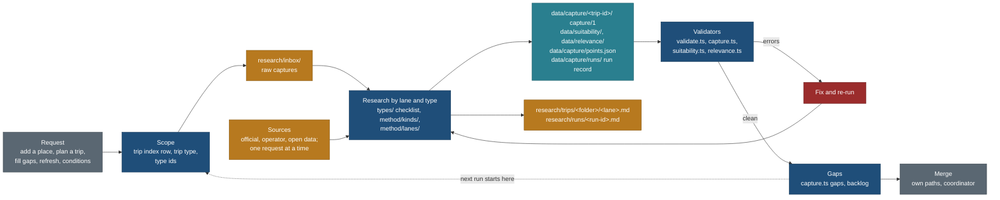

# Research: the map

Research collects facts about places, routes, offers and events, each with a source, a read date and a confidence. This
folder is the one research home (cleanup decision D11, [CLEANUP-PLAN.md](../docs/v2/CLEANUP-PLAN.md)). Structured results go
to `data/`, which is the system of record. Prose, method and findings stay here. Code stays in `core/`, `web/` and `tools/`.

Read this page first, whatever the job. Every section ends in links; the method itself is written once, in the pages it
links to.

## 1. What this folder holds

| Path | Holds | Authored or generated |
|---|---|---|
| `README.md` | this map | authored |
| [tools.md](tools.md) | every script research uses, by its real path, with when to use it and its rate rules | authored |
| [method/](method/README.md) | how research is done: the loop, trust, freshness ([method/README.md](method/README.md)), the [capture contract](method/capture-contract.md), [kinds/](method/kinds/README.md) (one profile per kind of place), [lanes/](method/lanes/README.md) (one contract per lane), [suitability](method/suitability.md), [applicability](method/suitability-applicability.md), [relevance](method/relevance.md), [sources and licences](method/sources-and-licences.md), [onboarding and refresh](method/onboarding-and-refresh.md), [trip types](method/trip-types.md) | authored |
| `types/` | one checklist per domain (15), generated by `capture.ts build` into `research/types/` (for example [types/access.md](types/access.md)); never hand-edit, never add a file | generated |
| [formats/](formats/README.md) | every output format, with its schema string, path, validator and a template in `formats/templates/` | authored |
| `inbox/` | raw captures: screenshots and batch files, named `<date>-<slug>.<ext>` | authored |
| [trips/](trips/README.md) | one folder per trip with its lane findings (`<lane>.md`, `notes/`, `archive/`); `trips/README.md` is the trip index | authored |
| `runs/` | the prose note of one research run (`<run-id>.md`); its JSON record is `data/capture/runs/<run-id>.json` | authored |
| `audits/` | audits of published claims (for example [the sun audit](audits/sun-audit-2026-10-18.md)) | authored |
| `reports/` | research that fed a product decision (map stack, schema diff, trails and media) | authored |
| `vault-notes/` | notes imported from the Obsidian vault, kept as written ([vault-notes/README.md](vault-notes/README.md)) | imported |

Nothing else goes at this folder's root. The work queue is [backlog.md](backlog.md).

## 2. The flow

## 3. Start here, by job

### 3a. Add a place

1. Use the `location` skill (`.claude/skills/location/SKILL.md`). Capture only; no research at this step.
2. Add one place with `python3 tools/locations.py add`. For a plain list of names, write one `Name, Country[, kind]` per line and run `locations.py quick-add <file>` (ambiguous, not-found and duplicate lines are printed and not written; settle them with `add --pick N`). For five or more places with tags, sources or stats, use a batch file in `research/inbox/<date>-<topic>.json` and `locations.py import` ([formats/README.md](formats/README.md#inbox-batch)).
3. Screenshots go to `research/inbox/<date>-<slug>.jpg` and are passed with `--screenshot`.
4. Finish with `python3 tools/locations.py build --check` (prints `up to date`).
5. Research starts when a trip adopts the place: `locations.py edit <ID> --trip <slug> --status planned`, then 3b. A place no trip uses still gets the basics tier ([DATA-LOC.md](../docs/v2/build/public-site/briefs/DATA-LOC.md) section 2): `locations.py basics --report` lists what each place lacks, worst first; store columns are filled with `locations.py edit <ID> --wikidata/--elevation-m/--image` or marked `--searched-none ... --tried ...`, and its capture, suitability and relevance records go in the trip-less lane `data/<kind>/catalogue/` under the place's `place/<slug>` ref (the lane rules: [method/capture-contract.md](method/capture-contract.md) section 3.8).

Outputs: `data/locations/locations.json` and its generated views. Commands: [tools.md](tools.md#places).

### 3b. Plan or research a trip

1. Give the trip a row in [trips/README.md](trips/README.md) before its first lane file. A new trip uses its trip id for both `research/trips/<id>/` and `data/*/<id>/`.
2. Pick the trip type in [method/trip-types.md](method/trip-types.md); its lane depth matrix says which lanes go deep.
3. Run the lanes as a fan-out: [method/lanes/README.md](method/lanes/README.md#running-a-fan-out). Media is one sequential runner.
4. Each lane reads its contract in `method/lanes/`, the kind profile for each kind it fills, and the checklist of each type (section 4).
5. Write prose findings to `research/trips/<folder>/<lane>.md` and records to `data/capture/<trip-id>/<lane>.json`, with the suitability and relevance sidecars beside them (section 5).
6. Run the validators (section 6), then `capture.ts gaps --trip <trip-id>` (section 7).

The `trip` skill wraps this job. Step 7 writes the trip file and schedule (`data/trips/README.md`, written by TD-0).

### 3c. Fill the gaps of a trip

1. `node core/bin/capture.ts gaps --trip <trip-id> [--level usable|complete]` lists every record and what it still lacks.
2. `node core/bin/capture.ts fields --ref <ref>` shows one record's checklist and its open fields.
3. `node core/bin/suitability.ts check --coverage <trip-id>` does the same for the suitability block.
4. Take the next rows of the backlog ([backlog.md](backlog.md)).
5. Write a run record and a run note (section 5). A later run reads the run record and starts where this one stopped.

### 3d. Refresh stale facts

1. `node core/bin/sources.ts due` lists sources past their re-check date (prices and hours 90 days, seasons and closures 180, rules 365, grades and geography 730).
2. `node core/bin/relevance.ts freshness` lists stale values in the relevance sidecars.
3. Re-read only those sources; record the new value with a new read date, and keep the old one as a conflict when they differ.
4. Method: [method/README.md](method/README.md) section 5 and [method/onboarding-and-refresh.md](method/onboarding-and-refresh.md) section 3. Freshness classes: `data/schema/freshness.json`.

### 3e. Photos

1. One runner for the whole machine; never from parallel agents. Contract: [method/lanes/media.md](method/lanes/media.md).
2. Trip galleries are data: `tools/gallery/gallery_find.py`, look at the contact sheet, `gallery_pick.py`, then `gallery.py verify` ([tools.md](tools.md#photos)). `inject` is frozen with the legacy pages.
3. Credits for the new site: `web/scripts/fetch-photo-credits.mjs`; Wikidata images for the globe: `web/scripts/globe-images.mjs`.
4. Sources, in order (owner, 25 Oct 2026; spec [DATA-LOC.md](../docs/v2/build/public-site/briefs/DATA-LOC.md) section 4): Wikimedia Commons, Openverse (filtered to CC0, the Public Domain Mark, CC BY and CC BY-SA), Flickr (CC0, CC BY, CC BY-SA, no known copyright restrictions; reached through Openverse only, no Flickr key, Q-LOC-2), Geograph, public-domain agency media (NPS, Parks Canada pages that state an open licence), the owner's photos. **Licences stay strict (DD-3, decided 25 Oct 2026): CC BY, CC BY-SA, CC0 and public domain only.** NC, ND and all rights reserved files are out, and so are the Unsplash and Pexels licences (not Creative Commons; they forbid building a similar collection). The capture validator refuses any other licence on a stored photo (`E_CAP_PHOTO_LICENCE`). Every photo is credited with author and licence and linked to its file page. Never take a file only because it is publicly visible. One runner, one request at a time, for every service.

### 3f. The pre-trip conditions check

Two days or so before a trip that depends on conditions (foliage, snow, wildlife, weather), re-read the closures, forecast
and live sources and end with one named verdict ("A keep, B swap days, C backup route"). Method:
[method/onboarding-and-refresh.md](method/onboarding-and-refresh.md) section 4. Today it runs as a one-time scheduled routine
(the `schedule` skill) that emails the verdict.

## 4. What to collect for a type

| Need | Source of truth | How to read it |
|---|---|---|
| Which type a thing is | `data/vocab/types.json` (15 domains, 61 categories, 324 type ids) | `node core/bin/capture.ts types --tree`; `capture.ts fields --kind <old kind> [--subkind S]` resolves old names |
| The exact checklist for a type | generated from `types.json` and `core/src/schema/capture/properties.ts` | `node core/bin/capture.ts fields --type <id>` (`--format json` for a crawler); the same per domain, for a person, in `types/<domain>.md` (today [research/types/](types/water.md)) |
| What a record still lacks | the record plus its type | `capture.ts fields --ref <ref>`; `capture.ts gaps --trip <trip-id>` |
| Where a mark comes from | the node or an ancestor | `capture.ts explain <type>` |
| Sources in order, traps, what never to guess, the Draft, Usable and Complete checks | [method/kinds/](method/kinds/README.md)`<kind>.md` | read it before the first record of that kind |
| How a lane runs and what it produces | [method/lanes/](method/lanes/README.md)`<lane>.md` | read the lane for the job |
| Who-it-suits fields | [method/suitability.md](method/suitability.md), [suitability-applicability.md](method/suitability-applicability.md) | `node core/bin/suitability.ts fields --ref <ref>` |

How to read the checklist. `R` is required for Usable, `R?` is required when its condition holds (in brackets), `A` is
applicable and counts for Complete, and anything unlisted is never asked. The checklist prints the record layers the type
allows, the suitability block, the link checklist, and "sources in order" as letters (F official, O operator, T tourism
board, and so on, defined in [capture-contract.md](method/capture-contract.md) section 3.1).

Worked example, a tubing trip on a river:

1. `node core/bin/capture.ts fields --type water.river.tubing` says the record is an `offer` (class `rental`), requires
   `name, type, summary, season, hours, access_cost, price, links, at, run_by`, and needs the suitability fields `min_age`,
   `water_safety.lifejacket` and `water_safety.child_sizes_from_kg` among others. Sources in order: operator, official,
   tourism board.
2. Read [method/kinds/adventure.md](method/kinds/adventure.md) for the traps (hard limits from the operator only, weight
   ranges in kg, the refund terms).
3. Read [method/lanes/adventure.md](method/lanes/adventure.md) for what the lane produces and its example.
4. `at` names the river place; `run_by` names an operator in `data/capture/operators.json` (add it there first).

**Never add a file to `types/`** (or to `research/types/` today): `capture.ts build` treats any file it did not
write as stale and deletes it.

## 5. Output formats

Full detail, minimal examples and the validation commands are in [formats/README.md](formats/README.md).

| Format | Schema string | Path | Validator | Template |
|---|---|---|---|---|
| Capture records (place, route, offer, event) | `capture/1` | `data/capture/<trip-id>/<lane>.json` | `node core/bin/validate.ts <file>` | [capture-record.json](formats/templates/capture-record.json) |
| Suitability sidecar | `suitability/1` | `data/suitability/<trip-id>/<lane>.json` | `node core/bin/suitability.ts check` | a real file (formats README) |
| Relevance sidecar | `relevance/1` | `data/relevance/<trip-id>/<lane>.json` | `node core/bin/relevance.ts check` | a real file (formats README) |
| Captured points | `capture-points/1` | `data/capture/points.json` (one file) | `relevance.ts points --build --check` reads it | [capture-points.json](formats/templates/capture-points.json) |
| Operators | `capture-operators/1` | `data/capture/operators.json` | `validate.ts` | - |
| Run record | `capture-run/1` | `data/capture/runs/<run-id>.json` | `node core/bin/capture.ts run --check <file>` | [capture-run.json](formats/templates/capture-run.json) |
| Source registry | `sources/1` | `data/sources/registry.json` | generated by `sources.ts build`; never hand-edit | - |
| Inbox batch | none (the `locations.py import` shape) | `research/inbox/<date>-<topic>.json` | `locations.py import`, then `validate` | a real file (formats README) |
| Lane findings | Markdown | `research/trips/<folder>/<lane>.md` | none; the rules in formats README | formats README |
| Run note | Markdown | `research/runs/<run-id>.md` | none | formats README |

## 6. Validators and gates

| Command | Checks | check-all stage |
|---|---|---|
| `node core/bin/validate.ts <file>` or `--all` | every data file against `core/src/schema`, including capture files and run records | "validate every data file" |
| `node core/bin/capture.ts run --check <file>` | one run record | covered by `validate.ts --all` |
| `node core/bin/capture.ts build --check` | the generated checklists and contract match `types.json` | "capture contract: generated files match data/vocab/types.json" |
| `node core/bin/suitability.ts check` | every suitability sidecar | "suitability sidecars (suitability/1)" |
| `node core/bin/relevance.ts check`, `derive --check` | relevance sidecars, no AllTrails, Google, Tripadvisor or Komoot ratings; derived files current | "relevance sidecars ...", "relevance derived files are current" |
| `node core/bin/sources.ts check` | the registry matches the lane files | "source registry is current and valid" |
| `python3 tools/locations.py validate`, `build --check` | the location store and its views | "locations validate", "locations build --check" |
| `bash tools/check-all.sh` | all of the above plus tests and the web build | the whole gate |

Run the narrow command while working and `check-all` before asking for a merge.

## 7. Gaps, conflicts and the backlog

| State | Meaning | Where |
|---|---|---|
| `searched_none` | every source the contract lists for the field was tried; list them in `tried` with the date | value state, run outcome, link state |
| `gap` | not all sources were tried yet; say which failed and why | value state, run outcome |
| `blocked` | robots, terms, 404, 429 or a login stopped the run; name the host and the reason | run outcome |
| `none_stated`, `no_limit`, `not_applicable` | the source is silent, the source says there is no limit, the field does not apply | value state ([kinds/README.md](method/kinds/README.md) section 4) |
| conflict | two sources disagree: keep the official value as `v` and every other value in `conflicts`, never an average | value `conflicts`, run outcome `conflict` |

In lane Markdown a gap is a line starting `GAP:` with the source that failed. A later run that closes it writes
`GAP CLOSED <date>` with the source, and says so when the new fact contradicts the old note. Open gaps feed the backlog; a
run record lets the next pass start where this one stopped.

## 8. Merge

1. Work on a branch in its own worktree, from `main`. Parallel agents get disjoint paths.
2. Stage only your own paths: `git -C <absolute worktree path> add <paths>`. Never `-A`, never `.`.
3. Message `research(<trip or lane>): <what was found>`, ending with the session's `Co-Authored-By` trailer.
4. Do not push or merge. The coordinator runs check-all, merges, and moves any TODO or BACKLOG row the run answers.

Later, research arrives as a changeset through the MCP and a review queue instead of a commit:
[method/skills-and-prompts.md](method/skills-and-prompts.md).

## 9. Rules that do not bend

This section is the single home of these rules. Skills and agents carry one line each, with a pointer here.

**What to store.** A value goes into a record only when it changes a decision, a display, a filter, a check or money, or
proves or dates another stored value; everything else stays in the prose archive, becomes the one-sentence summary, or is
dropped. A fact moves from prose into a record through the capture step, with a `RECORDED <ref> <path> <date>` marker in the
prose. The rule, the `meta` contract and the load pipeline: [catalogue-intake-and-storage.md](../docs/v2/features/catalogue-intake-and-storage.md).

**Method**
- **Rule zero: do not take the draft at face value.** A rough itinerary is a hypothesis. Research it and lead with what
  changed and why. Earlier plans found a "summit hike" with no view at the summit, an attraction assumed closed that was
  running, trailhead lots of 9 cars full by 9 AM, and two waterfalls of the same name an hour apart.
- **Gaps are output.** Never fill a field with a plausible number. Record what was tried and why it failed (section 7).
- **Official or operator first.** Community sources corroborate; two dated reports make a pattern.
- **Link-only platforms are never a source of a stored value**: AllTrails, Komoot, Gaia, Outdooractive, Wikiloc,
  Trailforks, FATMAP; Tripadvisor, Yelp, Booking.com, Expedia, Airbnb; resellers (GetYourGuide, Viator). Store them as
  links (`found_in_search` with the date). AllTrails blocks bots; never fetch or scrape it. Never store their ratings,
  reviews, counts, ranks or prices.
- **Google** (Maps, Places, Search result pages, Street View) is never the source of a stored value. Navigation links are
  built from our own coordinates at render time.
- **Hard limits** (minimum age, height, weight, fitness, swim ability) come only from official or operator sources. A
  reseller's limit is kept as a conflict. Convert units and say so in the quote.
- **Conflicts are recorded, never picked silently** (section 7). Ranges, not averages.
- **Every URL is real**: fetched (HTTP 200 or a normal page) or recorded as `searched_none` with the query and date.
  Never invent a URL. Work through the full link checklist of the type.
- **Prices** carry the currency (ISO 4217) and read date; **booking windows** carry the rule, the local time and the IANA
  zone.
- **Parking capacity and fill time order the day**, ahead of light, crowds and driving efficiency.
- **Light and sun are computed**, never guessed or remembered: `node core/bin/sun.ts`. Longitude is positive east
  (Reykjavik is -21.94). Four legacy scripts once negated it and were off by 8 minutes per degree
  ([audits/sun-audit-2026-10-18.md](audits/sun-audit-2026-10-18.md)); they are fixed and pinned by
  `tools/tests/test_sun_scripts.py`, but new work uses `core/bin/sun.ts` only.
- **The year of a fact.** Every price, hour and window has `applies_to`. A plan for a later year built on 2026 data says so.
- **Report completeness** per record ("Usable, 18 of 24") with the checks still missing.

**Coordinates**
- WGS84, at least 5 decimals, each with a `point_source`: an OSM node or way id, an official dataset, or a person's pin.
- **Never from Google.** A coordinate of unknown origin counts as Google-derived and is not stored.
- The point is the thing itself (the waterfall, the viewpoint). Access points (trailhead, car park) are separate records.
- Every agent point says "agent checked, needs a person's check" until a person confirms it.

**Rate and politeness**
- One request at a time per host, at least 1 s apart; Wikidata and Nominatim one a second; obey `Retry-After`; stop a
  host after the second 429. At most 200 pages per host per run. Honour robots.txt and terms ([capture-contract.md](method/capture-contract.md) 9.2, 9.3).
- **Overpass, Nominatim and Commons are one runner for the whole machine, never parallel agents.** The scripts take
  `/tmp/travel-overpass.lock` and `/tmp/travel-commons.lock`. Four agents on Commons at once got a 429 that lasted 25 minutes
  (12 Oct 2026). Commons thumbnails use the standard widths 330, 960 or 1920.
- **User agent**: the project name and the public site, never an email or personal data:
  `travel-relevance-signals/1.0 (+https://nks-travel.pages.dev/about/)`, defined as `USER_AGENT` in
  `core/src/relevance/signals.ts`. Overpass answers 406 without one. Each script carries its own copy ([tools.md](tools.md#user-agents)).
- Cache every fetched page; never re-fetch inside the field's freshness window.

**Privacy and storage**
- **Nothing about travel goes in the Obsidian notes vault.** Imported notes live in `vault-notes/`.
- **Household data never enters a public field**: no names, ages, birthdays, booking codes, phone numbers or costs of the
  family in records, sources, quotes or notes. Traveller limits are checked against limits at plan time, never stored on a
  place. `research/` is published with the repository: the vault notes that held household data were removed (PUBLIC-SCRUB,
  25 Oct 2026), and no note, record or run file may hold it again.
- **Paraphrase.** `quote` is our own words or a short exact phrase, at most 300 characters. Never copy descriptions.

## 10. Scripts

Every script, by its real path, with when to use it and its rate rules: [tools.md](tools.md).

## 11. Trips

The trip index, with each trip's state, dates, data paths and open items: [trips/README.md](trips/README.md).

## 12. Gotchas

- **Folder names differ from trip ids.** `research/trips/dolomites-july-2027/` holds the prose for the trip whose data is
  `data/capture/dolomites-2027/`. The 13 existing folders keep their names because data citations and validator examples
  name them; the trip index maps each folder to its id. New trips use the trip id for both.
- **`types/` is generated.** The generator writes it; never put a README or notes there.
- **Run records live in `data/capture/runs/`, not here.** `research/runs/` holds only the prose note.
- **`validate.ts` reads any JSON under `research/` as `research-sidecar/1`.** The path rule wins over the `schema` key, so a
  template validated in place fails. Validate a copy outside the repo ([formats/README.md](formats/README.md#validating-a-template)).
- **2026 data is a pattern.** Plans for 2027 to 2029 use 2026 prices, timetables and season dates; `applies_to` says so.
- **`capture.ts migrate` ran once and refuses to run again.** `data/capture/migration-ledger.json` pins every migrated value.
  One exception, points only (DG2F, 28 Oct 2026): a pinned point that is a derivation (`trailhead "X" at <ref>`) may be replaced by
  the record's own researched OSM point. Store the row in `data/capture/points.json`, run `node core/bin/capture.ts ledger-point
  --ref <ref> --reason "<why>" --write` (it refuses a pin that is a fact, a row that is not OSM and a missing reason, and logs the
  replacement in the ledger's `replaced`), then `relevance.ts points --build`. Never edit the ledger by hand.
- **Commons 429s last.** One runner, a couple of seconds apart, a probe request before a long run.
