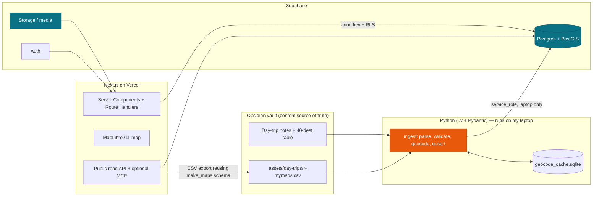

# Travel Finder — Architecture & Stack

> How the app is built, hosted, and kept in sync with the vault, plus the one genuinely tricky bit: real drive-time without a runaway bill. Part of [[Travel Finder — Overview]].

## Stack

- **Frontend:** Next.js (App Router, Server Components by default), TypeScript strict, Tailwind (professional palette — no purple/AI aesthetics), Zod for runtime validation.
- **Backend/data:** Supabase — Postgres + **PostGIS** for spatial, Row Level Security, Auth (later), Storage (media).
- **Map rendering:** MapLibre GL JS (vector, smooth re-centering for the "everything re-sorts around me" feel).
- **Geocoding + drive-time:** Google (best POI resolution for Canadian named places) — server-side only, cached.
- **Hosting:** Vercel (fastest path for Next.js + previews). Azure is my default elsewhere, but here Supabase carries the data/auth/storage, so Vercel just hosts the web tier.
- **Data tooling:** Python (uv + Pydantic) for the vault → DB ingestion job.

## Principle: the vault stays the source of truth

The Obsidian vault is where trip content is authored (via [[trip-planner]]). The database is a **derived, queryable projection** of it. Ingestion is **one-way (vault → DB) and idempotent** — the cure for any drift is "re-run ingest." The app's only write back toward the vault is an optional CSV export that already matches the existing `make_maps.py` format.

## Architecture



## Drive-time without runaway cost

The hero feature is "sorted by real drive-time from you." Calling a Matrix API for every place on every page view would be expensive and rate-limited. The approach:

1. **Spatial prefilter** — `ST_DWithin(geom, origin, radius)` in PostGIS returns the candidate set instantly and for free, ordered by straight-line distance.
2. **Matrix only for the top-N** — call Google Distance Matrix (or Mapbox Matrix) for the nearest ~30–50 candidates, origin → each.
3. **Cache aggressively** — `drive_time_cache (origin_geohash, place_id, minutes, km, fetched_at)` keyed on the **rounded origin** (geohash ~precision 6) with a TTL. Two users near the same spot reuse the same results.
4. **Graceful fallback** — show straight-line distance, clearly labelled, when a drive-time isn't cached yet.

Net: accurate "X min drive" on displayed results, bounded cost.

## Repo layout (standalone, NOT inside the vault)

The vault is a private notes repo with secrets/licensing concerns — the public web app lives in its own repo.

```
travel-finder/
  apps/web/            # Next.js App Router
  tooling/ingest/      # Python uv project (vault -> DB)
  supabase/migrations/ # SQL migrations
  supabase/config.toml
  packages/shared/     # Zod schemas + generated DB types (shared contract)
```

## Deployment & secrets

- **Web (Vercel):** `NEXT_PUBLIC_SUPABASE_URL`, `NEXT_PUBLIC_SUPABASE_ANON_KEY` (RLS-safe to expose). Server-only keys (geocoding, Matrix) live in Route Handlers, never shipped to the browser. Map/autocomplete browser key is **referrer-restricted** to the app domain.
- **`service_role` key:** god-mode, bypasses RLS — lives only in the laptop ingest `.env`, never on the web app, never committed.
- **DNS:** the chosen domain points to Vercel.

## Open questions

- Google end-to-end (geocoding + Matrix) vs. all-Mapbox (tiles + Matrix + geocoding in one vendor) — pick on accuracy vs. simplicity.
- Self-hosted basemap tiles (Protomaps) to avoid per-load tile billing?
- Eventually move the web host to Azure (Static Web Apps / Container Apps) while keeping Supabase? Only if there's a reason to.
