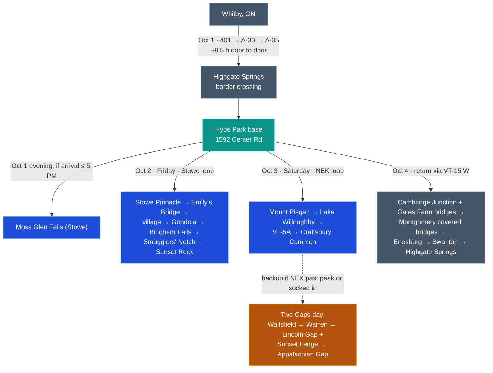

# Vermont Fall Foliage Trip — October 1–4, 2026

Base: hotel at 1592 Center Rd, Hyde Park, VT 05655 · From: Whitby, ON
Researched Aug 23, 2026. Automated conditions re-check runs Sept 29, 2026 (details at the bottom).

| | |
|---|---|
| Drive down | Thu Oct 1, ~8.75 h door-to-door via Montreal (A-30/A-35) and Highgate Springs border, **including a 1 h lunch at Brossard** |
| Day 2 (Fri) | Stowe loop: Pinnacle at dawn, Emily's Bridge, village, Gondola, Bingham Falls, Smugglers' Notch, Sunset Rock |
| Day 3 (Sat) | Northeast Kingdom: Pisgah **to Pulpit Rock**, Lake Willoughby, Craftsbury Common, **+ Barr Hill**, then **Appalachian Gap at golden hour (LOCKED 2026-09-25)** (backup: **Two Gaps day**, see addendum) |
| Drive home | Sun Oct 4 via the **covered-bridge route (Route A; Route B is superseded by the Saturday gap)** (Cambridge Junction, Montgomery), home ~6:30 PM |
| Sunrise / sunset (Stowe) | Oct 1: 6:47 / 6:33 · Oct 2: 6:49 / 6:31 · Oct 3: 6:50 / 6:30 |

## CURRENT PLAN AT A GLANCE (2026-09-25)

Decisions: leave 07:30 to 08:00 every morning; breakfast and dinner at home; lunch 30 min and one 30 min coffee (Thursday: three 20 min breaks, packed lunch and dinner). **App Gap is not on this trip** (write-ups below are kept for the record). Gondola optional: swap is the Mansfield Auto Toll Road, or Cold Hollow. Prospect Rock is the optional Saturday hike. Times are estimates, not routed in Maps; at an 08:00 start shift each day by 30 min.

**Thursday Oct 1 — Whitby to Hyde Park (~660 km, 6 h 40 driving)**

| Time | What |
|---|---|
| 08:00 (07:30 better) | Leave Whitby, packed lunch and dinner in the cooler |
| ~10:10 | Break 1, 20 min: Napanee |
| ~12:30 | Break 2, 20 min: packed lunch at an A-30 aire |
| ~14:35 | Highgate Springs border (check live wait) |
| ~15:00 | Break 3, 20 min: fuel at St. Albans |
| ~16:30 | Check in, 1592 Center Rd |
| 17:00-17:45 | Moss Glen Falls (skip if arriving after 17:30) |
| ~18:15 | Hannaford, Morrisville: Friday trail food, Saturday picnic, Sunday food |
| ~18:45 | Dinner at home |

**Friday Oct 2 — Stowe (~2 h driving, ~70 mi)**

| Time | What |
|---|---|
| 07:15-07:30 | Leave base |
| ~07:40-11:15 | Stowe Pinnacle, 3.4 mi / 1,500 ft; turn back if not on the summit by 10:00 |
| 11:30 | Emily's Bridge, 10 min (first to drop) |
| 11:45-12:15 | Lunch, 30 min, Stowe (Raja or Green Goddess) |
| 12:15-12:45 | Coffee, 30 min, Community Church view point |
| 13:15-14:45 | Instead of the gondola: Mansfield Auto Toll Road (~90 min, $37/vehicle + $14/extra passenger) Cold Hollow Cider Mill (30-45 min, free), or the Stowe Recreation Path (5.3 mi paved greenway, start behind the Community Church at Lintilhac Park; any length; free; https://www.alltrails.com/trail/us/vermont/stowe-recreation-path · https://gostowe.com/listing/stowe-recreation-path · https://maps.google.com/?q=Lintilhac+Park,+Stowe,+VT) |
| 15:00-15:45 | Bingham Falls |
| 16:00-17:00 | Smugglers' Notch drive |
| 17:30-18:30 | Sunset Rock (sunset 18:31) |
| ~19:10 | Home, dinner at home (optional Bierhall drink first) |

**Saturday Oct 3 — Northeast Kingdom (~3 h driving, ~130 mi)**

| Time | What |
|---|---|
| 07:30 | Leave base (1 h 05 to Pisgah) |
| ~08:35-10:50 | Mount Pisgah to Pulpit Rock and back, 2.2 mi / 900 ft |
| 11:00-11:30 | Lunch, 30 min, picnic at South Beach |
| 11:30-12:40 | VT-5A, VT-58, VT-14 north |
| ~12:40-13:10 | Craftsbury Common |
| 13:10-13:40 | Coffee, 30 min, The Genny |
| 13:55-14:35 | Barr Hill |
| ~15:10 | Fisher Covered Railroad Bridge, 15 min, on the way |
| ~15:35 | Base |
| ~15:45-17:30 | Optional: Prospect Rock, 2.6 mi / 460 ft, 1 h 30-1 h 45 (AllTrails 1 h 43); easy fallback rail trail + Ten Bends |
| evening | Dinner at home |

Prospect Rock links: https://www.alltrails.com/trail/us/vermont/prospect-rock--2 · https://www.outdoorproject.com/united-states/vermont/prospect-rock · https://www.greenmountainclub.org/hiking/hiking-recommendations/lamoille-river-valley/ · https://www.komoot.com/smarttour/e1318961440/prospect-rock. Trail condition for 2026 not checked.

**Sunday Oct 4 — home (~1 h 50 to the border, then 6 h 40)**

| Time | What |
|---|---|
| 08:00 | Check out |
| ~08:40 | Cambridge Junction (Poland Bridge) |
| ~09:00 | Gates Farm Bridge |
| ~09:30 | Drive to Montgomery |
| 09:55-11:00 | Montgomery covered bridges |
| ~11:15 | VT-118, Enosburg Falls, Swanton |
| ~12:10 | Highgate Springs border |
| ~13:30-14:00 | Lunch, 30 min, Brossard |
| ~18:30 | Whitby |

Open: Koushik (from 106 Blossom Circle, Dayton NJ, ~385 mi / 620 km, ~7 h, ESTIMATE) — meet at base only, or at Moss Glen Falls? Confirm the rental allows a late check-in and has a fridge and microwave.

---

**Reading the rest of this file:** the day-by-day sections and addenda below are the earlier detail (research, alternatives, reasons). Where they differ from the tables above, the tables above win. The superseded App Gap material (Thursday arrival, Saturday evening, Sunday Route B) is kept, and on the web page it is in the Archive tab.

**Sequenced day loops** (every stop, in visiting order; coordinates used where place names are
ambiguous — Google resolves "Smugglers' Notch" to the ski resort 3.5 km away):

| Day | Route |
|---|---|
| Thu 1 — Whitby → Hyde Park | https://www.google.com/maps/dir/Whitby,%20ON/1555%20Provencher%20Blvd,%20Brossard,%20QC/Saint-Armand,%20QC/Highgate%20Springs,%20VT/St.%20Albans,%20VT/44.601828,-72.5745682/44.4823794,-72.6245046/44.5727869,-72.5967606/44.601828,-72.5745682/ |
| Fri 2 — Stowe loop | https://www.google.com/maps/dir/44.601828,-72.5745682/44.43882,-72.66764/44.4404009,-72.6798624/44.4656466,-72.6846447/44.52903,-72.78428/44.5167269,-72.7660351/44.5553,-72.79587/44.4650363,-72.6786046/44.4654369,-72.7451481/44.601828,-72.5745682/ |
| Sat 3 — Northeast Kingdom | https://www.google.com/maps/dir/44.601828,-72.5745682/44.7297412,-72.0306816/44.748209,-72.0597399/44.7711201,-72.0548723/44.6535578,-72.3827342/44.6345579,-72.3718867/44.6080645,-72.289919/44.5323138,-72.4277306/44.601828,-72.5745682/ |
| Sun 4A — covered bridges home | https://www.google.com/maps/dir/44.601828,-72.5745682/44.6510988,-72.8146024/44.6457214,-72.8722716/44.9072383,-72.6556465/44.8996622,-72.6446362/44.9032472,-72.6397131/44.8585853,-72.6125419/44.86724,-72.65252/Swanton,%20VT/Highgate%20Springs,%20VT/ |
| Sun 4B — App Gap traverse home | https://www.google.com/maps/dir/44.601828,-72.5745682/Waitsfield,%20VT/44.2110741,-72.9312953/Bristol,%20VT/Burlington,%20VT/Highgate%20Springs,%20VT/ |
| Backup — Two Gaps day | https://www.google.com/maps/dir/44.601828,-72.5745682/44.18937,-72.8235/44.1145085,-72.8560776/44.0955039,-72.8643766/44.0950338,-72.9290382/44.0879167,-72.9275429/44.2110741,-72.9312953/Waitsfield,%20VT/44.601828,-72.5745682/ |

**Parking:** `PARKING.md` — a verified lot for every stop, with coordinates, plus the four
that still need a Google pin from you. Parking is the binding constraint on this trip.

**Companion files:** `MASTER-MAP-AND-SCORES.md` — every destination as a map pin, per-day loop
links, a drive/on-site time budget and a 1–10 score for each stop.
`research-gaps-and-viewpoints.md` and `OPTIONS-viewpoints.md` — the research behind them.

## What changed from the rough plan (and why)

1. **Trip window is well-timed; no structural change needed.** Oct 1–4 lands at peak in the Northeast Kingdom, peak-at-elevation / near-peak valley in Stowe, and pre-peak on Route 100. The 2026 forecast (Jeff Foliage — the only detailed one out) calls a slightly LATE season, which makes the NEK day the safest bet and Route 100 the natural backup, exactly as drafted.
2. **Keep NEK on Saturday.** Stowe's Mountain Road crawls 10 AM–4 PM on foliage weekends; Willoughby/Craftsbury is the low-crowd Saturday. Friday for Stowe is right.
3. **Reordered the Stowe day.** Every lot is tiny (Pinnacle ~9 cars, Bingham ~15, Notch top smallest of all). Pinnacle needs a pre-7:30 AM start; Smugglers' Notch moved to late afternoon (guides: before 9 AM or near sunset — midday is gridlock). Gondola confirmed operating (10:00–4:30) — it was NOT replaced; cabins were upgraded for 2025–26.
4. **Sterling Pond demoted to "skip unless the day runs long."** It is a genuinely hard 1,000 ft in ~1.1 mi on eroded, slippery rock, there's an active bear situation at the shelter, and its parking is at the single worst congestion point of the week. The Notch drive + Bingham Falls deliver the same scenery for a fraction of the effort.
5. **Mount Pisgah: the summit has NO view.** The classic panorama needs Pulpit Rock (~1 mi up) plus the North/West overlooks 0.3–0.4 mi PAST the summit — the marked trail ends before the best ledge, so budget 3.5 h, not 2.5.
6. **Moss Glen Falls on arrival evening is realistic** (arrival ~4:30–5:00 PM vs 6:33 sunset, and it's a 15-min drive + 0.5 mi walk). No weekday construction restriction found. Fallback to Oct 4 stands.
7. **Route via Montreal got faster in 2025:** A-35 is now continuous freeway to Saint-Armand (Phase III opened Sept 2025). Old trip reports about slow Route 133 villages are outdated. Cross at quiet Highgate Springs, not Lacolle.
9. **The gaps were missing entirely, and so was Sunday (revised Sept 7, 2026).** Lincoln Gap and Appalachian Gap were in no version of this plan; they are now the backbone of the backup day. **Cold Hollow is dropped and Sunday rebuilt as a covered-bridge route home.** The viewpoint audit also added Barr Hill, Prospect Rock and Mount Elmore (reserve). **A one-real-hike-per-day rule is now enforced — see "Hiking load" below.**
8. **Added places** (marked "added" below): Emily's Bridge, Sunset Rock, von Trapp Bierhall/Trapp meadows, Lamoille Valley Rail Trail (at your doorstep), Ten Bends Beer (Hyde Park), North Beach Willoughby, Warren Falls + covered bridges on the backup day.

## Route overview

## Hiking load — the realism check

One real hike per day. That is the rule now, and it is what the schedule is built to.

| Day | Hike | RT / gain | Time |
|---|---|---|---|
| Thu 1 | Moss Glen Falls | 0.5 mi / 55 ft | 45 min |
| Fri 2 | **Stowe Pinnacle** | 3.4 mi / 1,500 ft | 3 h |
| Sat 3 | **Pisgah to Pulpit Rock** *(trimmed)* | 2.2 mi / 900 ft | 2 h |
| Sun 4 | none — covered bridges and driving | — | — |

**Total: ~2,455 ft of climbing across four days, one big day and one moderate one.**

The original plan had Pinnacle (1,500 ft) and full Pisgah (1,650 ft) on **back-to-back days with
pre-7 AM starts, immediately after an 8.75-hour drive** — 3,150 ft, two hard mornings in a row.
That was the overload. Pisgah is trimmed rather than Pinnacle because:
- Pinnacle is the signature Stowe hike and Friday is built around it;
- the plan already concedes **Pisgah's summit has no view**, and the good ledges are 0.3–0.4 mi
  past it — so the extra 750 ft buys overlooks, not the famous shot;
- **Pulpit Rock at ~1 mi in IS the famous shot** — the ledge 650 ft straight above the lake.

Cutting it frees ~1 h 45, which is exactly what pays for Barr Hill and Fisher Bridge and still
gets you home by 15:45 instead of after 16:00 with nothing left in the tank.

**Nothing harder goes in.** Mount Abraham (5.2 mi / 2,500 ft), Sterling Pond, Mount Elmore and
Laraway are all documented in the addendum as options, and all four are deliberately unscheduled.

## Foliage outlook (as of late Aug 2026)

| Area | Historical stage Oct 1–4 | 2026 lean |
|---|---|---|
| Northeast Kingdom (Willoughby, Craftsbury) | Peak (turns first, often last week of Sept) | Safest peak bet; "slightly late" forecast protects against past-peak |
| Stowe / Lamoille Valley | Peak at elevation, valley ~60–90% | Notch and Pinnacle in full color; village still filling in |
| Smugglers' Notch pass | Peak (high, turns early) | Strong |
| Route 100 / Mad River Valley | Pre-peak to near-peak | Backup only. **The gaps sit 1,000+ ft above the valley floor and turn well ahead of it** — App Gap 2,375 ft, Lincoln Gap 2,424 ft — so a "pre-peak Route 100" call does not condemn the Two Gaps day |

Peak lasts ~7–10 days per spot; color moves high→low and north→south. The Sept 29 automated check settles this with live reports.

---

## Thursday, October 1 — Whitby → Hyde Park (+ Moss Glen Falls)

Route: ON-401 E → A-20 → A-30 E bypass (toll bridge, $4.40 CAD — pay by card in the lane to avoid the mailed-invoice fee) → A-35 S → Route 133 → Highgate Springs, VT → I-89 S exit 19 (St. Albans) → VT-104 → VT-15 E → Hyde Park. ~660 km, ~6 h 40 m driving.
Map: https://www.google.com/maps/dir/Whitby,+ON/Saint-Armand,+QC/1592+Center+Rd,+Hyde+Park,+VT+05655/ (Saint-Armand waypoint forces the quiet Highgate crossing over Lacolle)

| Time | | Buffer |
|---|---|---|
| 8:00 | Depart Whitby, full tank. | |
| ~10:10 | **ONroute Napanee — coffee, washrooms, fuel** (optional; Mallorytown North ~11:15 is the alternative). Keep it to 20 min. Highway vegetarian here is a cheese bagel — do not eat, just refuel. | 20 min stop |
| ~13:00 | A-30 toll bridge (+20 min on the old schedule because of the Napanee stop). | |
| **13:15–14:15** | **LUNCH — Brossard, at the A-30/A-10 interchange the route already passes.** Le Tandoor, 1555 Provencher Blvd #4 (Thu 12:00–21:00, 450-672-6112) or Shaan Tandoori, 2550 Boul Lapinière (lunch 11:30–14:30 only, BYOW, 450-678-9322). Both have real vegetarian sections. **This is the only good vegetarian meal on the entire drive.** | 60 min |
| ~15:15 | Border at Highgate Springs (typical Thu midday wait 0–15 min). Live wait: https://bwt.cbp.gov/details/05021201/POV | |
| ~15:40 | Fuel at St. Albans (VT gas ≈ 1.50 CAD/L vs ~1.80 in Quebec — never fill in Quebec). Optional coffee: Catalyst Coffee Bar, The Traveled Cup, or Charlie's Coffee & Co (veg + GF, all-day breakfast). | 10 min fuel / 30 with coffee |
| ~16:45 | Check in, 1592 Center Rd, Hyde Park. *(was 16:30 — the lunch hour moved it 15 min, not 60, because the old schedule had slack in it.)* | |
| 17:15–18:15 | **Moss Glen Falls (Stowe)** — 15 min drive: VT-100 S → left on Randolph Rd → first right on Moss Glen Falls Rd, small gravel lot. 0.5 mi round trip to a 100+ ft cascade. The left-fork rim climb is steep/eroded — stay back from the edge. Sunset 6:33, light until ~7:00. | 45 min vs cut-off |
| 18:45 | Hannaford, 80 Fairgrounds Plaza, Morrisville (open to 10) — **Saturday picnic supplies, see the Oct 3 list.** | |
| 19:15 | **Dinner: Raja, 151 Main St, Stowe** (Thu 11:00–21:00, 802-760-6685) — 10 vegetarian mains $12.99–14.99. Fallbacks: Piecasso (pizza, daily) or Black Diamond BBQ / Lost Nation, both meat-led. | |

Decision rule (unchanged): arrival after ~5:30 PM → skip the falls, move to Oct 4.

### Thursday maps (added 2026-09-25)

- **Map 1, Whitby, every stop:** https://www.google.com/maps/dir/Whitby,%20ON/1555%20Provencher%20Blvd,%20Brossard,%20QC/Saint-Armand,%20QC/Highgate%20Springs,%20VT/St.%20Albans,%20VT/44.601828,-72.5745682/44.4823794,-72.6245046/44.5727869,-72.5967606/44.601828,-72.5745682/
- **Map 2, Koushik from 106 Blossom Circle, Dayton, NJ 08810 to the base:** https://www.google.com/maps/dir/106+Blossom+Circle,+Dayton,+NJ+08810/1592+Center+Rd,+Hyde+Park,+VT+05655/ — road chosen by Google, no stops added yet. **Open:** does Koushik meet at Moss Glen Falls / Raja Thursday, or only at base? Distance: about 385 mi / 620 km, ~7 h (ESTIMATE from Jersey City to Stowe figures, not routed). Whitby: ~660 km / 410 mi, 6 h 40 driving.

### Thursday alternative — arrive over the Appalachian Gap

Instead of I-89 straight to Hyde Park, come in over the gap: **Border → I-89 S → Richmond (exit 11)
→ VT-116 S → Bristol → VT-17 E over the Appalachian Gap → Waitsfield → VT-100 N → base.**
Map: https://www.google.com/maps/dir/Highgate+Springs,+VT/Richmond,+VT/Bristol,+VT/44.2110741,-72.9312953/Waitsfield,+VT/1592+Center+Rd,+Hyde+Park,+VT/

| | |
|---|---|
| Extra distance | **+142 km, about +2 h** |
| Timeline | border 15:15 → Richmond 16:05 → Bristol 16:35 → **App Gap 17:00–17:50** → base **19:20** |
| Day becomes | 8 h 45 → **11 h 15** door to door |

**Why it is tempting:** you approach **westbound** and arrive at 17:00 with sunset at 18:33, so you
are driving *into* the view and standing at a west-facing overlook in late-afternoon light. That is
App Gap at its best hour, which **Sunday Route B structurally cannot give you** (09:15, sun behind
you). It also frees Sunday for the covered bridges — you would get App Gap **and** Montgomery.

**Why it is rejected on a Whitby-direct trip — three reasons, in order:**
1. **Sleep.** Base at 19:20, then a **06:45 Friday departure** for the Pinnacle. That is roughly six
   hours before the biggest hike of the trip, and Friday's tiny lot does not forgive a late start.
2. **A 15% hairpin gap road at dusk at the end of an eleven-hour travel day.** Every other decision
   in this plan is built around fatigue. This one cuts against it, and it is the single riskiest
   thing anyone would do all week.
3. **1 October is the worst foliage day of the trip for that valley.** The Mad River Valley runs
   pre-peak to near-peak across Oct 1–4 and improves daily.

It also displaces Moss Glen Falls, whose only fallback was Sunday — and Sunday is now full.

### THE FLIP CONDITION

**If the Québec prologue happens** (`quebec-sept-2026`: Whitby → Île d'Orléans, 2 nights → Derby
Line → Hyde Park), Thursday stops being an 8 h 45 haul. Derby Line → base is about **1 h 15**, so
you arrive around **14:00, rested, with a free afternoon**. App Gap then becomes an easy out-and-back
leaving ~15:45, on the overlook for golden hour, back by 19:30 — and **reason 1 and reason 2 both
disappear.** In that case **do it on Thursday** and take Route A (bridges) on Sunday.

**If you are considering the Québec leg at all, this is an argument for it.**

## Appalachian Gap at golden hour — which day can actually take it

Sunset: Oct 1 18:33 · Oct 2 18:31 · Oct 3 18:30 · Oct 4 18:29.
Drive times from documented road mileage, not straight lines: **base → App Gap ≈ 1 h 15**,
**Stowe → App Gap ≈ 55 min**.

| Day | Approach | Cost | Day becomes | Hiking that day | The catch |
|---|---|---|---|---|---|
| **Thu 1** | traverse in on arrival | +2 h 02 | 8 h 45 → 11 h 15 | none | ~6 h sleep before the Pinnacle. **Unless the Québec prologue runs** |
| **Fri 2** | from the Notch, ~1 h | +2 h 10 | 12 h 30 → **14 h 30** | 5.5 km / 457 m | Needs the gondola cut, and **costs Sunset Rock** — you cannot have two sunsets |
| **Sat 3** | out and back from base | +2 h 30 | 9 h 30 → **12 h** | 3.5 km / 274 m | Back at 19:50; **Raja is 18 min further south and shuts at 21:00** |
| **Sun 4** | — | — | — | — | **Impossible.** You are in Québec by 18:29 |

### DECISION (2026-09-25): Saturday evening, locked. Raja moved to Friday.

### The recommendation, revised

**Saturday evening is the best golden-hour slot on a Whitby-direct trip** — and this changed once
Pisgah was trimmed. Saturday now carries only a 2-hour hike and finishes at 15:45, so it absorbs the
detour better than Friday (14 h 30) or Thursday (the sleep problem). Sunday departs at 08:00, so a
20:00 finish still leaves a full night.

**And it is strictly better than Sunday Route B:** Saturday evening gives you App Gap **in the right
light**, and leaves Sunday free for **Route A and the seven covered bridges**. Route B gives you a
badly-lit App Gap and no bridges. If App Gap matters, take it on Saturday, not on the way home.

**Solve the dinner clash by swapping the meals (DONE, 2026-09-25):** move **Raja to Friday** (Friday's dinner is
currently von Trapp, which the plan already admits is thin on vegetarian) and leave Saturday for a
late, simple meal after the gap. That removes the only real objection.

**Packed-lunch alternative, honestly costed:** eating what you brought at an A-30 aire plus a
washroom stop is **25–30 min**, not zero. You save about half an hour over the sit-down, not a
full hour — and you give up the only proper vegetarian meal between Whitby and Vermont.

Documents: passports (or NEXUS/EDL); PR card too if applicable. Download offline Google Maps for northern Vermont before crossing — the NEK, the Notch, and VT-15 have real dead zones. Roaming: Rogers ~$15–18/day, Bell/Telus $14/day; a US eSIM is cheaper for 4 days.

## Friday, October 2 — Stowe day

Loop map (every stop, in time order): https://www.google.com/maps/dir/44.601828,-72.5745682/44.43882,-72.66764/44.4404009,-72.6798624/44.4656466,-72.6846447/44.52903,-72.78428/44.5167269,-72.7660351/44.5553,-72.79587/44.4650363,-72.6786046/44.4654369,-72.7451481/44.601828,-72.5745682/

| Time | | Buffer |
|---|---|---|
| **6:00–6:45** | **Coffee and breakfast at the property.** Nothing opens before 7:00 — Black Cap in both Stowe and Morrisville starts at 7 and you are on the trail by then. Pack the trail food now, not later. | |
| 6:45 | Depart (sunrise 6:49). | |
| 7:10 | **Stowe Pinnacle** trailhead, Upper Hollow Rd — **the lot holds ~9 cars and fills before 9 even on weekdays.** Hike **7:15–10:45**: ~3.4 mi / 5.5 km RT, ~1,500 ft / 457 m, steep rocky upper third; morning light front-lights Mansfield and the valley color. | **+30 min** (3h30 window vs 2.5–3h moving) |
| | **PARKING — both lots pinned.** **Main trailhead lot** (44.43882, −72.66764) — https://maps.app.goo.gl/D7669yKyCB4n5fhw6 — ~9 cars. This is the one you want, and it is the whole reason for the 6:45 departure. **Pinnacle Meadows overflow** (44.43779, −72.64712), Stowe Land Trust, off Pinnacle Rd — https://maps.app.goo.gl/EUgqbNiy8ozLqxDC6 — **1.6 km / 1 mile EAST of the trailhead by road, not next door.** Falling back to it costs ~20 min of road walking each way; better to drop the walkers at the trailhead and shuttle the car back. | |
| | **Turnaround rule: not on the summit knob by 9:00 → go back down.** The gondola is the fixed point of the afternoon, not this hike. | |
| 11:00 | **Emily's Bridge (Gold Brook Covered Bridge)** (added) — 5 min away in Stowe Hollow; 1844 covered bridge over ledges, quick photo stop. **This is the flex item** — 10 min if the hike ran long, 25 if not, drop it entirely and the day still works. | absorbs overrun |
| **11:30–13:00** | **Stowe village — coffee, then lunch.** **Community Church viewpoint** — a SEPARATE Google pin from the church itself, mapped as "Stowe Community Church View Point": https://share.google/JglcjAOLx1XIpeHL1 — navigating to the church address puts you at the building, not at the angle the classic shot needs, Main Street, short Rec Path stroll from Lintilhac Park. **Coffee: Black Cap, 144 Main St, 7:00–18:00 daily.** | 90 min total |
| | **Lunch, vegetarian first:** **Raja**, 151 Main St — opens 11:00, four doors from the coffee, 10 veg mains. **Green Goddess Café**, 618 S Main St, 7:30–15:00 daily — salads/sandwiches/smoothies, wide veg + vegan range, the faster option. von Trapp Bierhall (opens 11:30) is a view and a beer garden more than a vegetarian meal. Piecasso for pizza. | |
| 13:15 | **Gondola SkyRide** — operating fall 2026, 10:00–4:30, last ticket 4:15, ~US$40–43 adult; BUY ONLINE IN ADVANCE (stowe.com) — foliage-season queues are real. Cliff House at the top. ~1.5 h. **ALTERNATIVE — Mansfield Auto Toll Road** (https://maps.google.com/?q=Mount+Mansfield+Auto+Toll+Road,+VT-108,+Stowe,+VT): 4.5 mi gravel, ~20 min up, entrance off VT-108 past the cross-country centre. **$37/vehicle + $14/passenger = $51 for two, against ~$80–86 for two gondola tickets.** Tops out at **3,850 ft** at the Summit Station (GMC caretakers on site) vs the Cliff House at ~3,625 ft — and from there **the Chin, Vermont's high point at 4,395 ft, is 1.4 mi north on the Long Trail with 546 ft of gain.** No queue, no advance booking, no food at the top. **Carry cash AND card** — one source says all Vermont toll roads are cash-only, GoStowe doesn't specify. Season ends mid-October. **This is the better pick if Friday is running long or if you want the state high point.** | gondola is the day's fixed point |
| 15:00 | **Bingham Falls** — pull-offs on VT-108 ~6.4 mi up from the village; 0.5 mi RT, steep wet rock staircases down to the gorge — grippy shoes. | 45 min slack before the Notch |
| 16:00 | **Smugglers' Notch drive (VT-108)** — hairpins, boulders, 1,000-ft cliffs; pull-offs and the top-of-Notch area. Late afternoon = the quiet window; the pass is shaded (even light — good for photos). Road confirmed open early Oct (closes ~Nov); no vehicles over 40 ft. Optionally continue down to Jeffersonville and loop home via VT-15 (no backtracking). | |
| 17:45 | **Sunset Rock** (added) — back in the village, 10-min walk from the end of Sunset Street (park behind the Community Church). West-facing ledge over the village and church; sunset 6:31. | |
| 19:00 | **Drink at von Trapp Bierhall, then dinner at Raja by 20:00 (moved here from Saturday; ring 802-760-6685 first).** Old line: **Dinner: von Trapp Bierhall** (11:30–21:00, Resy, 1333 Luce Hill Rd) for the beer garden and the view — but the kitchen is Austrian and thin on vegetarian. **Option: drink there at 7:00, eat at Raja at 8:00** (Fri, open to 21:00). Or eat at Raja at lunch and treat the Bierhall as the sunset drink. | |

Sterling Pond: optional only. Hard 1,000 ft on slippery eroded rock from the top-of-Notch lot (worst parking of the week), active bear situation at the shelter. If you want it, do it instead of the gondola, from the Notch top at ~7 AM on a clear morning — not appended to a full day.

## Saturday, October 3 — Northeast Kingdom day

Loop map (every stop, in time order): https://www.google.com/maps/dir/44.601828,-72.5745682/44.7297412,-72.0306816/44.748209,-72.0597399/44.7711201,-72.0548723/44.6535578,-72.3827342/44.6345579,-72.3718867/44.6080645,-72.289919/44.5323138,-72.4277306/44.601828,-72.5745682/

**Westmore has no food.** No cafe, no store, nothing on VT-5A. Everything between breakfast and
Craftsbury is carried up the mountain — and **the Craftsbury store is now optional**, so on a
skip-it day the picnic is the only food between 06:15 and home.

| Time | | Buffer |
|---|---|---|
| **5:45–6:15** | **Breakfast at the property, build the picnic.** List below. | |
| 6:15 | Depart with picnic (sunrise 6:50). VT-15 E → VT-16 N → VT-5A. ~1 h 05. | |
| 7:25 | **Mount Pisgah, South Trail** — lots on both sides of VT-5A south of the lake. | |
| **7:35–9:45** | **Hike to PULPIT ROCK and turn around** — ~2.2 mi RT, ~900 ft, ~2 h. The spur at ~1 mi is the vertigo ledge **650 ft straight above Lake Willoughby**, and it is the one view Pisgah uniquely owns. **The summit is treed and has no view**; the good overlooks are a further 0.3–0.4 mi PAST it, which is what turns this into a 3 h 45 day. **Trimmed deliberately — see "Hiking load".** Clifftops are cold, windy, slick when wet. | **+25 min** |
| | *Extension, only if the legs are fresh and the sky is clear:* continue to the North/West overlooks for the full-length lake-and-cliffs panorama — 4.4 mi RT, ~1,650 ft, back at 11:20 instead of 9:45. **Costs Barr Hill.** Turnaround rule if you take it: not at Pulpit Rock by 8:30 → turn around anyway. | |
| **10:00–11:00** | **South Beach — picnic lunch.** The classic fjord view north between Pisgah and Hor. Parking free (a fee was only "in talks" in Apr 2026 — check signage). Bring the flask; sitting still here in early October is cold. | 55 min |
| 11:00 | **VT-5A north along the east shore** — 5 shoulder-less miles under the cliffs, limited pull-offs; quick look at North Beach (added) from the north end. | |
| 11:40 | VT-5A N → VT-58 W through Orleans/Irasburg (paved) → VT-14 S. ~50 min. | |
| 12:30 | **Craftsbury Common** — white-fenced hilltop green, church, Sterling College; 30–45 min stroll. | |
| **13:15** | **Craftsbury General Store ("The Genny") — OPTIONAL**, 118 S Craftsbury Rd, **Sat 7:00–21:00**. Scratch baking, localvore menu, well-regarded pesto margarita pizza; 100 m from the Common. Veg offer varies with the daily specials — pizza and baked goods are the dependable part. **Skip it and you gain 30 min and get home at 15:15.** | 20–30 min, cuttable |
| | **Decision rule:** you ate the picnic at 10:00, so this is a coffee-and-a-pastry stop, not a meal. Take it if the morning ran cold on the clifftop or the Common was worth lingering over; skip it if the light is good and you would rather have the extra half hour at **Barr Hill**, which scores higher. **One caveat if you skip:** it is **the only staffed food between Westmore and Morrisville** — there is nothing else until you are nearly home. | |
| **13:50–14:40** *(13:20 if the store is skipped)* | **Barr Hill Natural Area, Greensboro** (added) — 1521 Barr Hill Rd, ~15 min from Craftsbury. 0.7 mi / 88 ft, and **the near-panorama is from the open field at the trailhead**: Mansfield, Camel's Hump, Elmore, Woodbury Mtn, the Groton peaks, Lake Caspian and Long Pond. Free, dawn–dusk. Directions: north out of Greensboro on East Craftsbury Rd, **bear right onto Lauredon Ave at the town hall**, 0.6 mi to the first fork, **left onto Barr Hill Rd**, past a dairy farm and a red barn. Dirt road, fine in a car. | |
| 15:00 *(14:30)* | Home via VT-14 → Hardwick → VT-15 W (~35 min). | |
| 15:25 *(14:55)* | **Fisher Covered Railroad Bridge, Wolcott** (added) — **directly on VT-15, on the way home, 10 min from base.** 1908 double Town lattice truss; **the last covered railroad bridge in use in the United States** (carried trains until 1994) and now part of the Lamoille Valley Rail Trail. NRHP 1974. 15-min stop. | |
| 15:45 *(15:15)* | Back at base — **an hour and a half earlier than the old version.** | |
| 16:15 | Optional: **Ten Bends Beer** taproom in Hyde Park itself (added), a flat sunset walk on the **Lamoille Valley Rail Trail** Hyde Park→Johnson segment (added), or **Prospect Rock** (2.6 mi / 460 ft, 1 h 10) if the legs have anything left — the trimmed Pisgah makes this genuinely possible. | |
| 16:00–19:50 | **LOCKED evening: Appalachian Gap at golden hour.** Depart 16:00, overlook by 17:15, sunset 18:30, base 19:50. The Hyde Park evening (Ten Bends, rail trail) is the fallback for rain or tired legs. | |
| ~19:30 | **Dinner: late and simple** — Piecasso (pizza, Stowe, hours not checked) on the way back, or Hannaford Morrisville (to 22:00). Raja is on Friday now. Fallback-evening alternatives: 10 Railroad Street (Resy, closed Sunday) or Black Diamond BBQ (Sat 5–9, sides only for you). Old line, superseded: last chance for Raja. Alternatives: 10 Railroad Street, Morrisville (Resy, closed Sunday — ask about vegetarian when booking) or Black Diamond BBQ (Sat 5–9, sides only for you). | |

**Saturday picnic list — bought at Hannaford Thursday night:**
bread/rolls, a good cheese, hummus, olives · fruit, nuts, something salty (sweet-only does not
hold up on a cold clifftop) · **2 L water each** — no source on the mountain · hot drink in a
flask · a bin bag, there is no service at the trailhead or the beach.

### Backup — SUPERSEDED, see the addendum

The old "Route 100 chase" (Waitsfield → Warren → Granville Gulf, ~104 mi) has been **replaced by
the Two Gaps day** — same trigger, same corridor, materially better payoff. Full timetable in the
addendum at the bottom of this file. Granville Gulf is dropped; Lincoln Gap Road and the
Appalachian Gap overlook take its place.

**Also new for this Saturday, regardless of which version runs:**
- **Barr Hill Natural Area, Greensboro** — add after Craftsbury Common, ~15 min detour, ~40 min
  total. 0.7 mi / 88 ft; the near-panorama is from the field at the trailhead. Mansfield, Camel's
  Hump, Elmore, Groton's peaks, Lake Caspian.
- **Prospect Rock, Johnson** — swap for the rail trail in the 16:00 slot if there is appetite.

## Sunday, October 4 — the covered-bridge route home

**Cold Hollow Cider Mill is dropped.** Without it there is no reason to drive south to Waterbury
at all — that was a 40-minute detour in the wrong direction. Going **west on VT-15 instead** is
shorter, adds five covered bridges, and **crosses the border earlier**, which the plan already
identifies as the leaf-season Sunday risk.

Route: Hyde Park → VT-15 W (Johnson, Cambridge) → VT-108 N (Jeffersonville) → **Montgomery** →
VT-118 → Enosburg Falls → VT-105 → Swanton → I-89 N → Highgate Springs. ~75 mi, ~1 h 50 driving.
Map: https://www.google.com/maps/dir/1592+Center+Rd,+Hyde+Park,+VT/Cambridge+Junction+Covered+Bridge,+Cambridge,+VT/Montgomery,+VT/Enosburg+Falls,+VT/Swanton,+VT/Highgate+Springs,+VT/

| Time | |
|---|---|
| 8:00 | Checkout, bags in the car. |
| 8:15 | Moss Glen Falls (Stowe) IF not done Oct 1 — 45 min. **This is the only thing that can push the day; if it happens, cut Montgomery to two bridges.** |
| 8:40 | **Cambridge Junction / Poland Covered Bridge** — off VT-15 on Cambridge Junction Rd. Burr arch, 1887, 140 ft, **second-largest single span in Vermont**. **Closed to traffic but you can walk through it** — which is the better photo anyway. NRHP listed. |
| 9:00 | **Gates Farm Covered Bridge** — also off VT-15 in Cambridge, sitting in a field. 1897 Burr arch, the last built in the historic covered-bridge era. Quick roadside stop. |
| 9:15 | *(Optional)* **Boyden Valley Winery**, junction of VT-15 and VT-104, Cambridge — restored 1875 carriage barn on a 5th-generation farm; wines, cream liqueurs, maple bourbon. **Verify Sunday hours before counting on it.** |
| 9:30 | VT-108 N through Jeffersonville to **Montgomery — "Vermont's Covered Bridge Capital"**, a Yankee Magazine Top-25 foliage town. |
| **9:55–11:00** | **Montgomery covered bridges.** Six built 1863–1890; **Hectorville has been removed and is in storage**, so five to find. All off VT-118 unless noted: **Longley** (1863, at VT-118 and Longley Bridge Rd) · **Comstock** (1883, left onto Comstock Bridge Rd) · **Fuller** (1890, two blocks off VT-118 on South Richford Rd) · **Hutchins** (1883, left onto South Brook Rd → Hutchins Bridge Rd, **turns to dirt after ~50 yards**) · **Creamery** (1883, 2.6 mi on **West Hill Rd — not Hill West Rd** — then left on Creamery Bridge Rd). Town office has a printed map. **Do three if time is tight: Longley, Comstock, Fuller are the easy roadside ones.** |
| 11:15 | VT-118 → Enosburg Falls → VT-105 W → Swanton. |
| ~11:50 | *(Optional, 20 min)* **Missisquoi National Wildlife Refuge**, visitor centre on Tabor Rd 6 mi west of Swanton — 6,729 acres of Lake Champlain wetland, boardwalk trails, big migratory bird numbers in early October. |
| ~12:10 | I-89 N → **Highgate Springs**. Check CBSA northbound wait first (https://www.cbsa-asfc.gc.ca/bwt-taf/menu-eng.html). Declare purchases — 48 h+ exemption is CAD $800/person + 1.5 L wine or 1.14 L spirits or 8.5 L beer. |
| **~13:30–14:15** | **LUNCH — Brossard, same exit as Thursday.** Le Tandoor, 1555 Provencher Blvd #4 (**Sun 12:00–21:00**, 450-672-6112). Shaan Tandoori's Sunday hours were NOT confirmable — phone 450-678-9322 first. **Raja is closed Sundays**, so this is the last proper meal of the trip. |
| ~18:30 | Whitby. |

**Why this beats the old Sunday:** the plan had exactly one stop (a cider mill) on the way home and
called it a day. This has five covered bridges and a Top-25 foliage town on a road you were going
to drive anyway, **and it reaches the border ~30 min earlier** than the Waterbury version.

### Sunday alternative B — the Appalachian Gap traverse

**This is the only way to get App Gap into the trip without giving up the Willoughby day.**

**Placements tested and rejected, so this does not get re-litigated:**
- **Friday** — already 12 h 30 door to door and 9.7 km on foot. No.
- **Saturday daytime** — opposite direction from the Kingdom. No.
- **Saturday evening** — **CHOSEN 2026-09-25.** It *does* fit (home 15:45 → gap 17:15 → sunset 18:30 → dinner 20:00) and it
  is the **best light of any option**, because the overlook faces west. But it turns a 9 h 30 day
  into ~14 h and Saturday's driving from 3 h 02 to 5 h 32, on the eve of a 6 h 40 drive home.
  Accepted on 2026-09-25 with Raja moved to Friday; the old rejection was on fatigue, not merit.
- **Sunday Route B** — costs ~30 min. Superseded by the Saturday gap.

Hyde Park → VT-100 S → Waitsfield → **VT-17 W over the Appalachian Gap** (overlook lot on the
right just over the crest) → **down the west side and never back**: Bristol → US-7/VT-116 N →
Burlington → I-89 N → Highgate Springs. **~127 mi, ~3 h 10 driving.**
Sequenced map: https://www.google.com/maps/dir/44.601828,-72.5745682/Waitsfield,%20VT/44.2110741,-72.9312953/Bristol,%20VT/Burlington,%20VT/Highgate%20Springs,%20VT/

| | Route A — bridges | Route B — App Gap |
|---|---|---|
| Distance | ~75 mi | ~127 mi |
| Driving | 1 h 50 | 3 h 10 |
| Stops | 7 covered bridges, ~1 h 35 | App Gap overlook, ~45 min |
| Border | **~12:10** | ~12:40 |
| Home | ~18:30 | ~19:00 |

**It costs only ~30 minutes** because it is a **traverse, not an out-and-back** — you descend the
west side into new country instead of retracing. That is the whole reason it works.

**The two honest caveats.** App Gap faces **west**, so a 09:15 arrival puts the sun behind the
view — this is its worst hour, not its best. And the Mad River Valley historically sits **pre-peak
to near-peak on Oct 1–4**, while the gap itself (2,375 ft) will be well ahead of the valley floor.
**If the Sept 29 check says Route 100 is still green, take Route A.**

### Sunday alternative C — Lake Champlain Islands
Hyde Park → VT-15 W → VT-104 → I-89 S → **US-2 W into the islands**: South Hero, Grand Isle,
North Hero, Alburgh — lake on both sides, Adirondacks across the water, Snow Farm Vineyard in
South Hero, St. Anne's Shrine on Isle La Motte. Then **VT-78 E across Missisquoi Bay** through the
wildlife refuge to Swanton and back up I-89 to Highgate Springs.
**The islands peak earliest in Vermont — late September into the first week of October — so Oct 4
is right on time.** Cost: **~1 h 30–2 h more** than the bridge route, which pushes the border to
~13:30–14:00 and lands you in exactly the Sunday-afternoon queue the plan is trying to dodge, and
Brossard becomes a late lunch. **Pick this only if you accept getting home ~20:30.**

Note: Stowe Farmers Market runs Sun 10–2 (Topnotch Field) — only if you accept a ~2-hour-later arrival home. The big Stowe Foliage Arts Festival is Oct 9–11, after the trip.

---

## Trail reference

| Trail | RT dist / gain | Grade | Moving time | Scheduled window | Buffer | Links |
|---|---|---|---|---|---|---|
| Stowe Pinnacle | ~3.4 mi / 5.5 km · ~1,500 ft / 457 m | Moderate, rocky top | 2.5–3 h | **7:15–10:45 (3h30)** | **+30 min** | [Main lot](https://maps.app.goo.gl/D7669yKyCB4n5fhw6) · [Overflow lot](https://maps.app.goo.gl/EUgqbNiy8ozLqxDC6) · [AllTrails](https://www.alltrails.com/trail/us/vermont/stowe-pinnacle-trail) · [GoStowe](https://gostowe.com/things-to-do/outdoor-activities/stowe-pinnacle) · [Trail Finder](https://www.trailfinder.info/trails/trail/stowe-pinnacle) |
| Bingham Falls | 0.5 mi / 150 ft down | Easy but slippery stairs | 30–45 min | 15:00 | in the day | [AllTrails](https://www.alltrails.com/trail/us/vermont/bingham-falls-trail) · [GoStowe](https://gostowe.com/things-to-do/outdoor-activities/bingham-falls) |
| Sterling Pond (optional) | 2.2–2.5 mi / ~1,000 ft | Hard: eroded rock staircase | 2–2.5 h | not scheduled | — | [AllTrails](https://www.alltrails.com/trail/us/vermont/sterling-pond-trail) · [Trail Finder](https://www.trailfinder.info/trails/trail/smugglers-notch-mount-mansfield-east) — bear alert at shelter |
| Moss Glen Falls (Stowe) | 0.5 mi / 55 ft | Easy (rim spur steep) | 30–45 min | 17:15–18:15 | 45 min vs cut-off | [AllTrails](https://www.alltrails.com/trail/us/vermont/moss-glen-falls-2) · [GoStowe](https://gostowe.com/things-to-do/outdoor-activities/moss-glen-falls) |
| Mount Pisgah S Trail | 4.4 mi / ~1,650 ft | Hard | 3–3.5 h | **7:35–11:20 (3h45)** | **+20 min** | [AllTrails](https://www.alltrails.com/trail/us/vermont/mount-pisgah-trail) · [Trail Finder](https://www.trailfinder.info/trails/trail/willoughby-state-forest-mount-pisgah) · [VT FPR](https://fpr.vermont.gov/willoughby-state-forest) |
| Stowe Rec Path | up to 5.3 mi paved | Easy | any | Fri 11:30 block | first to cut | [AllTrails](https://www.alltrails.com/trail/us/vermont/stowe-recreation-path) |
| LVRT Hyde Park–Johnson (added) | flat rail trail | Easy | any | Sat 16:00 | optional | [Outdoor Project](https://www.outdoorproject.com/united-states/vermont/lamoille-valley-rail-trail-hyde-park-johnson) · [Official](https://railtrails.vermont.gov/trails/lamoille-valley-rail-trail/) |

Trail alerts checked Aug 2026: no closures on any planned trail (GMC trail updates clean; peregrine closures all lifted Aug 1 and Pisgah isn't on the 2026 list). Sterling Pond bear situation is the only active alert.

## Food quick reference — vegetarian first

Household is **vegetarian, Indian preferred**. Ranked by that, not by general repute.

### The Indian options

| Place | Where | Hours | Notes |
|---|---|---|---|
| **Raja Indian & Nepali** | 151 Main St, Stowe · 802-760-6685 | **11:00–21:00 Thu/Fri/Sat.** Closed Wed **and Sun** | **The anchor of the whole trip.** Dedicated 10-dish veg section $12.99–14.99: dal makhani, chana masala, malai kofta, paneer matar, saag paneer, veg korma, aloo gobi, aloo bhanta, paneer tikka masala, yellow dal tadka. Also veg momos, veg pakora, samosa chole, cauliflower 65. Covers Thu, Fri AND Sat. 18 min from base. **Call ahead for a foliage Friday.** |
| **Le Tandoor** | 1555 Provencher Blvd #4, Brossard QC · 450-672-6112 | Thu–Mon 12:00–21:00 (Fri/Sat to 22:00), **Sun 12:00–21:00** | The drive-day lunch, both directions. Right at the A-30/A-10 interchange the route already passes. |
| **Shaan Tandoori** | 2550 Boul Lapinière, Brossard QC · 450-678-9322 | Lunch **11:30–14:30**, reopens 17:00. **Sunday unconfirmed** | BYOW. Strong veg + vegan range. Alternative to Le Tandoor on the way down. |
| Aromas of India | 202 Cornerstone Dr, Williston VT | — | ~50 min away. Listed so it is not silently dropped; Raja makes the detour pointless. |
| Shalimar of India | Burlington VT | — | Same — too far to matter. |

### Coffee and cafés, in trip order

| Place | Where | Hours | When |
|---|---|---|---|
| ONroute Napanee | ON-401 | 24 h | Thu ~10:10, drive down |
| Catalyst Coffee Bar / Charlie's Coffee & Co | St. Albans VT | verify | Thu ~15:40, after the border. Charlie's flags veg + GF |
| **Black Cap Coffee** | 144 Main St, Stowe / 53 Lower Main, Morrisville | **Stowe 7:00–18:00 daily; Morrisville 7:00–17:00 Mon–Fri, 8:00 wknd** | Fri 11:30. **Opens at 7 — after both early departures, so pre-hike coffee happens at the property** |
| **Green Goddess Café** | 618 S Main St, Stowe | **7:30–15:00 daily** | Fri lunch. Wide veg/vegan; the fast option |
| **Craftsbury General Store ("The Genny")** | 118 S Craftsbury Rd | **Sat 7:00–21:00** | Sat 13:15, **OPTIONAL**. Only staffed food in the Kingdom — so if you skip it, nothing until Morrisville |

### Non-vegetarian rooms kept as fallbacks

| Place | Where | Hours gotcha | Vegetarian reality |
|---|---|---|---|
| von Trapp Bierhall | Trapp Family Lodge | Daily 11:30–9, Resy | Austrian kitchen — thin. Go for the beer garden and view; eat at Raja |
| Piecasso | Stowe Mountain Rd | Daily | Pizza — reliably fine |
| 10 Railroad Street | Morrisville | Mon–Sat, CLOSED Sunday; Resy | Ask about vegetarian when booking |
| Black Diamond BBQ | Morristown | Thu 5–8:30, Fri/Sat 5–9 ONLY | Barbecue — sides only |
| Lost Nation Brewing | Morrisville | Thu–Sun 12–8 only | Limited |
| Butler's Pantry | Stowe Main St | Breakfast 8–12; closed Tue–Wed | Fine for breakfast |
| ~~Cold Hollow Cider Mill~~ | Waterbury Center | Daily 8–6 | **DROPPED from the plan Sept 7** — wrong direction on Sunday. Only reachable now via the Two Gaps backup day |
| Hannaford (grocery) | Morrisville | 7–10 (Sun to 9) | Picnic supply, Thursday night |

Jeffersonville note: 158 Main closed May 2026; reopened as Main Street Restaurant and Bakery (same address) — call 802-644-8100 before relying on it.

## Photography light plan

- **Sunrise:** Lake Willoughby (fog + reflections; Mount Hor's cliffs catch first light), Stowe Pinnacle (front-lit Mansfield), LVRT river fog, Craftsbury Common.
- **Sunset:** Sunset Rock over the village, Trapp meadows, Community Church in warm late light.
- **Midday/overcast:** Smugglers' Notch (shaded slot — even light), both Moss Glen Falls, Bingham Falls, covered bridges (soft light; harsh sun blows out the white church and bridge trusses).
- Pulpit Rock: mid-morning, as valley fog burns off.
- Galleries for a preview of early-Oct color: [GoStowe photographer's guide](https://gostowe.com/blog-fall-foliage-northern-vermont-photographers-dream/) · [Stowe photo guide](https://www.chasinghippoz.com/travel-photo-blog/stowe-vermont) · [Willoughby in fall](https://herresphotography.com/autumn-colors-and-wildlife-at-willoughby-lake-vermont/) · [Pisgah hike photos](https://adventuresofaplusk.com/hiking-to-mount-pisgah-vermont/) · [NEK villages photo essay](https://newengland.com/travel/vermont/fall-comes-to-vermonts-northeast-kingdom/) · [Route 100 in fall](https://newengland.com/travel/vermont/vermonts-route-100-in-fall/) · [Emily's Bridge gallery](https://www.scenicvermontphotography.com/gold-brook-covered-bridge-stowe-hollow-bridge-emilys-bridge-in-stowe-vermont/)

## Pre-trip checklist

- [ ] Passports (+ PR card if applicable); car docs
- [ ] Book gondola tickets online (stowe.com) for Fri Oct 2 once the Sept 29 check confirms weather
- [ ] **Call Raja, 802-760-6685** — confirm Fri Oct 2 (foliage Friday, small room) and check Sunday hours
- [ ] **Call Shaan Tandoori 450-678-9322** if you want it for the Sunday return — Sunday hours unconfirmed
- [ ] Resy: von Trapp Bierhall for Fri Oct 2 if you want the beer garden
- [ ] Resy: 10 Railroad Street for Sat Oct 3
- [ ] Offline Google Maps: northern Vermont
- [ ] Roaming plan or US eSIM
- [ ] Hiking shoes with real grip (wet rock + leaf-fall everywhere), layers + wind shell (Pisgah clifftops), headlamp
- [ ] Cash USD (toll road / small lots) + credit card
- [ ] CAD card for A-30 toll lane
- [ ] Cooler/picnic kit for Saturday

## Sept 29 automated check (already scheduled)

A cloud agent runs Tue Sept 29, 2026, 7:30 AM Toronto and emails nitin27may@gmail.com a full report: foliage stage per area, Oct 2 vs Oct 3 weather, VT-108/gondola/toll-road status, per-trail conditions, and a single verdict — A (keep), B (swap Fri/Sat), or C (Route 100 replaces NEK). Manage it at https://claude.ai/code/routines/trig_01XZPgWV5iHm54Pwcvme6XzG

Live sources it (and you) can check any time:
- Vermont official foliage report: https://vermontvacation.com/vermont-seasons/fall/fall-foliage-report/
- Explore Fall daily map: https://www.explorefall.com/fall-foliage-map
- Stowe mountain cams: https://www.stowe.com/the-mountain/mountain-conditions/mountain-cams.aspx
- VT-108 Notch status: https://vtrans.vermont.gov/notch
- Border waits: https://bwt.cbp.gov/details/05021201/POV (US-bound) · https://www.cbsa-asfc.gc.ca/bwt-taf/menu-eng.html (return)

## Gotchas

1. Every trailhead lot is tiny; the schedule above only works with the early starts. **Stowe
   Pinnacle's main lot is ~9 cars**, and its overflow (Pinnacle Meadows) is **a mile away by road**
   — not a next-door fallback. Both are pinned in the Friday timetable.
2. Bingham Falls and the Moss Glen rim are the two "wet rock + fallen leaves" injury spots — take the grippy shoes seriously.
3. Toll road / small vendors: payment methods are inconsistent — carry both cash and card.
4. stowe.com pages were flaky during research; if booking fails online, call 1-800-842-8062.
5. Sunday dinner options thin out (10 Railroad and Black Diamond closed) — you're driving home anyway.
6. Do NOT confuse the two Moss Glen Falls (Stowe vs Granville) in the GPS.

## Added after reviewing the Eat See TV Stowe video (Aug 2025) and Nitin's shop link

Transcript pulled and compared against this plan. Most of what the video covers we already had —
Cold Hollow, Smugglers' Notch, the gondola, Bingham Falls, Stowe village, and Sterling Pond
(already in the Notch card's fine print). Three genuine gaps, now added:

1. **Cabot Creamery Store, Waterbury** — 2657 Waterbury-Stowe Rd (Route 100), a mile from Cold
   Hollow. **Opens 10:30, closed Mondays.** Farmer-owned co-op since 1919, free samples, also
   sells Vermont microbrews and cider. Costs ~45 min and pushes the border crossing to ~12:15.
2. **von Trapp Bierhall** — 1333 Luce Hill Rd, Stowe, **11:30 AM – 9 PM daily**, Resy
   reservations. Austrian-style lagers, beer garden, on the Trapp Family Lodge hillside. Now the
   Day 2 dinner. Daytime alternative: the lodge day pass and the half-mile Chapel Hill climb.
3. **Stowe Farmers Market** — 3420 Mountain Rd, **Sundays 10 AM – 2 PM, season to 18 Oct 2026**.
   4 October is a Sunday, so it is available — but it conflicts directly with an early border
   crossing. Pick one.

Minor mentions from the video not added as cards: Lake Champlain Chocolates (Stowe village),
Stowe Cider (Mountain Rd, cidery with barbecue), Black Diamond BBQ (Morrisville, ~10 min from
base). Useful crowd intel: the video was filmed 5–9 Oct 2024 at peak colour and found Cold Hollow
"a zoo" on a **Wednesday** — our Sunday stop will be worse, so go at opening.

## Temperature — early October, Stowe

| | Typical high | Typical low | Notes |
|---|---|---|---|
| Thu 1 Oct | 61°F / 16°C | 43°F / 6°C | ~32% chance of a wet day |
| Fri 2 Oct | 61°F / 16°C | 42°F / 6°C | Mansfield summit ~12°F colder — **a 6.7°C drop, not a 12°C one** — near 49°F / 9°C by day, freezing at dawn |
| Sat 3 Oct | 61°F / 16°C | 41°F / 5°C | Pisgah clifftops cold and windy |
| Sun 4 Oct | 61°F / 16°C | 40°F / 4°C | |

Daylight on 1 Oct is 11 h 43 m — sunrise 6:48, sunset 6:31. The summit figure is derived from a
standard lapse rate over 3,400 ft of relief, not measured; the video's own footage at the gondola
top ("it is freezing right now") supports it.

---

# Addendum — the Green Mountain gaps + viewpoint audit (Sept 7, 2026)

Trigger: Lincoln Gap and Appalachian Gap appeared **nowhere** in this plan. Full research and
sources in `research-gaps-and-viewpoints.md`. This section is the decision and the schedule.

## The finding in one paragraph

Appalachian Gap is a **drive-up** west-facing overlook — car door, twenty metres, Lake Champlain
and the Adirondacks. Lincoln Gap is **not a viewpoint at all**: it is a wooded pass whose value is
the road under it (highest road pass in Vermont, the steepest paved mile in the US, ~24% max
grade). The rocky alpine summit photos attached to "Lincoln Gap" online are **Mount Abraham**,
4 hours of hiking away. Both areas' best views face **west**, so both are afternoon assets. And
both sit **1 h 15 – 1 h 25 from the Hyde Park base** — which is why they were never going to fit
into the Stowe day or the NEK day. They belong on the Route 100 day, which already drives past
the foot of both and then turns around.

## Decision

1. **Upgrade the Route 100 backup day into a Two Gaps day** (timetable below). Same trigger as
   before — the Sept 29 check says NEK is past peak or socked in. It is now a much better day than
   the one it replaces.
2. **Do NOT bolt the gaps onto Friday or Saturday.** Every version costs 2.5 h+ of driving and
   breaks the early-start logic the whole plan depends on.
3. **Add Barr Hill to Saturday** — 15 min off the existing route, near-panoramic, ~40 min total.
4. **Trim Mount Pisgah to Pulpit Rock** rather than adding anything to Saturday (see "Hiking load").
5. **Mount Elmore is the standing answer to "we have a free half-day."** It is 15 min from the bed.

## Revised backup day — Two Gaps + Mad River Valley

Replaces the old "Route 100 foliage chase". Granville Gulf is **dropped** — a roadside cascade we
already have two Moss Glen Falls for, and it does not survive the arithmetic against the gaps.

| Time | | |
|---|---|---|
| 7:30 | Depart base. VT-100 S through Stowe and Waterbury. | |
| 8:45 | **Waitsfield** — Great Eddy Covered Bridge (1833, oldest still in service), village. Coffee. | 45 min |
| 9:45 | **Warren village** — covered bridge, Warren Store, **Warren Falls** carved-granite gorge just south. | 45 min |
| **10:45** | **Lincoln Gap Road, west from VT-100** — climb the **paved** Warren side, the steep one. 4.3 mi, ~1,800 ft, 24% max. Park in the **western** lot at the top (the better of the two). | 20 min drive |
| **11:15–12:30** | **Sunset Ledge** — Long Trail **SOUTH**, 1.1 mi each way, 2.2 mi RT, ~390 ft. Open ledges west over Lake Champlain and the Adirondacks. Rugged footing for a short trail. | 1 h 15 |
| | *Ambitious swap: Long Trail **NORTH** to **Mount Abraham** instead — 5.2 mi RT, ~2,500 ft, ~4 h, 4,006 ft above treeline, genuine alpine 360. Costs the rest of the day; the gap drive and App Gap survive, Waitsfield/Warren do not. Start 8:30 from base if you want this.* | |
| 12:45 | Back down the paved side to Warren. **Do not continue west to Lincoln** unless committing to the full 147-mile circle. Lunch from the cooler or the Warren Store. | |
| 13:30 | VT-100 N to Irasville, then **VT-17 W up the Appalachian Gap**. Sustained 15%+ pitches, hairpins. | 35 min |
| **14:15–15:15** | **App Gap overlook, 2,375 ft** — large lot on the right just over the crest. West over the Champlain Valley, Lake Champlain and the Adirondacks. No walking. | |
| | Optional here: **Molly Stark's Balcony** — LT north, 2.5 mi RT / ~1,030 ft, steep for its length, view **north** to Camel's Hump and the Worcester Range. Adds ~2 h. | |
| | Optional, weekends only: **Mad River Glen single chair**, $20 adult, first chair 10:00, **last chair loaded 14:30** — the world's last single chair, up to Stark's Nest. Call 802-496-3551 for 2026 dates. Note the 14:30 cut-off collides with this slot; take it at 13:30 and push App Gap to 15:00 for better light anyway. | |
| 15:30 | Down the east side to Waitsfield, VT-100 N home. **Cold Hollow and Cabot Creamery are only reachable on this day now** — they are dropped from Sunday. | |
| ~17:15 | Base. | |

~120 mi, ~3 h driving before stops. Sunset 6:30 — if the day runs early, **stay at App Gap for
golden hour instead of leaving at 15:30**; it is a west-facing overlook and that is its best hour.

### Lincoln Gap — hard constraints
- **Winter closure ~Oct 15, 2026.** Opened May 14, 2026. Our window has ~11 days of margin. Fine.
- **A full culvert replacement was scheduled for spring/summer 2026** after a temporary repair.
  No 2026 closure notice was posted on the town sites as of Sept 7. **Confirm before the drive** —
  Warren highway dept **802-496-2709**, or https://trailsnh.com/roads/status/58/lincoln-gap-road
- Paved Warren side, **dirt Lincoln side**. No trailers. Narrow, twisty, sections without guardrail.
- vermontvacation.com claims Lincoln Gap is "open year round". It is wrong. Trust the town.
- Both gap lots fill in foliage season. Neither is large.

## Should you actually drive these? — straight verdict

**Appalachian Gap: yes.** VT-17 is a paved, maintained, year-round state highway. Steep (sustained
15%+) and twisty, but it is a normal road with a centre line, and any car does it. There is a real
overlook lot at the top and the view needs no walking. This one justifies itself.

**Lincoln Gap: only if you are hiking from the top.** Be clear about what it is:
- **The top is wooded. There is no view from the car.** Zero payoff if you just drive over.
- Paved on the Warren side, **dirt on the Lincoln side**. Narrow — closer to 1.5 lanes than 2 in
  places — with blind hairpins, no guardrail on sections, and a 24% pitch.
- Foliage season puts cyclists (it is a famous climb) and two-way car traffic on that same width.
- Descending the steep paved side is harder than climbing it: low gear, not brakes.

So the decision reduces to: **hiking Sunset Ledge (or Mount Abraham) is the entire reason to go up
Lincoln Gap.** No hike, no reason.

**If the answer is "no hiking that day": drop Lincoln Gap and keep App Gap only.** The Two Gaps day
becomes Waitsfield → Warren + Warren Falls → App Gap overlook at golden hour → home. Shorter,
easier, and you lose nothing you would actually have seen.

## Drop-ins that cost almost nothing

| Add | Where it goes | Cost | Why |
|---|---|---|---|
| **Barr Hill Natural Area, Greensboro** | **Saturday, after Craftsbury** — ~15 min detour | ~40 min | 0.7 mi / 88 ft, and **the panorama is from the field at the trailhead**. Mansfield, Camel's Hump, Elmore, Groton's peaks, Lake Caspian. Best view-per-step of anything researched. |
| **Prospect Rock, Johnson** | **Saturday 16:00**, in place of the rail trail | ~1 h 10 | 2.6 mi / 460 ft, suspension bridge over the Lamoille at Ithiel Falls, ledge over the valley and Sterling Range. 15 min from base. |
| **Smugglers' Notch Boardwalk / Barnes Camp** | **Friday**, inside the existing 16:00 Notch block | 20 min | 0.66 mi boardwalk, wetland and beaver dam under the Notch walls. Free. |

## Held in reserve

- **Mount Elmore fire tower** — 4.2 mi loop / 1,470 ft, ~3 h, **15 min from the base.** Mansfield,
  Camel's Hump, the Worcester Range, Lake Elmore. The standing answer to a freed-up half day, and
  the one genuine omission closer to the bed than anything else on this list.
- **Jay Peak aerial tram** — weekends **through Oct 11**, 10:00–17:00, **$15/person**, ~4,000 ft.
  Oct 3 is a Saturday so it runs. ~50 min north. A third the Stowe gondola price, but it eats a
  whole day, so it is an NEK alternative rather than an addition.
- **Laraway Lookout, Waterville** — 3.6 mi / 1,390 ft, Mansfield and the Sterling Range, ~25 min
  from base. The local fallback if the NEK day dies and we don't want to drive far.

## Checked and rejected (so they don't get re-researched)

Great Cliff of Mount Horrid at Brandon Gap (excellent, but 2 h+ each way) · Middlebury Gap and
Roxbury Gap (only work inside a central-VT loop we aren't doing from this base) · Mount Hor
(duplicates Pisgah) · Belvidere Mountain, Lowell (7.9 mi, no slot) · Owl's Head and Spruce Mountain
in Groton (wrong side of the state).

## Added to the pre-trip checklist

- [ ] **Call Warren highway dept 802-496-2709** — Lincoln Gap Road culvert work / open status
- [ ] **Verify Boyden Valley Winery Sunday hours** before counting on it (Oct 4)
- [ ] Pick up the **Montgomery covered bridge map** from the town office, or screenshot the directions
- [ ] **Call Mad River Glen 802-496-3551** — 2026 single chair foliage weekend dates (only if the gaps day is on)
- [ ] Verify the Hyde Park → Waitsfield → App Gap / Lincoln Gap drive times in Maps before committing the day

---

# Must-see audit — what a Vermont fall trip should not miss (Sept 7, 2026)

Done after Cold Hollow and Burke were dropped. The question asked was: what is genuinely
must-see that this plan still misses. Sources in `research-gaps-and-viewpoints.md`.

## The date-critical find: the NEK Fall Foliage Festival lands ON this trip

**Sept 27 – Oct 4, 2026.** Seven host towns, one per day:

| Day | Host town |
|---|---|
| Fri **Oct 2** | **Peacham** |
| Sat **Oct 3** | **Barnet** |
| Sun **Oct 4** | **Groton** |

Music, crafts, farmers markets, wagon rides, parades, church suppers. **Peacham is one of the most
photographed villages in Vermont** in its own right, festival or not.

**But be clear about the geography: Peacham, Barnet and Groton are the SOUTHERN Kingdom** — roughly
**1 h 15 – 1 h 30 from Hyde Park via Hardwick and Danville**, and in the opposite corner from
Willoughby. You cannot do Willoughby and Barnet on the same Saturday.

**Recommendation: know it exists, don't chase it.** Willoughby is the stronger landscape and it is
the reason Saturday exists. The festival is worth knowing about for two reasons: (1) if the Sept 29
check kills the NEK day, **"Barnet festival + Peacham village" is a better Plan C than sitting in
Stowe**, and (2) it explains why some NEK roads and diners will be busier than the "empty corner of
the state" reputation suggests. Schedule: https://www.northeastkingdom.com/

## Now covered — added Sept 7

| Added | Where | Why it is a must |
|---|---|---|
| **Cambridge Junction / Poland Bridge** | Sun, on VT-15 | 1887 Burr arch, **second-largest single span in Vermont**, closed to cars so you walk through it |
| **Gates Farm Bridge** | Sun, on VT-15 | 1897 — the last Burr arch of the historic era |
| **Montgomery's covered bridges** | Sun | **More covered bridges than any other town in the country.** Yankee Top-25 foliage town |
| **Fisher Covered Railroad Bridge** | Sat, on VT-15 home | **The last covered railroad bridge in use in the US** (trains until 1994). 10 min from base |
| **Barr Hill** | Sat, after Craftsbury | Panorama from the trailhead field; best view-per-step in the region |
| **Appalachian Gap + Lincoln Gap** | Backup day | Drive-up Champlain/Adirondack view; steepest paved mile in the US |
| **Missisquoi NWR** | Sun, optional | 6,729 acres of Champlain wetland at peak migration |

Before this pass the plan had **one covered bridge** (Emily's) on a trip whose entire premise is
Vermont in October. It now has eight.

## Considered and consciously left out

| | Why not |
|---|---|
| **Lake Champlain Islands** | Genuinely worth it and peaking exactly Oct 4 — but **+1 h 30–2 h** on the drive home, which lands you in the Sunday-afternoon border queue. Written up as the Sunday alternative; pick it only if 20:30 arrival is acceptable |
| **Burlington waterfront / Church St** | 45 min each way, and a city is not what this trip is for |
| **Shelburne Museum / Shelburne Farms** | 1 h 15 south, needs half a day minimum |
| **Bread & Puppet Museum, Glover** | Open daily 9–18, genuinely strange and wonderful, ~50 min — but it is a **detour off the Saturday loop**, not on it |
| **Dog Mountain, St. Johnsbury** | The Dog Chapel; ~1 h 20, southern Kingdom. Only if the festival option is taken |
| **Jay Peak tram** | $15, weekends to Oct 11 — but 50 min north and it eats a day you do not have |
| **Mount Elmore** | **Gate does not open until 10:00.** Cannot be a dawn hike; needs its own half-day. Reserve only |
| **Jenne Farm / Sleepy Hollow Farm** | The two most photographed farms in Vermont, both 2 h+ south. Out of range from this base — full stop |
| **Rock of Ages quarry, Barre · Montpelier gold dome** | ~45–50 min, and neither is a foliage attraction |
| **Hazen's Notch (VT-58)** | Gravel section; only makes sense combined with Montgomery, which Sunday already does better |

## The honest gap that remains

**This base cannot reach southern Vermont.** Woodstock, Quechee Gorge, Jenne Farm, the Green
Mountain Byway south of Killington — all 2 h+ away. Hyde Park was chosen for Stowe and the Kingdom
and it is excellent for both. It is not a "see Vermont" base, and no amount of schedule
engineering changes that. Worth knowing so it is a decision rather than a regret.
